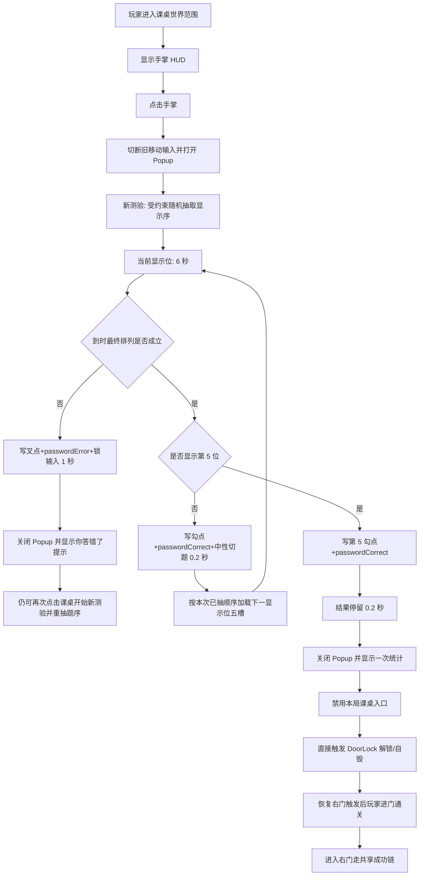

# Level 115 开学测验功能说明

## 2026-08-18 黄色范围脚本精简

- 背景：删除门解锁入口中的不可达防御逻辑，保持测验答案、门动画、事件和结算行为不变。
- 影响文件：仅 `Level115Ctrl.cs`。`StartDoorUnlock()` 在 `_doorUnlockStarted` 为真时已提前返回，而协程引用只在把该标记设为真后创建，因此移除首次启动前不可能成立的旧协程停止分支。
- 前后差异：门解锁仍只启动一次，协程创建、答案判定、UI、声音、资源、Reset 和成功链均未修改。
- 验证：赋值/调用路径静态核对完成；`Assembly-CSharp.csproj` 编译通过（0 错误）。
- 回滚：在 `StartCoroutine()` 前恢复旧的非空停止判断即可。

## 当前有效结论

Level 115 当前已完成以下静态实现：课桌 `Sp_l115_sz_01` 世界范围 Trigger、专属手掌 HUD、`Level115QuizPopup` 五题测验、六位置全元素交换、单题 6 秒计时、固定 0.2 秒切题、左上角五题进度点（按显示位置记录，到时对当前新写入点播放勾/叉差异化 Tween 与一次正误音效）、结果停留（第五题全对 0.2 秒；单题失败 1 秒）、通用等式判定、暂停/关闭/统计与错题提示收口，以及五题全对后禁用入口并直接触发 DoorLock 解锁与门触发恢复。单题到时不成立按“单题失败即结束”：写叉反馈后停留 1 秒（略长于 `passwordError`≈0.984s）再关窗，显示固定错题 SystemTips「你答错了！！！」（`S_LevelTips_Des_level_115_2`），不显示条数统计、不进入下一题、不禁用课桌；仅五题全对或玩家主动关闭才显示一次条数统计 SystemTips。题组为固定五题成员；显示顺序的“受约束随机题序”已在 `Level115QuizPopup` 源码静态落地（`BeginSession` → `BuildConstrainedQuestionOrder` → `LoadQuestion` 按会话序消费），可由源码直接核对；未运行 Unity，故运行时随机采样分布与玩家重试表现仍为 `uncertain`。

本关已在 `tbleveldata.json` 登记 `10115 -> Level_115`，但 `tblevelsort.json` 与 `LevelData.xlsx` 暂不修改，因此正常流程仍不可达。根级有常驻 `LevelTitlePlaceholder`，只读复用 078 同款 `Tips.prefab`，显示 `S_LevelTips_Des_level_78` / 「射箭比赛」作占位；不是开学测验规则预告，也不表示正式标题已确认。当前结论来自源码、Prefab YAML、资源和配置静态检查；未运行 Unity、编译、PlayMode、测试或探针，因此触控、物理命中、Popup 栈、计时观感、题序随机分布与同局稳定性、字体渲染、开锁动画和完整通关均为 `uncertain`。

## 领域术语

- **单题**：一道独立 6 秒等式题。
- **一次测验**：从课桌打开弹窗到主动关闭、单题失败即结束或五题全对系统关闭，最多包含五道单题。
- **同次测验**：同一次测验内部的跨题范围；右上角内容在该范围继承。
- **显示位置**：一次测验内从左到右/从先到后的第 1–5 位；进度点按显示位置记录，不绑定题目身份。
- **单题失败即结束**（2026-08-13 用户确认；同日修订停留与提示）：单题 6 秒到时最终排列不成立 → 错误+1、写叉与音效、**1s** 结果停留 → 系统关窗 → 固定提示「你答错了！！！」；不进入下一题、不显示条数统计、不开锁；课桌可重试。
- **受约束随机题序**（2026-08-12 用户确认）：每次新测验重抽显示顺序；特殊题 `4 + 2 = 8` 等概率仅出现在显示第 4 或第 5 位；其余四题在剩余位均匀打乱、各出现一次；同局内顺序稳定。

领域真源为 `docs/contexts/levels/115/CONTEXT.md`。

## 组成与职责

| 组成 | 当前职责 |
| --- | --- |
| `BaseLevelCtrl` | 保留共享入场、失败、右门触发和标准成功链 |
| `Level115Ctrl` | 管理课桌范围、手掌显示、Popup 开关、本局完成门禁及一次性直接开锁 |
| `Level115QuizTrigger` | 挂在课桌上；维持 `5.28×1.78` 最终世界 Trigger，只接受当前玩家主角 |
| `GamePlayPanel_115` | Level 115 专属 Gameplay HUD 变体，保留基础 HUD 并增加黄色手掌按钮 |
| `Level115GamePanelFeature` | 手掌显示/隐藏动画及点击回调；不复用 Level 006 密码 Feature |
| `Level115QuizPopup` | 五题状态机、实时时钟、六位置交换、通用判题、统计、暂停和关闭原因 |
| `Level115QuizDragHandle` | 六个交换位置的 EventSystem 拖拽/轻点适配；业务所有权回到 Popup |
| `Level115Ctrl.CutGameplayInput` | 只调用上游已有 `GamePlayPanel.ResetState()` 并清零本关 Actor 移动输入；Popup Mask 阻断新 HUD 点击，不修改共享面板源码 |
| `Level115Ctrl.NotifyQuizCompleted` | Popup 关闭并显示统计后直接执行 DoorLock 解锁链并恢复门触发；重复调用不重复开锁 |
| DoorLock / 右门 Trigger | 门锁解锁句柄 + 门触发碰撞体由 Ctrl 直接驱动；场景不再保留 Key |

## 主流程

到时不成立按“单题失败即结束”关窗，不弹统计。玩家轻点右上角会提前结束本次测验：当前尚未到时的单题不计分，Popup 关闭后显示一次已判定统计。失败重置、退出、卸载或销毁属于静默取消，不显示统计、不补判、不完成。从课桌重开属于新的一次测验，会重新抽取显示顺序。

## 固定题组、受约束随机题序与判题

下表为固定五题题组成员事实；成员编号标识题目身份，**不是**显示顺序。受约束随机显示序于 2026-08-12 由用户确认；下列方法名与算法细节仅作源码静态证据，不扩大为运行验证。

| 成员 | 初始五槽内容 | 一步参考结果 | 题序约束 |
| --- | --- | --- | --- |
| A | `5 + 2 = 3` | `3 + 2 = 5` | 与 B/C/E 在剩余显示位均匀打乱 |
| B | `4 = 1 - 3` | `1 = 4 - 3` | 同上 |
| C | `3 + 6 = 3` | `3 + 3 = 6` | 同上 |
| D | `4 + 2 = 8` | `4 × 2 = 8` | 特殊题：仅等概率出现在显示第 4 或第 5 位 |
| E | `2 - 7 = 9` | `9 - 7 = 2` | 与 A/B/C 在剩余显示位均匀打乱 |

- 每次新一次测验 `BeginSession` 调用 `BuildConstrainedQuestionOrder` 重建 `_questionOrder`；同次测验内 `LoadQuestion` 只按该数组消费，不中途重抽。
- 特殊题源索引固定为 `Questions[3]`（`4 + 2 = 8`），显示位由 `Random.Range(0,2)` 等概率选零基 3 或 4（显示第 4/5 位）；其余四题源索引经 Fisher–Yates 打乱后填入剩余显示位，各出现一次。
- 不扩充题库、不改 `Questions` 内容；单题失败即结束或主动关闭后从课桌重试会再次 `BeginSession` 重抽。右上角在 `LoadQuestion` 中不被重置（跨题继承）；进度点与完成判断仍按显示位索引 / 五题数量。
- 五个等式槽位和右上角组成六个交换位置；任意两个不同位置均可交换数字、运算符或等号。
- 右上角不是判题槽位。其内容在同次测验跨题保留，可把旧题元素带入后续题；新的测验才恢复 `×`。不在特殊题到来时强制恢复右上角 `×`，因此特殊题参考解法（`+` ↔ `×`）是参考步骤而非跨题操作后仍必然可用的硬保证。
- 每题只在 6 秒结束时读取五槽最终排列。
- 接受任意数学成立的 `A 运算 B = C` 或 `A = B 运算 C`，运算符仅为 `+`、`-`、`×`。
- 不接受数字拼接、一元负号、多运算符、其它等号位置或右上角参与判题。

## 五题进度点与到时反馈

- 弹窗左上角固定 5 个装饰进度位，从左到右对应显示第 1–5 位；按显示位置记录正误，不绑定题目身份。
- 每位：常驻 `yuan` 底圆 71×72；判定后居中叠 `gou` 42×33 或 `cha` 33×33；未判定只显示空圆。
- 仅在该题 6 秒到时统一判题完成瞬间写入；进行中无高亮，中途等式成立不提前改点。
- 写入瞬间只对**当前新写入**的那一个进度点播放勾/叉差异化视觉 Tween（正确：勾 OutBack 弹出 + 底点回弹；错误：叉弹出 + 锚点左右轻抖），并复用既有 Tag 播放一次正误音效：正确 `passwordCorrect`、错误 `passwordError`（Level 006 同源，不新增音频素材、默认参数、不截断）。
- 反馈视觉时长固定约 `0.2s`（与正确切题窗口对齐），在该窗口内完成；单题失败路径在视觉 Tween 结束后继续锁定至 `1s` 届满。已有进度点保持静止终态。
- 玩法暂停链冻结进度点视觉 Tween 与过渡/停留剩余时间（正确 0.2s / 错题 1s）；已触发音频不暂停，自然继续播完。
- 不进入六位置交换，不响应点击/拖拽；不追加正误文字、震动或中央大特效。
- 主动关闭、静默取消、重置与未判定题不触发进度点反馈或正误音效；新一次测验五点重置为空圆并清理残留 Tween；静默取消不单独展示。
- 到时正确且非第五题：写勾后走 0.2s 中性切题。到时正确且为第五题：FinalHold 0.2s 后关窗与条数统计 SystemTips。到时不成立：FinalHold **1s** 后关窗并弹固定错题提示。停留期间输入锁定，视觉与剩余时间可被暂停链冻结。

## 拖拽与显示

- 五个槽位各使用完整 `160×160` RectTransform 作为拖拽源和释放目标；目标按释放指针位置判断。
- 右上角使用完整 `88×88` X2 圆形区域作为命中范围。
- 拖拽时源位置留空，跟随指针的内容显示在 Popup 最上层；目标在释放前不变化。
- 自身、空白和集合外控件落点均回原位；同一时刻只有第一个有效指针拥有拖拽。
- 超时、暂停、隐藏、关闭或取消会撤销尚未释放的拖拽。
- 数字/`+`/`-`/`=` 在五槽与右上角用 TMP，并统一描边 `#665a4f`、外侧约 4px（对齐 Level 78 的 outline + FaceDilate）；拖拽文字同步。凡内容为 `×`（右上角、五槽、拖拽预览）一律显示同一张 46×46 X1 图片，不再把槽位 `×` 画成 TMP。槽位在运行时于圆底框下生成互斥叉图节点，命中仍由 160 圆底承担。
- 右上角未进入拖拽状态的轻点负责主动关闭；拖拽释放不得同时触发关闭。

## 计时、暂停与输入

- 单题时长固定 6 秒；前四题之间固定 0.2 秒中性过渡；第五题全对 FinalHold 0.2 秒；单题失败 FinalHold 1 秒（对齐 `passwordError`≈0.984s 并略留余量）。
- 计时、过渡与进度点视觉反馈使用不受 `Time.timeScale` 影响的实时时钟，但只在玩法处于 `PLAYING` 时累计；暂停时视觉 Tween 同步冻结，恢复后续播。
- 暂停、外部 Popup 覆盖或应用切后台均冻结剩余时间与进度点视觉反馈，不补算后台经过时间；到时已触发的正误音效不随暂停截断。
- Android Back/Escape 打开的退出 Popup 会通过 `OnHide`/`OnShow` 接入现有暂停/恢复链；取消后继续当前状态。
- 打开测验时 `GamePlayPanel` 清除旧左右移动输入。Popup 关闭后等待鼠标/触点全部释放，新的 PointerDown 才能再次移动；已发生的跳跃或下落不回滚。

## 倒计时条

- `UI_kaixueceyan_bar_1_01`：590×60，静态深色外框/底层。
- `UI_kaixueceyan_bar_2_01`：578×48，彩色剩余时间内层。
- 每题开始恢复完整；左边固定，右边向左收，6 秒时填充归零。
- 外框 `bar_1` 保持 Simple；彩色内层 `bar_2` 为 Horizontal Filled（Origin=Left），代码只写 `fillAmount = 剩余/6`，不再改宽度或缩放素材。缩短中的橙色右缘允许平切，圆角由外框承担。

## 统计、完成与关闭

- 条数统计模板使用 I2 词条 `S_LevelTips_Des_level_115_1`：`正确{0}条，错误{1}条`。
- 错题固定提示使用 I2 词条 `S_LevelTips_Des_level_115_2`：`你答错了！！！`（仅 zh-CN）。
- 当前三个 Level 115 专属词条均仅 zh-CN 有内容，其余语言槽为空；运行时回退仍未验证。
- 仅主动关闭与五题全对的系统关闭显示一次条数统计；单题失败即结束显示一次固定错题提示；静默取消不显示任一提示；未判定题目不计错。
- 五题全对时，Popup 先锁定入口并关闭，再显示条数统计，随后立即调用 `NotifyQuizCompleted` 直接开锁，不等待 SystemTips 动画结束。
- 单题失败即结束：`CompleteCurrentQuestion` 走 1s FinalHold 后 `EndSession(System)`，因 `wrong != 0` 不 `completed`、走 `ShowWrongAnswerTip` 而非 `ShowStatistics`；课桌入口保持可重试。
- 非业务关闭统一静默取消。

## HUD、Prefab、资源与配置

- `Level_115.prefab` 已改用 `GamePlayPanel_115`。
- 课桌 Sprite 保持原资源；同对象新增 Trigger Collider 与 `Level115QuizTrigger`，不形成实体挡路碰撞。
- 正式运行 Prefab 位于 `Resources/Level115QuizPopup.prefab`（GUID `bc367009b7bbc4427b55f219ccc40288`），供 `ResourcesUILoader` 以裸名 `Level115QuizPopup` 加载；根节点已挂 `Level115QuizPopup`，并绑定五个 TMP、五个槽位框、X1/X2、双层计时条与五题进度点（yuan/gou/cha）。`Sprites/` 保留 JSON 与美术素材，含新增 `UI_kaixueceyan_img_yuan_01` / `gou_01` / `cha_01`。
- 玩法说明使用 I2 词条 `S_LevelTips_Des_level_115`，当前仅填写简体中文「拖动交换数字或符号使等式成立」；其余语言槽留空。
- 手掌固定复用 `UI_youxizhong_icon_shumima_01.png`。
- 不新增测验专属音频素材；到时判题正误音效复用既有 Tag `passwordCorrect` / `passwordError`。拖拽、交换、无效回位、统计 SystemTips、主动关闭与静默路径无音效。门锁 `unlock` 继续走 DoorLock 既有音效。
- `tbleveldata.json` 已新增唯一内容数据注册 `10115 -> Level_115`；`tblevelsort.json` 与 `LevelData.xlsx` 暂不修改，正常入口仍不可达。
- 根级 `LevelTitlePlaceholder` 是共享 `Assets/Game/Prefabs/LevelItems/Tips.prefab`（GUID `49d63fd22a39a044bab1c28dbf961bcb`）的独立实例；沿用 078 的 `m_text=射箭比赛`、`m_margin.z=-0.40812898`、I2 `S_LevelTips_Des_level_78`、中心 `(0.5, 4.42)`、尺寸 `7.5473×2.2407`、SortingLayer 2；无组件增删、碰撞、Animator 或关卡脚本接线。不修改 `Tips.prefab`、`I2Languages.asset`、C#、测验玩法或 078。

## 验证与回滚

### 已验证（静态）

- Popup 根脚本 GUID、序列化字段、五槽/X1/X2/计时条/五题进度点引用存在且本地 fileID 闭合。
- `Level_115.prefab` 使用 `GamePlayPanel_115`，课桌 Trigger 为 `isTrigger=1`、目标尺寸 `5.28×1.78`，owner 指向本关 Ctrl。
- `tbleveldata.json` 可解析，且 `10115` / `Level_115` 注册项各唯一；`tblevelsort.json` 不含 `10115`。
- 新 HUD 变体引用 Level 115 专属 Feature，手掌 Sprite 仍为既有 GUID。
- 固定五题题组成员、6 秒、0.2 秒切题、结果停留 FinalHold（第五题全对 0.2 秒；单题失败 1 秒）、单题失败即结束（错题不切下一题、系统关窗后弹固定错题提示）、进度点到时写入与当前点 Tween/正误音效（`passwordCorrect`/`passwordError`）、通用判题、跨题右上角继承、统计/错题提示和完成调用链已在源码中逐项复核。
- 受约束随机题序（2026-08-12 用户确认）已在源码静态核对：`BeginSession` 每次调用 `BuildConstrainedQuestionOrder`；特殊题源索引 3 的显示位仅为 3/4 且等概率；其余四题 Fisher–Yates；`LoadQuestion` 按 `_questionOrder[display]` 消费且不重置右上角；进度点与 5/5 完成判断仍按显示位 / 五题数量。运行时随机采样分布、同局稳定表现与重抽观感未运行验证，仍为 `uncertain`。
- Prefab 已移除 Key 与爆钥锚点；Ctrl 绑定 DoorLock `EventHandleListener` 与右门 Trigger Collider。
- 静态证据确认 `LevelTitlePlaceholder` 的 PrefabInstance、stripped RectTransform 与根 child 各唯一一处，引用闭合且文案/词条/位置一致；I2 刷新与画面为 uncertain。

### 未验证 / uncertain

- Unity 导入、C# 编译、Prefab 反序列化与资源加载。
- EventSystem 拖拽、多指、默认阈值、移动端触控与关闭先后边界。
- Trigger 实际物理范围、HUD 动画、Popup 遮罩和外部 Popup 暂停/恢复顺序。
- 6 秒、0.2 秒切题/全对停留与 1 秒错题停留的主观节奏、错题 SystemTips 文案与上浮观感、进度条与五题进度点像素观感、勾/叉 Tween 与正误音效重叠听感、暂停中途冻结/恢复视觉反馈、TMP `×` 和右上角动态文字。
- 受约束随机题序的运行时随机采样分布（特殊题第 4/5 位经验频率、其余四题经验均匀性）、玩家重试时的实际重抽观感与同局顺序稳定表现。
- I2 非中文回退、门锁解锁动画时序、门碰撞恢复及完整进门通关。

### 回滚

选择性回滚本次测验实现时：

1. 恢复 `Level_115.prefab` 的 `gamePlayPanelName`，移除课桌 Trigger 接线；若需回到爆钥匙流程，优先检出 git tag `level-115-key-drop-unlock`，不得整文件粗暴回滚无关改动。
2. 删除 `GamePlayPanel_115.prefab` / `.meta` 与 Level 115 专属 HUD Feature。
3. 恢复 `Level115QuizPopup.cs`、Popup Prefab 根组件接线及拖拽适配器。
4. 恢复 `GamePlayPanel.cs` 中仅供外部 HUD 模态使用的输入阻断入口。
5. 同步恢复 Context、功能说明和风险评估。
6. 如需撤销 Level 115 专属提示词条，只删除 `I2Languages.asset` 中 `S_LevelTips_Des_level_115`、`S_LevelTips_Des_level_115_1`、`S_LevelTips_Des_level_115_2` 三个词条块，不整文件回滚。
7. 如需撤销本次内容数据登记，只删除 `tbleveldata.json` 中 `10115 -> Level_115` 条目，不改 `tblevelsort.json` 或 `LevelData.xlsx`。
8. 不修改共享 Key、DoorLock、右门或其它关卡。
9. 仅回退标题占位时，只移除 `Level_115.prefab` 的 `LevelTitlePlaceholder` PrefabInstance、stripped RectTransform 和根 child，并同步恢复 Context 与成对文档；不得修改共享 Tips、I2、078 或本关测验玩法。
