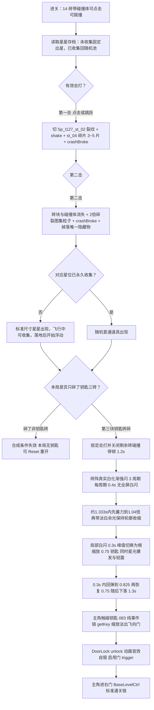

# Level 127 击砖寻钥功能说明

> 关卡正式标题未确认（`uncertain`）；文档主题「击砖寻钥」为当前玩法的描述性称谓，随正式标题确认后更名。领域语言：`docs/contexts/levels/127/CONTEXT.md`。

## 当前有效结论

Level 127 使用 14 块两击可碎砖（点击或主角跳跃碰撞共用计数），顶部第 4 格留空，中心间距横向 1.36、纵向 1.26。`R02_C02` / `R03_C04` 固定藏标准尺寸的索引 1/2 星星：第二击才出现，飞行中可收集，落地后浮动；已永久收集星位改掉普通道具。普通道具池共 14 种，不再分配皮肤或临时穿戴；已收集星数量为 `k` 时，普通道具为 `12+k` 件，星星为 `2-k` 颗，正常完整池下普通道具外观不重复。普通道具最大边 1.2 世界单位，抛出后落在 Ground 上，不与主角或本关其它普通道具发生实体碰撞，允许重叠而不堆叠。

严格合成与开门规则保持：只击碎钥匙三砖（`R02_C02`、`R03_C05`、`R03_C04`）才会关闭剩余砖碰撞，停顿 1.2s、渐强闪白 3×0.4s、约 1.333s 蓄力/收缩，在 0.3s 局部白闪峰值切换为 0.75 倍实体钥匙并播放 `passwordCorrect`、暖白星光和轻震。钥匙在 0.3s 内回弹后用 1.3s 落地，落地后可拾取且不悬浮，沿 083 同款事件链解锁右门。多击碎任一非钥匙砖则本局不能合成，需 Reset 重开。掉落、物理、星星收集、合成和开门均未取得本次运行证据，保持 `uncertain`。

## 背景与目标

本关从双门、Ground_long 与 14 块占位砖骨架发展为两击击碎、固定藏星、普通道具随机藏物和严格钥匙合成玩法。用户已确认取消皮肤掉落，用普通道具补满原皮肤槽，新增三张指定素材，并取消普通道具之间的实体碰撞；星星与钥匙规则不变。领域术语见 Context 对应条目。

## 组成与职责

- **`Level127Ctrl`**（`MainLevel/Level_127/`，全局命名空间，`IDebuger`）：挂在 `PlaceholderBrickWall` 上，从关卡根查找 Key/KeyLandingPoint/Actor；负责点击输入、砖注册、星星状态读取与藏物分配、碎裂/掉落/排序、普通道具与主角及彼此的碰撞隔离、严格合成与演出、钥匙落地/拾取门禁。门锁解锁仍由 Key prefab 事件链负责，不再加载或穿戴皮肤。
- **`Level127Brick`**（同目录）：单砖两击状态机，挂在砖块 prefab 上（14 个实例共享）。负责：第一击裂纹切换 + shake + `Sp_l127_st_04` 碎片弹出、第二击上报并自隐藏、跳跃碰撞计击；合成排队后由 `PrepareForSynthesis()` 停止 shake、复位并关闭剩余砖碰撞，使砖阵只作为后续闪白与收缩的视觉对象。
- **`Level_127/Prefabs/Level_127_PlaceholderBrick.prefab`**：砖块 prefab（文件名保留历史占位名）。`BoxCollider2D` 保持 1.32×1.22，`Level127Brick` 引用 st_01/st_02/st_04；新版完整砖 st_01 为 125×118 像素，裂纹砖 st_02 为 124×121 像素，保留 100 PPU 与居中 pivot，对应名义尺寸 1.25×1.18、1.24×1.21 世界单位。替换仅覆盖 PNG，原 meta/GUID、Prefab 缩放、碰撞体与引用均不变。
- **`Level_127.prefab` 新增结构**：door0 下 DoorLock 实例（115/083 同款挂点 `(-0.2,-1.514)`）；根下预置 inactive `Key` 实例（083 同款 `Key.prefab`，子 sprite 覆写为 `Sp_l127_st_03`、子缩放 1.2、根 layer=TriggerItem、根 inactive），本关实例额外覆写 `MoveFloatHandle.m_Enabled=0`，拾取缩放绝对目标仍为 0.25；合成后钥匙根缩放由 Ctrl 设为 0.75，拾取时再从 0.75 缩小到 0.25；`KeyLandingPoint` 空节点 `(0,-2.1)`；`PlaceholderBrickWall` 节点挂 `Level127Ctrl`；根节点下保留两个 inactive 的标准 `Postcard_Star` 模板（索引 1/2，分别绑定 `R02_C02`/`R03_C04`）；未收集时运行时复制到 `Level127Drops` 并调整排序、不改变模板缩放，已收集时对应砖改走普通道具槽；另有 `Level127WallTextPlaceholder` 世界空间文字实例，后者复用 083 `Tips.prefab` 的 TMP/I2/SortingGroup 结构。
- **碎裂特效资产**：`ArtSrc/Particles/Texture/Sp_l127_stsp_atlas.png`（碎裂 10 帧 100×100 合成 500×200，5×2 网格）→ `Particles/Material/Level127_BrickBroken.mat` → `Particles/Prefabs/Level127_BrickBroken.prefab`。两个 ParticleSystemRenderer 均固定为 `SceneLayer/92`，运行时还会继承被击砖排序层并取砖块 order+2；本关序列化 `shatterVfxScale=1.2`（此前 0.6 的 2 倍）；Clouds 子节点保持停用。
- **合成表现资产**：本关 `Level127WhiteFlash.shader/.mat` 忽略砖块与钥匙贴图 RGB，只保留 sprite alpha 轮廓并输出白色，因此叠图淡入会形成真实白化；切换星光由 Ctrl 运行时创建一次性 ParticleSystem，材质只读复用 Epic Toon FX 的 `sparkle_ADD.mat`，实例仍挂在本关 `Level127Effects` 下。
- **固定星星与墙面文字占位**：`Postcard_Star_Level127_01`/`02` 直接挂在 `Level_127` 根节点作为 inactive 模板，使用标准 Postcard 收集链和索引 1/2；未收集时分别从 `R02_C02` 与 `R03_C04` 第二击位置复制，沿 Ground 抛物线落地，落地后启用模板自带 `MoveFloatHandle`，模板根/`icon` 缩放保持标准值；已收集时对应砖改为普通道具掉落。`Level127WallTextPlaceholder` 直接挂在关卡根节点，复用 `Tips.prefab` 的 TextMeshPro + I2 `Localize` + `SortingGroup`，当前 `mTerm=S_LevelTips_Des_level_83`、临时位置 `(0,2.0,0)`、缩放 `0.65`，后续正式文字只需替换实例 `mTerm`。
- **共享系统（只读复用）**：`BaseLevelCtrl`、`ActorCtrl`（`whatIsStuff` 不含 TriggerItem，普通道具另排除 Actor 碰撞）、`Key.prefab` 事件链、`DoorLock.prefab`、`door_0.prefab`、`GamePlayPanel_000` Reset 重开链、共享 `PlayCtrl` 根节点控制器解析合同。未修改共享物理层矩阵、角色皮肤系统或三张新增候选的源素材。

## 主流程（玩家时序）

1. **初态**：14 砖完整、带碰撞体（layer Default，不在 `whatIsStuff`/`whatIsGround` 检测层）；`Key` inactive；door0 进门 trigger 被 Prefab 覆写禁用（`m_Enabled=0`）；两颗标准星使用索引 1/2 作为 inactive 模板，不在开局直接显示；墙面占位暂用既有 `S_LevelTips_Des_level_83`；Ctrl 在 `Start` 读取永久收集状态，未收集星位固定保留，已收集星位转为普通道具槽并完成其余随机分配。
2. **有效击打**：点击路径——Ctrl `Update` 轮询触摸/鼠标按下（`InputUtils.IsPointerOverUI` 屏蔽 UI），世界点命中任一砖碰撞体即 `TapHit`；跳跃路径——砖 `OnCollisionEnter2D` 命中 Player 且距上次跳跃击打 ≥0.5s。两路径共用 `RegisterHit`。
3. **第一击**：换裂纹贴图、`DOShakePosition(0.18s, 0.06)`、从砖块四边随机取点生成 3~5 片 st_04 碎片（抛物线 + 随机旋转 + 淡出销毁，挂在 `Level127Drops` 同级的特效父节点 `EffectRoot`）、`crashBroke`。
4. **第二击**：上报 Ctrl → 在砖中心实例化碎裂粒子（缩放 1.2，为此前 0.6 的 2 倍；首 burst 覆写为 8、3 秒后销毁）并把全部粒子 Renderer 调整到被击砖前方 → 同帧创建唯一掉落物及 `SortingGroup` → `crashBroke` → 砖 GameObject 停用。粒子 Prefab 自身也固定为 `SceneLayer/92`，避免材质与图集已加载但被 `SceneLayer/90` 砖墙遮住。
5. **掉落物**：普通道具与固定星在砖墙前景执行 0.45~0.6s、拱顶 0.6 的抛物线，落点只探测 Ground。普通道具水平随机偏移 ±0.4，最大边为 `0.8×1.5=1.2`，使用砖 order+2 排序；飞行期关闭刚体模拟与 BoxCollider，落地同步刚体位置并清零速度，再启用模拟/Collider、排除主角与本关其它已落地普通道具的碰撞。固定星直接复制标准模板，不缩放、不随机水平偏移，保留飞行中收集与落地浮动链。
6. **随机分配**：未收集的固定星位不进普通道具池；其余砖与已收集星位合并洗牌，`CollectPropSprites()` 过滤空引用并去重，候选也洗牌后按索引分配。完整 14 种池覆盖 12/13/14 个普通道具槽，不需要重复；候选不足时仍循环复用，全部为空则警告且不能保证掉落。当前局收集星星不额外生成道具；本关已移除皮肤分配、异步加载、占位图和穿戴触发组件。
7. **严格合成**：非钥匙砖先碎时本局失效；第三块钥匙砖碎且非钥匙击碎数为 0 时，`InteractionLocked` 立即阻断点击与跳撞，并对剩余砖调用 `PrepareForSynthesis()` 关闭 Collider，玩家自身移动保持可用。1.2s 后 `LateUpdate` 启动唯一合成 Sequence。
8. **合成演出（串行七段）**：①剩余砖阵用 `Level127WhiteFlash` alpha 轮廓材质真实闪白 3 次（每周期 0.4s，总 1.2s），峰值由 0.55 逐次提升到 1.0，没有全屏 Sprite；②约 1.333s 变形段先用 0.08s `Ease.OutQuad` 把砖阵尺寸和间距同步蓄力到 1.04 倍，再用余下约 1.253s `Ease.InOutSine` 收缩到目标倍率，期间白化 overlay 保持 0.12 淡光；③目标倍率仍采用砖阵/最终钥匙宽高比的几何平均值，保持轮廓并让两轴误差尽量对称；④创建只覆盖钥匙附近、约为最终钥匙 1.3 倍的局部白色 key sprite，0.3s 内在亮度峰值隐藏砖阵并激活实体钥匙；⑤峰值同时运行一次暖白星光 burst（16 颗、0.35~0.6s、速度 1.4~2.4、尺寸 0.08~0.16）与镜头轻震（0.22s、强度 0.12、18 次），震动结束、Kill 或关卡销毁均恢复相机起始 localPosition；⑥实体钥匙根 scale 固定为 0.75，拾取 BoxCollider 按最终视觉包围盒的 1.3 倍配置但保持 disabled，在原 0.3s 空中停留内先回弹到 0.825 再恢复 0.75；⑦用 1.3s `Ease.InQuad` 落到 `KeyLandingPoint`，完成回调才启用拾取。`passwordCorrect` 只在局部白闪达到峰值、砖阵切换为实体钥匙的同一回调播放一次，音量保持 `AudioManager.PlaySound` 默认值 `0.4`。
9. **开门通关**：`Key` 的 `MoveFloatHandle` 脚本在仓库存在且共享 Prefab 默认 `autoStart=true`；127 的 PrefabInstance 与 Ctrl 启动防御均把它禁用，避免其与下落 Tween 同时写根 Transform。落地后启用 BoxCollider，主角触碰才启动 083 同款 8 项事件链：`getKey` → 根 scale 从 0.75 缩到本关既有绝对目标 0.25 → 子 sprite 淡出 → 飞向门 → DoorLock unlock → 启用门 trigger → 销毁钥匙。共享 `Key.prefab` 不修改。

## 关键规则

- **两路径同状态机**：点击与跳跃共用 `RegisterHit`，混合使用（点一下+跳一下）同样成立；裂纹永久保留，无间隔限制。
- **合成排队即锁定玩法实体**：`InteractionLocked` 阻断两种击打路径，`PrepareForSynthesis()` 同时关闭剩余砖 Collider；玩家移动不锁定，缩小中的砖阵不再挤压主角。
- **失效不提示**：多碎任一非钥匙砖只写一条 `LogWarning`，玩家靠 Reset 自救；Reset 走 `GamePlayPanel` 既有 `GameResetType.Manually` 链，关卡整体重建，砖、掉落物与局部碰撞对随实例销毁。
- **门锁纯事件链**：`Level127Ctrl` 不引用门、锁、钥匙对象（按名字查找 Key/KeyLandingPoint 仅用于合成演出）；解锁链全部在 Prefab 覆写内，与 083 结构一致。
- **普通道具不与角色或彼此实体碰撞**：道具仍为 `TriggerItem(9)`，不进入 Actor 推箱检测层；Collider 排除 Actor，另对当前主角 Collider 建立局部忽略。Ctrl 的 `propDropColliders` 只记录本实例创建的普通道具；后落地者在双方 Collider/模拟开启后调用 `Physics2D.IgnoreCollision` 补齐与已落地者的碰撞对，不改变 Ground 接触，不调用全局 `IgnoreLayerCollision`，也不关闭星星/钥匙 Trigger。道具允许相互重叠，不可拾取、不主动消失。

## 输入、事件与生命周期

- 输入：Ctrl `Update` 轮询 `Input.touchCount`/`Input.GetMouseButtonDown(0)`（Level 88 同款，无 EventSystem 依赖）；`IsGameplayPlaying()`（`PlayCtrl` PLAYING 状态）不满足时不响应。
- 砖块注册：`Level127Brick.OnEnable` → `GetComponentInParent<Level127Ctrl>(true)` → `RegisterBrick`；`OnDestroy` 反注册。钥匙砖按 `gameObject.name` 识别（实例名覆写保留 `PlaceholderBrick_Rxx_Cxx`）。
- Tween 清理：砖 shake Tween 在 `OnDestroy` Kill；Ctrl 的完整合成 Sequence 与镜头轻震 Tween 在 `OnDestroy` Kill；轻震完成、Kill 与销毁路径统一恢复相机 localPosition；局部砖 overlay、局部钥匙切换闪光、一次性星光、第一击碎片和第二击粒子都挂在关卡子级并随关卡销毁；掉落物挂在 `Level127Drops`。
- 普通道具 Collider 列表属于 Ctrl 实例，不使用静态缓存；Reset/离关随关卡对象销毁，无跨局碰撞层设置需恢复。

## Prefab、资源、配置与数据流

- **素材**：砖使用 `ArtSrc/Sprites/L127/Sp_l127_st_01..04.png`；碎裂图集、白化材质、Postcard 星模板、Tips 文字和 `sparkle_ADD.mat` 均保持现有引用。普通道具通过 `propSprites` 直接引用下列 14 张 Sprite，不复制、不修改源素材，不实例化素材所属关卡的玩法 Prefab：
  - 原有 11 张：`Assets/Game/ArtSrc/Sprites/Turntable/rewards/Sp_prop_1_01..09,11,12.png`。
  - 新增：`Assets/Game/Scripts/Level/MainLevel/Level_50/Sprites/Sp_fxyq_2__04.png`（GUID `b60dcd6a39fa2db49919cc782e6e5918`）。
  - 新增：`Assets/Game/ArtSrc/Sprites/Level066/Sp_mfmz_1.png`（GUID `8b9b74881a83a034393dabda950dc7d2`）。
  - 新增：`Assets/Game/ArtSrc/Sprites/level061/Sp_l61_dj_img_04.png`（GUID `4a6345599f3562c42a0e670997e56ca5`）。
- **音效**：全部使用现有 tag——`crashBroke`（两击）、`passwordCorrect`（合成，音频 `l5/passwordCorrect.ogg` 与 006 关密码正确共用）、`getKey`/`unlock`（Key/DoorLock prefab 自带）。
- **序列化接线（Level127Ctrl）**：固定星星模板按 `R02_C02`/`R03_C04` 对应索引 1/2；隐藏物 `dropMaxSize=0.8`、`hiddenItemScaleMultiplier=1.5`（普通道具有效最大边 1.2，标准星星不放大）；合成 `synthesisDelaySeconds=1.2`、3×0.4s 渐强闪白（peak 0.55→1.0）、`synthesisScaleDuration≈1.333`、蓄力 1.04/0.08s、收缩余光 0.12、切换闪光 0.9/0.3s；星光为暖白色、16 颗、life 0.35~0.6、speed 1.4~2.4、size 0.08~0.16、radius 0.12；震动为 0.22s/0.12/18；`keyFinalScale=0.75`、回弹倍率 1.1/0.3s、`keyHoldDuration=0.3`、`keyPickupColliderScale=1.3`、`keyFallDuration=1.3`。碎裂粒子为 `shatterVfxScale=1.2`（此前 `0.6` 的 2 倍）/ burst 8，掉落抛物线仍为 0.45~0.6s、拱顶 0.6、普通道具水平偏移 ±0.4；固定星星沿砖中心竖直落到 Ground，不使用随机水平偏移。
- **事件链覆写（Key 实例）**：保留 8 项 TriggerExecutor 顺序与 door/DoorLock 引用；本关 `MoveFloatHandle.m_Enabled=0`，`ItemScaleListener.targetScale` 保持绝对值 0.25；子 `Square` sprite→st_03、localScale 1.2，根 layer=9、inactive。Ctrl 激活钥匙时设根 scale 0.75，事件链拾取阶段再缩到 0.25；共享 `Key.prefab`、DoorLock 与 door_0 均不修改。
- **配置**：`tbleveldata.json` 已有 `10127` 登记（lockType 1），本次不改配置或 I2 key。固定星星使用标准 Postcard 索引 1/2 与收集存档链；墙面占位仍为 `S_LevelTips_Des_level_83`。普通道具只作场景展示，不发奖、不写存档，不改变角色已有装备。
- **可达性**：关卡经 `tbleveldata` 登记，但玩家排序入口与正式投放未确认（Context 边界），正常主线可达性 `uncertain`。
- **创建链路**：`tbleveldata 10127` → `Level_127` Prefab → 共享 `PlayCtrl.CreateLevelAsync`；共享 PlayCtrl 保持上游原有“实例化根节点后直接读取 `BaseLevelCtrl.GamePlayPanelName`”行为，不在本关文档或代码中改写。用户曾观察到资源加载完成但面板刷新阶段控制器解析为空；磁盘 Prefab 静态接线包含根 `BaseLevelCtrl`，因此运行时实例/导入状态差异及具体原因仍为 `uncertain`。

## 验证与回滚

- **验收声明**：取消本关皮肤链，14 种有效不同素材覆盖正常进关的 12～14 个普通槽位；碰撞忽略仅作用于本关普通道具对，星星/钥匙规则和共享设置不变。
- **已验证（静态）**：一次性 `python3` 解析核对 14 个不同 GUID，各自唯一解析到存在的 PNG 和单 Sprite 导入配置；Ctrl 的 42 个序列化字段与 Prefab 完全匹配。相对修改前 HEAD，Prefab 除新增 3 个道具引用及删除 `skinParts` 外字节一致；钥匙判定/合成及 `SpawnStarDrop` 方法内容不变。`rg` 检查已删除皮肤组件的类名/GUID 在 C#/Prefab/Scene/Asset 中无残留引用；源码静态复核普通道具按列表成对忽略，不调用全局层碰撞设置。`git diff --check` 通过。
- **未验证 / `uncertain`**：未执行编译、Unity 导入或运行验证；新道具的透明边距、视觉大小、地面落点、重叠遮挡、先后/同时落地碰撞和 Reset 清理尚无人工证据。此前记录的关卡创建 NRE 原因、星星收集/存档、点击/跳撞、碎裂/合成/镜头演出、钥匙拾取与开门同样未在本次验证；历史堆栈不证明当前运行结果。扩大验证范围：N/A。
- **本次选择性回滚**：仅恢复 `Level127Ctrl.cs`、`Level127SkinDrop.cs/.meta`、`Level_127.prefab` 的本次差异及对应 Context/路由关键词/文档对。不删除或改写三张既有源素材，不回退星星、钥匙、合成或其它关卡改动，也不修改共享资源和物理层矩阵。
