# Level 137 车载钩取解谜功能说明

## 当前有效结论

### 2026-09-20：主角坐稳音效

- 用户指定「64关阻挡」level64Block作为坐上车的声音。在TickBoardingJump完成弧线、对齐座位并转为Swinging时单次播放；起跳和上车途中不播放，不增加循环或延时。核对正式SoundCollection登记、素材存在和源码仅新增这一行；刷新项目外音频库引用。基线与验证：`E:/WorkSpace/outputs/level137-seat-audio-20260920/`。未重跑编译或游戏听感，实际听感仍uncertain；回滚仅移除此行。

### 2026-09-20：坐车与挂钩分开排序

- 用户明确坐车时车身挡住角色下半身、挂钩时角色仍在最前，替代此前“所有状态均500”的表现。本轮仅调整137总控，Prefab布局和原始Actor500覆盖保留。
- 上车弧线完成、落到座位时，SetPlayerSorting(true)将角色根SortingGroup设为车身同层低一级，当前车211、角色210；点击角色离座挂钩时设回500。狗打斗后角色被击飞时也恢复前景，避免离座后继续被车遮住。组内皮肤、衣服和附件顺序不变，落地货物仍199。
- 排序句柄从第一次坐稳开始只缓存一次原值500，后续挂钩不把座位210覆盖为恢复基线；停止清理恢复原层级。原mounted命名相应改为player，旧“挂钩统一提层”的注释因职责变为按状态切换而替换。
- 完整生产C#编译0错误/113警告；静态核对坐稳、挂钩、击飞、清理调用与Prefab未变，证据及快照在`E:/WorkSpace/outputs/level137-seated-sorting-20260920/`。**uncertain**：未运行正式场景画面，需复看坐车下半身遮挡及飞向钩子后与银币重叠。回滚仅撤本轮状态排序改动，保留伸绳循环、速度和货物曲线。

### 2026-09-20：伸绳循环声、出钩降速与货物抛起节奏

- 用户选择`findItems`在伸绳过程中循环，回收不播放；要求伸绳更慢、回收到原点后物品抛起更自然。保留上一轮确认的点击单次`boardTrigger`，RequestShot成功进入Extending时同时创建本关持有的findItems循环句柄。
- TickExtension结束后若已转回收、钩狗或结束，Update同帧停止并清空循环句柄；死亡/玩家丢失、入门/重开退场和禁用/销毁也停止。暂停/继续复用同一声音的Pause/Resume；不会每帧或重复点击创建新循环。回收、抛起阶段不播放该循环。复用AudioManager现有loop参数和Sound生命周期接口，未修改共享音频服务或全局事件。
- `extendSpeed`默认与本关Prefab从9改6，伸长速度降低三分之一；`retractSpeed`仍9。普通货物回到钩子原点后的抛起使用独立CargoTossTimeCurve线性时间，现有ArcAtProgress抛物线自然产生快速弹起、顶点减速及下落加速；取消整条轨迹端点缓停。抛起仍0.7秒、额外弧高2，落点、落地199排序、门锁回正保持。狗上车、玩家上车/挂钩继续使用原曲线；原ArcTimeCurve注释因不再用于货物而只修正这一用途描述。
- 验证：完整生产C#编译0错误、113警告；隔离Unity局部39项通过，覆盖循环创建/去重、暂停恢复、阶段切换/死亡停声、音效关闭空句柄，以及15/30/60帧物品/锁准确落点、一次性完成和上升减速/下落加速。使用真实Unity Transform/Quaternion/AnimationCurve/DOTween，音频与玩家/HUD为替身，TickExtension以阶段转换替身验证Update停声；入门/重开/销毁的停声入口仅静态核对。不得将其当作完整关卡或真实听感验证。
- Prefab逐字节核对本轮仅extendSpeed变化，保留已有布局和主角最高层；项目外音频库已刷新。证据与修改前基线：`E:/WorkSpace/outputs/level137-extension-20260920/`。**uncertain**：正式137游戏实听、循环接缝、整体手感及真机。人工复核普通/载人伸绳、命中/空钩回收、暂停/重开、物品弹起与锁回正。回滚只撤伸绳句柄管理、速度和货物曲线，保留此前声音选择、层级及自动上车。

### 2026-09-20：出钩音效改选 boardTrigger

- 用户从离线音频库重新选定「场景按钮 / 踩下机关」`boardTrigger`，覆盖此前选择的`throwItem`。仅替换RequestShot中的音效标签，有效出钩一次一声，普通钩头与载人同用，原输入门禁和动作时序保持。
- 核对正式SoundCollection登记、音频资源存在及本轮源码仅一行标签差异；同步刷新项目外音频库引用索引。修改前快照和验证记录在`E:/WorkSpace/outputs/level137-boardtrigger-20260920/`。本次未新增测试或重跑整关；实际游戏内听感仍uncertain。回滚仅把本行恢复为throwItem。

### 2026-09-20：主角整体显示在场景物件之前

- 用户实测挂钩主角被银币遮住，并要求角色层级最高。旧 Actor 根组默认 SceneLayer/200；挂钩时 RaiseMountedSorting 写为车211加一，即212，与银币等物件同序，不能保证角色在前。
- 本关 Prefab 的真实 Actor 实例单独覆盖根 SortingGroup 为 SceneLayer/500；挂钩方法同样保持至少500。身体、帽子、衣服保留组内顺序，地面、上车及挂钩期间都使用该整体排序。停止清理恢复缓存的实例值500。共享 Actor Prefab 未修改。
- 落地货物原来按 Actor200减一设199，现明确保留199，避免随主角升到499后改变其与车辆、其它货物的遮挡。空中货物仍为220加已存数量。旧文“车高一级”在本次排序范围内被替代。
- 验证：完整生产 C# 编译0错误、113条既有警告；核对真实玩家实例覆盖目标、挂钩/清理赋值、Prefab唯一fileID和本轮增量。递归检查本关嵌套Prefab及狗/打斗模板排序，场景既有排序最高400，新增主角500在其上。证据与修改前快照：`E:/WorkSpace/outputs/level137-sorting-20260920/`。
- **uncertain**：未运行完整137场景与正式换装/真机画面。人工复核地面、坐车、挂钩伸出/回收时与银币、金币、钥匙重叠，以及失败和重开。回滚只撤本轮Actor排序覆盖、挂钩排序与货物199调整，不覆盖既有布局和前轮改动。

### 2026-09-20 本轮实现与验证

- 用户要求靠近车就自动跳上去、加快点击角色后的挂钩动作，并从候选中明确选择下钩音效 `throwItem`。本轮只改137总控、Actor脚本一处已失效的说明注释和Prefab控制器参数；不移动用户摆位、不改共享Actor/音频/星星/结算链。Prefab原有未提交修改按本轮前快照完整保留。
- 自动上车使用新Boarding阶段、显式车/地面Collider和原座位点，默认横向间隙0.5、车顶以上容差0.75；0.3秒、0.6弧高，上升/下降动作后落座idle，再启用原钩子HUD。点击角色挂钩从0.65缩短到0.3秒，弧高0.65与80%显示捆绑绳保持。暂停继续由原Update门禁冻结，重开/禁用继续由原EndMotion清理，不给旧角色重新恢复操作。
- RequestShot仅在原门禁通过、Swinging转Extending后单次调用throwItem，普通钩头与载人同用；无效点击、重复点击、暂停、HUD阻挡、退场不额外响。音效来源为44/45的抛出动作，标签资源已在正式SoundCollection登记。
- 完整生产Assembly-CSharp编译0错误、113警告。隔离Unity执行从生产文件逐字提取的上车/挂钩/出钩方法，15/30/60 FPS共78项通过：两侧靠近、短跳靠近、过远/过高/地下拒绝、控制/HUD门禁、精确落座、到位idle、挂载80%绳显隐、Tween清理及无效出钩静音/重复点击仅一声。真实Unity Collider/Transform/DOTween；Actor、HUD、音频调用为替身，未实际加载完整137场景或验证正式皮肤、出生/暂停竞争、整关通关与真机手感，仍为uncertain。
- 证据与回滚基线：`E:/WorkSpace/outputs/level137-boarding-20260920/`，包括before、compile.log、motion-final.log、motion-checks.txt、probe-scope.json。只撤本轮Boarding逻辑/参数、挂载时长和RequestShot音效，不整体还原场景覆盖用户编辑。手工复核：从选关及重开进入，走近自动跳上、跳跃时靠近、上车中暂停/重开、点击人物快速挂钩、普通及载人下钩各响一次。

### 当前玩法

依据用户在 2026-09-20 的最新修正：玩家靠近车身后自动用0.3秒跳到中央座位，完成后隐藏左右键，原 Jump 切为出钩按钮；替代此前手动跳到车顶中央落稳的要求。普通钩头收集物件，之后点击车上玩家用0.3秒沿小弧线移动到挂钩位置，改为不可逆的载人出钩；有效出钩时单次播放用户最新选定的boardTrigger。载人身体接触已开门的正式入门Trigger即启动标准通关吸入，不先送到中心。普通钩头碰开门会拉出狗并导致失败；揭开三块告示牌会露洞吸走下方物件及门，失去门后由玩家手动重启。

“车载钩取解谜”是本说明的描述性主题，不代替正式 I2 标题。2026-09-20 已取得完整C#编译及本轮局部运动方法的隔离Unity验证；完整关卡导入、正式输入/皮肤/HUD、视觉手感和业务全链仍为 **uncertain / 未验证**。后文带旧日期的“未编译/不做上车弧线”记录保留历史含义，最新上车、挂钩速度与音效规则以本节及文末2026-09-20记录为准。

本文沿用此前指定的 `dev138/docs/features/levels/138/Level138奶茶排队功能说明.md` 架构样式，并随 **dev137 当前工作区实现** 定向维护。类名、字段、阶段和函数均取自现有代码；术语以 `docs/contexts/levels/137/CONTEXT.md` 为准。未提交的本关源码、Prefab 和配置同样属于实现基线。

**装配修复（2026-09-14）**：此前 `Level_137.prefab` 的 `dogPrefab` 为 `{fileID: 0}`，会使 `Initialize()` 停止本关。既有 `BrainPunk/Logs/compile-verify-20260913-214235.log:1312` 还记录狗模板 `unexpected file IDs` 导入警告。本轮将模板的 1–10 短 fileID 改为唯一长 fileID，同步内部引用，并把关卡字段接到模板的 `Level137DogExit` 组件；保留模板 GUID、素材和演出参数。静态引用已修复，但未重新执行 Unity 导入，不能宣称历史导入警告已消除，也无法从现有证据确定空引用由哪次保存产生。

**共享出生调用边界（2026-09-14 核对）**：`PlayCtrl.CreateLevelAsync()` 仅在当前关卡状态 `ResetCount <= 0 && FailCount <= 0` 时调用标准出门流程；重启和失败重开跳过该动画。`EnterDoorAnimCtrl` 内部走出后等待关门的停步不能用来解释重启后的角色异常。本轮不修改共享出生流程。

**出生与普通 Actor 边界**：出生高度直接写在 Prefab，移除 `CorrectEntrancePenetration` 和入场窗口逐帧补偿。原 `EnterDoorAnimCtrl` 改挂到 `StartDoor/ActorSpawnPoint`，显式保留原门 Spine、玩家和透明度引用；出生门美术 Transform 不变。重启仍有共享的 1 秒暂停窗口，但本关不再冻结未锁定真实玩家的物理、Spine 或 Animator，普通移动与动画更新保留共享链。碰 Car 时只把该车引发的 push 分支替换为 walk，不强制覆盖所有动画；重启后的实际 walk 表现仍未运行验证。

## 总体架构

阅读风险时可先看后文“与共享逻辑的差异及潜在问题”：其中按玩家可能看到的现象列出触发条件、已有防护和未验证边界。状态流程图描述当前实现，不代表图中每条路径都已在Unity运行通过。

本关采用一个总控、一个真实玩家适配、一个静态几何工具及独立表现构件。`Level137Ctrl`保存玩法状态，`Level137HoleVortex`负责常驻内孔旋涡及由总控显隐的短时吸入彩带；共享层继续负责正常出生、星星存档/奖励、成功演出及失败重开。

```text
Level137Ctrl（MonoBehaviour，本关总控）
├── Phase：入场、摆动、挂载、伸缩、投放、狗失败演出、结束
├── ExitMotion：结束主玩法后的纯视觉回收/摆动，与 Phase.Finished 并存
├── EasedMotion：本关持有的DOTween进度；三种弧线用开锁大师同款曲线，洞吸入用OutQuad；活动帧Goto推进
├── Item / ItemState：可命中物件、搬运物、飞行钥匙及吸入对象
├── Level137ActorCtrl : ActorCtrl（唯一真实玩家）
│   └── 普通入场 → 脚本接管；跳键转出钩；玩家轮廓与可见附件边界
├── Level137Geometry（静态工具，不查询 Physics2D）
│   └── 坐标包围盒、线段扫掠、16:9 参考框、短弧线
├── Level137DogExit（按钩尖实际回收距离放大，并持续对齐上背挂点）
├── Level137HoleVortex（遮罩内effects常驻；遮罩外ribbon仅随物件吸入显隐，不反向驱动玩法）
├── Level137Vortex（旧资源保留，仅停止/清理，不播放旋流线条）
└── 复用共享层（本次文档任务不修改）
    ├── BaseLevelCtrl / EnterDoorAnimCtrl：真实玩家正常出生和控制门禁
    ├── Postcard_Star：去重、保存、发奖、飞星事件、音效与特效
    ├── BaseLevelCtrl / SuccessAnimCtrl / ActorDestroyAnimHandle：标准通关链
    ├── ActorCtrl.Die / BaseLevelCtrl.TryToRestart：死亡后 Failed 重开
    └── GamePlayPanel / AudioManager：已有跳键入口与本关音效
```

**执行模型**：`Update`先检查stopped和初始化；若exiting，则仅在未暂停时调用TickExitMotion并返回，位置在HUD绑定、Actor空引用和Finished门禁之前。非退场活动帧先调用 `TickSharedUnlock → TickAbsorptions`，再按phase推进主阶段，最后检查锁离门与完整露洞。钥匙直接由共享Key的执行器/监听器执行，锁由共享DoorLock播放并销毁；总控只观察锁销毁后开门。共享链创建Tween，本关暂停其执行器/等待监听器与本实例Tween，吸入取消和退出时停止；不全局暂停或Kill其它Tween。旧Level137Vortex线条不启动；新增Level137HoleVortex不依赖此Update，从自己的Start持续播放门内旋涡。

洞吸入、物件抛落、玩家挂钩、狗上车统一由本关EasedMotion创建DOTween进度Tween。默认OutQuad用于洞吸入；三种弧线传入ArcTimeCurve，使用18关同款AnimationCurve.EaseInOut，不近似替换为InOutQuad。Tween只由活动帧Goto推进，完成/退场/禁用/销毁时清理，轨迹由ArcAtProgress计算。玩家被狗击败后的飞行例外：复用共享Knockback和真实刚体重力，不再调用Arc或固定时长Tween。出钩/回收及共享钥匙不改，洞口旋涡是独立Spine循环；所有运行观感仍未验证。

### 已有文件与职责

代码目录：`BrainPunk/Assets/Game/Scripts/Level/MainLevel/Level_137/`。

| 文件 | 职责 |
| --- | --- |
| `Level137Ctrl.cs` | 靠近车身自动跳上车、点击挂载、摆动与伸缩、两种命中白名单、运输抛物线、星星替代、解锁、露洞、狗失败演出、HUD 切换/缩放与暂停清理 |
| `Level137ActorCtrl.cs` | 保留普通入场/行走/跳跃，仅排除Car push；钩取锁定后关闭模拟并接管跳键；狗失败时例外恢复物理Knockback，处理翻滚、专属暂停快照及停止 |
| `Level137Geometry.cs` | 二维扫掠、矩形范围、可见包围盒和短抛物线；不访问物理世界 |
| `Level137SharedKeyJump.cs` | 调用共享 ItemJumpToListener 的 base.Execute，仅给新建虚拟Tween标记本实例target，供暂停/取消使用；不复制飞行算法 |
| `Level137DogExit.cs` | 门内贴钩尖显现，上背骨骼挂点持续贴合钩尖，按实际钩尖回收距离将美术0.35放大至0.8；到车边松钩，无自行走出 |
| `Level137Vortex.cs` | 旧旋流资源保留；总控只在 Awake/停止路径调用 Stop，不调用 Begin/Tick，也不要求其接线存在 |
| `Level137HoleVortex.cs` | 从Start创建遮罩内effects常驻；另按总控请求创建独立ribbon子树，仅显现line_EF_槽位；两者统一暂停/卸载清理，停止彩带不停止旋涡；原资源只读 |
| `Art/Level137HoleInteriorMask.png`及`Level137HoleVortexInsideMask.mat` | 本关新遮罩与Stencil材质；遮罩只取原图深色内孔，材质只读引用门内effects纹理 |
| `Art/Level137Dog.prefab` | `sp_smalldog` 的专属实例模板，无 Player 标签、ActorCtrl 或物理组件 |
| `Art/Level137Fight.prefab` | 只提取 Level 85 的打斗 SpriteRenderer/Animator，不带入观众或关卡控制 |
| `Art/UI_youxizhong_icon_gouzi_01.png` | 用户提供的按钮图标，按原始字节导入 |

关卡仍保留 `BaseLevelCtrl`、真实玩家的皮肤绑定和标准出生/成功门。没有新增 Domain 程序集、测试或探针。

### 修改边界

- 不新拆控制器，不新增图中虚构的数据服务；`Item`、`Absorption`、`EasedMotion`及四个枚举（Phase、ExitMotion、Kind、ItemState）都是 `Level137Ctrl` 的嵌套类型。
- 当前钩取调整仅改本关总控、几何、狗表现、关卡/狗 Prefab 参数及所属文档；此前同日的出生/站位调整保留。不改共享运行时、相机、门美术布局、配置、存档、语言表及测试/探针。
- 不把已有实现写成编译通过、通关通过或视觉效果已经标定。

## 流程图

图1给主流程总览，图2～9承载玩法时序；图10～16及状态表补全活动帧优先级、物件状态、退场、锁定深入、Tween、HUD和狗挂点子流程；图17、18描述旋涡/彩带，图19说明真实物理击飞。数值和命中白名单集中在后文规则表中。概念节点不是新增C#枚举，类图也不代替状态迁移图。

| 图 | 覆盖逻辑 | 对应代码入口 |
| --- | --- | --- |
| 图 1 | 主阶段总览与并行过程 | `Update` |
| 图 2 | 自动上车、点击挂载 | `TickBoarding / TickBoardingJump / TryMountAt / TickMount` |
| 图 3 | 摆动、伸出、最早命中、回收与投放 | `TickSwing / TickExtension / Hit / TickRetraction / TickToss` |
| 图 4 | 钩锁与共享钥匙双路径开门 | `CheckLockDeparture / OnSharedKeyArrived / TickSharedUnlock / OpenDoor` |
| 图 5 | 一次性星星与下次加载替代币 | `Initialize / Hit` |
| 图 6 | 分层告示牌、露洞与吸入 | `CheckHoleExposure / TickAbsorptions` |
| 图 7 | 狗出门、拉回、打斗与真实击飞失败 | `TickDogExit / TickFight / TickDefeatFlying` |
| 图 8 | 载人接触与钩狗共用的入口区域后标准成功 | `SweepDoorTrigger / EnterDoor` |
| 图 9 | 暂停、HUD 阻挡与停止清理 | `OnPause / OnResume / StopOwnedWork` |
| 图 10 | 初始化、活动帧及中断优先级 | `Initialize / Update / LateUpdate` |
| 图 11 | 全部ItemState及例外终态 | `Initialize / Hit / TakeCargo / TickToss / CheckHoleExposure / TickAbsorptions` |
| 图 12 | 全部ExitMotion与重启映射 | `EnterDoor / BeginResetExit / BeginExitMotion / TickExitMotion` |
| 图 13 | pendingHit锁定、深入及目标失效 | `TickExtension` |
| 图 14 | DOTween进度创建、完成与取消 | `EasedMotion / BeginMotion / EndMotion` |
| 图 15 | HUD绑定、待显现、缩放、交互恢复 | `BindPanel / ApplyHookControls / TickHookButtonReveal / RestorePanel` |
| 图 16 | 狗隐藏等待、挂点连接、完成与解绑 | `TickDogExit / Level137DogExit` |
| 图 17 | 洞口内孔旋涡持续播放与独立清理 | `Level137HoleVortex` |
| 图 18 | 吸入彩带开始、完成、中断及清理 | `CheckHoleExposure / TickAbsorptions / PlayAbsorptionRibbon / StopAbsorptionRibbon` |
| 图 19 | 138同款物理击飞、暂停快照与FallArea失败 | `BeginDefeatFlight / SetDefeatFlightPaused / StopDefeatFlight` |

### 图 1 总览状态机

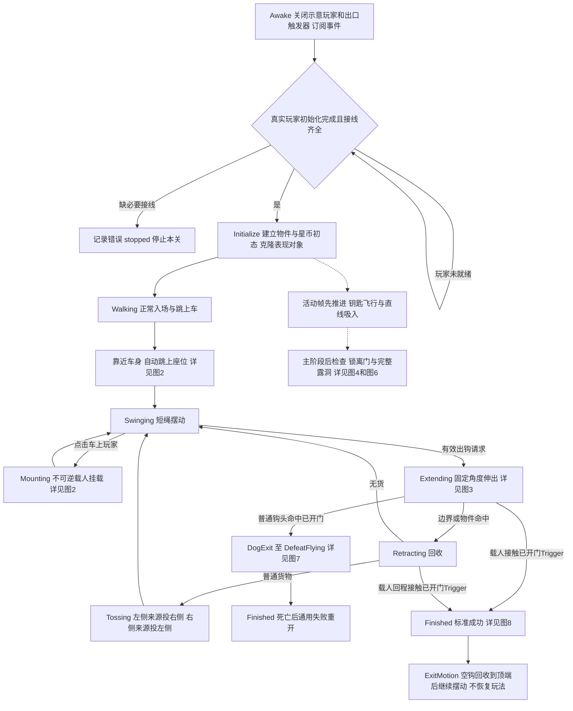

`mounted` 与 `Phase` 正交：同一个 `Swinging / Extending / Retracting` 可以是普通钩头，也可以是载人。`Mounting` 只用于点击玩家后的挂钩弧线；自动上车从 `Walking` 经 `Boarding` 到 `Swinging`。`Finished` 不等于成功：成功交接、狗失败及检测到玩家已死亡都会进入这个停止主流程的阶段。

`exiting / ExitMotion` 独立于主玩法阶段：进门后空钩以原回收速度收至顶端，再继续原角度、速度和端点停留节奏的左右摆动，直到卸载；仅成功入门设置exitResumeSwing。Reset/Replay保留当时正在进行的摆动、伸出或回收，伸出至原视野边界或回收到顶端即停，不开启新动作；若已在成功退场中则保留其回收后摆动。仅调用视觉几何更新，不执行命中、拾取、投放、开门或成功判定。重启时保留原随钩物件及已挂载玩家的位置关系；成功入门则不再写Actor位置。正常暂停仍暂停；共享重启流程约0.5秒后销毁旧关卡，不等待回收完成，新局不继承该状态。

### 图 2 上车与不可逆挂载

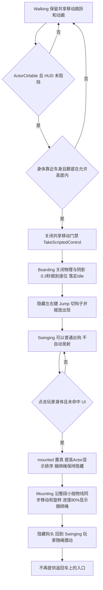

### 图 3 摆动、命中与搬运循环

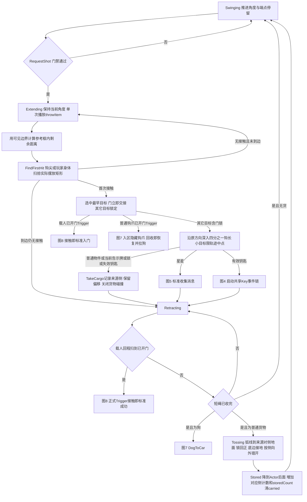

### 图 4 双路径门锁

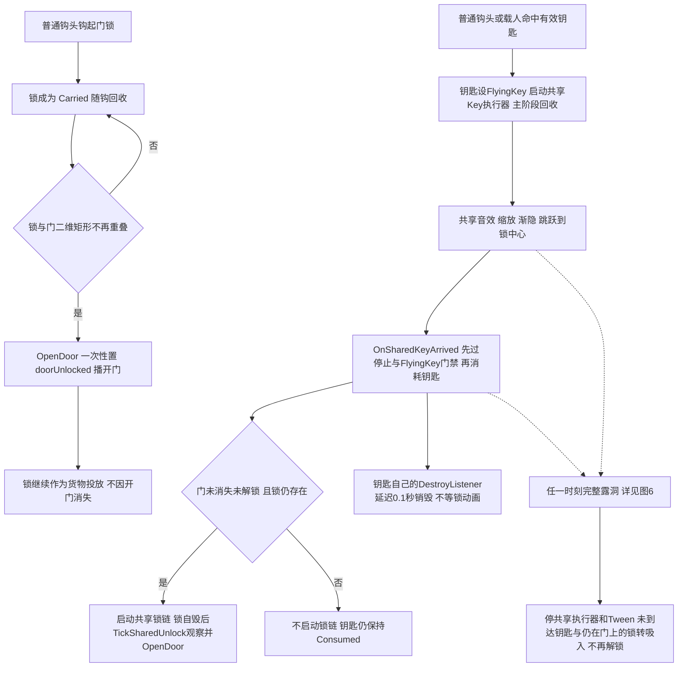

### 图 5 星星与替代银币

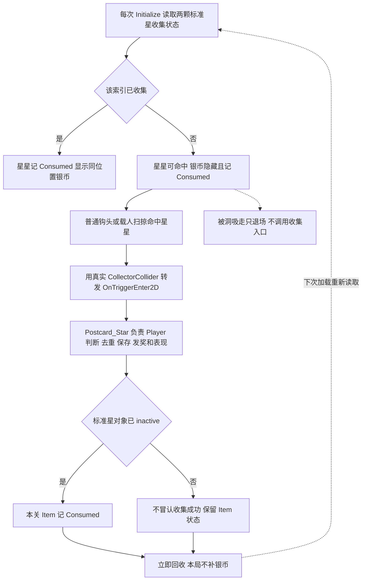

### 图 6 三层告示牌与洞吸入

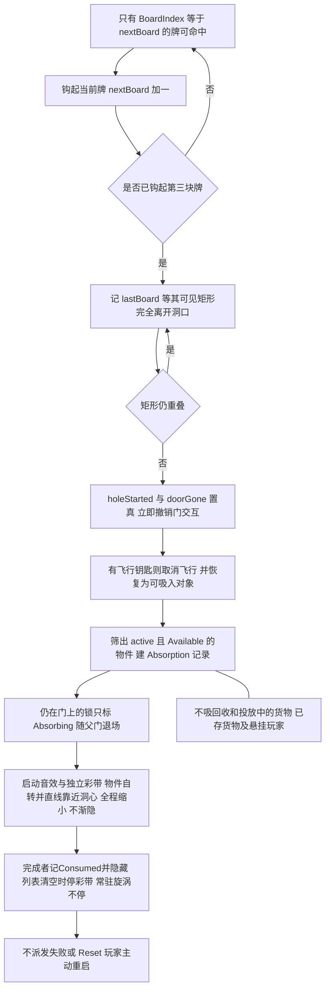

### 图 7 狗夺车失败链

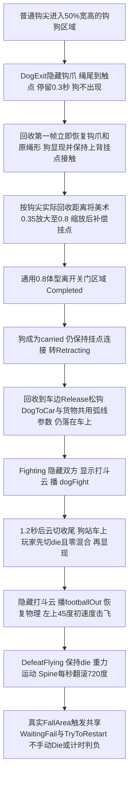

入区时隐藏钩爪并停留0.3秒，狗保持隐藏；DogExit先消费停留时间，余下帧时间才用于回收。开始回收立即恢复钩爪并显现狗，不再追加等待；暂停时不推进停留时间。载人与钩狗共用原门Trigger同中心、同旋转的50%宽高区域，Actor接触即入门、不等待0.3秒；狗0.8体型的完整离门距离仍按原完整门Trigger计算。实际隐藏时长、区域贴合与衔接观感未运行验证。

### 图 8 载人入门与成功交接

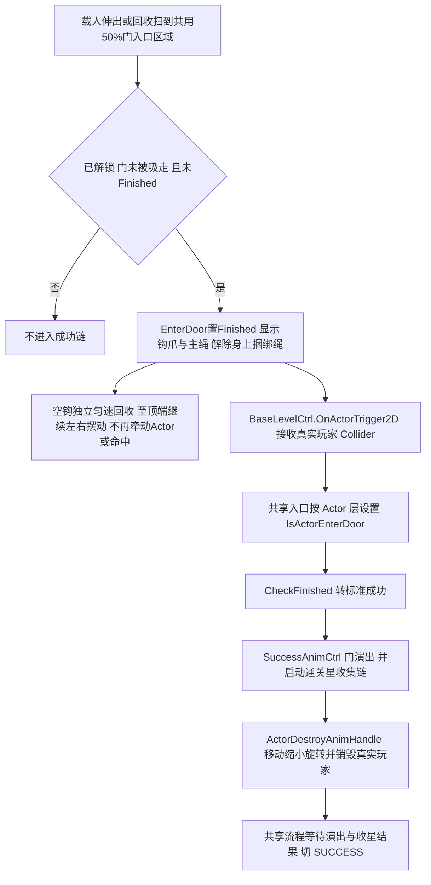

这里的成功触发依赖真实玩家 Collider 保持 `Actor` 层；不是把任何传入 Collider 都无条件判作成功。门自身物理 Trigger 关闭，普通钩头开门、摆动待机或门视觉消失都不构成该入口。

### 图 9 暂停、输入阻挡与重开清理

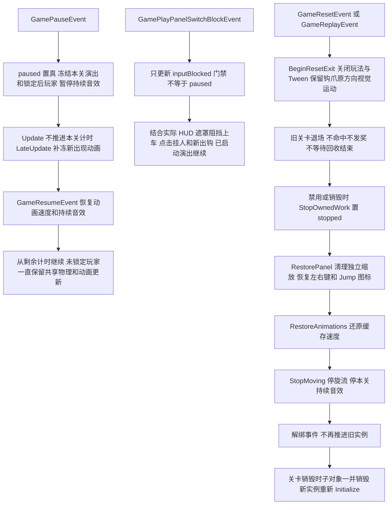

`StopOwnedWork` **不是原地 ResetLevel**：它不逐项把货物、锁、门和阶段还原，也没有 `stopped=false` 的重新启用路径。Reset/Replay 的完整重建由共享关卡生命周期负责；不能将“组件禁用后再启用”画成新局。

## 状态迁移逐项说明

本节按当前工作区源码逐项核对，不以历史截图或旧验证代替当前实现。范围是Level137本关及其直接交接的共享入口，不展开整个游戏的全局状态机。`Phase`的12项、`ExitMotion`的4项和`ItemState`的7项全部列出；`Kind`的7项是物件类别，不是可迁移状态。`scripted`、`mounted`、门锁/洞标志、狗挂点和HUD标志与枚举并存，不能合并成一条只有正常通关的流程。

### Phase：12个主阶段的进入、持续与离开条件

所有主阶段都受图10的外层门禁约束。Reset/Replay不等待本阶段完成，按图12进入退场；OnDisable/OnDestroy执行停止清理。

| 状态 | 进入来源与动作 | 持续行为与正常离开 |
| --- | --- | --- |
| `Walking` | 新实例枚举零值；Initialize完成后仍为Walking | 保留共享玩家移动。ActorCtrlable、HUD未阻挡、车身横向距离与脚底高度门禁通过后，TakeScriptedControl接管并转Boarding |
| `Boarding` | Walking靠近车身触发；关闭普通操作并播放jump_up | 本关活动帧推进0.3秒上车弧线，过半切jump_down；到座位后idle、切换HUD并转Swinging。此阶段拒绝挂钩点击与出钩 |
| `Swinging` | 中央锁定、挂载完成、无货回收完成或普通投放完成 | TickSwing先摆动，再CheckMountInput。点击未挂载玩家且未命中UI转Mounting；有效RequestShot转Extending。已mounted时不再接受挂载；HUD阻挡不停止已经进行的摆动 |
| `Mounting` | TryMountAt一次性置mounted=true，提排序，记录位置/旋转，BeginMotion传mountSeconds与ArcTimeCurve，捆绑绳隐藏 | 开锁大师同款EaseInOut弧线和旋转共用进度；TimeProgress≥0.8显示绳。Completed后EndMotion、隐藏原钩爪、转Swinging并UpdateRig。不原地返回车上 |
| `Extending` | RequestShot门禁通过，锁住发射时角度 | 按extendSpeed与视野可用距离推进。门接触立即分流；其它目标进入pendingHit深入子过程。无目标到边界、深入完成Hit后的普通分支、或锁定目标失效均转Retracting；载人门接触转Finished+退场，普通门接触转DogExit |
| `Retracting` | 空钩到边、普通Hit、锁定目标失效，或狗完整离门 | 载人先扫掠回程门区域，接触即成功交接；否则按retractSpeed缩绳。绳长归零：无carried→Swinging，狗→Release并BeginMotion后DogToCar，其它货物→计算最终姿态贴地落点并BeginMotion后Tossing |
| `Tossing` | 普通货物收回车边，按TakeCargo缓存的DropOnRight选来源对侧落点，BeginMotion传ArcTimeCurve | 原EaseInOut弧线；只有锁同步回正。完成后EndMotion、Carried→Stored、降到Actor排序后面、计数递增、清carried、转Swinging。不启用物理堆叠 |
| `DogExit` | 普通钩命中已开门，隐藏钩爪、保留到触点的绳尾，dogPullStarted=false，等待计时开始 | 先消费dogEntryHoldRemaining；本帧仍有剩余dt才恢复钩爪并调用dog.Begin。Begin失败→StopOwnedWork；成功后按回收距离推进。dog.Completed后建立临时Dog/Carried记录，转Retracting，并把本帧剩余dt交给TickRetraction |
| `DogToCar` | 狗回收到车边先Release，记录当前位置和车顶落点，与普通货物一样BeginMotion传tossSeconds与ArcTimeCurve | 与货物共用tossArcHeight的EaseInOut弧线，不再跟钩。Completed后EndMotion→BeginFight；不把狗记为Stored，不增加storedCount |
| `Fighting` | BeginFight清carried，隐藏狗/玩家，显示打斗云、isStop=false、播放dogFight、phaseTime=0 | 累计原fightSeconds=1.2秒后狗站车顶idle，玩家先播die且零混合再显现；隐藏云、播footballOut，BeginDefeatFlight后转DefeatFlying |
| `DefeatFlying` | 恢复玩家RB.simulated，沿共享Knockback给定(-0.5,0.5)×50的初速度，保留重力 | 物理移动，总控只调用TickDefeatFlight旋转Spine表现。没有固定落点、飞行时限或直接Die；真实FallArea让共享WaitingFail结算并等待Reset，此阶段可持续到Reset。若共享死亡标志被外部置真，仍走既有Finished门禁 |
| `Finished` | EnterDoor、Update发现player.IsDied，或BeginExitMotion | 不是成功标志，也不是stopped。exiting=false时主Update返回；exiting=true时仍先执行纯视觉ExitMotion。狗失败由实际FallArea共享链重启，成功由共享链结算；本关不把Finished统一改成自动Reset |

`RequestShot`要求initialized、非stopped、非paused、非GameplayInputBlocked且phase==Swinging。`mounted`表示已经接受不可逆挂载，准备帧就为true，不等于已经移动到钩头；`scripted`更早在车中央锁定时为true。二者本局均没有复原分支；新实例从false开始。`UpdateRig`在Mounting和Finished不写玩家悬挂位置，挂载弧线及成功入门因此不会被它覆盖。

### 图10：初始化和逐帧优先级

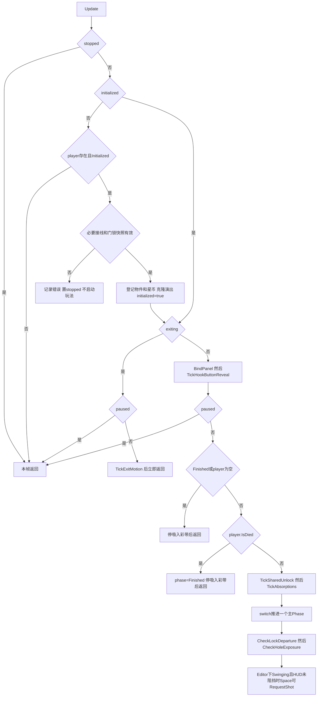

- player缺失/尚未Initialized会继续等待，当前Initialize并不把此项写为stopped；其它必需接线缺失或门锁关闭快照无效才记录错误并置stopped。快照失败前可能已创建捆绑绳/部分记录，不能把失败画成自动撤销所有初始化操作。
- `LateUpdate`独立：未初始化或stopped则返回；paused时反复FreezeAnimations补冻新出现的Spine/Animator；phase仍为Fighting时补写玩家透明度0。它不推进位移。
- **同帧边界**：在switch内部EnterDoor或StopOwnedWork之后，外层Update没有再检查exiting/stopped，仍会走末尾两项检查；退场优先返回从下一次Update生效。OpenDoor额外拒绝exiting，但CheckHoleExposure没有该门禁。若同帧恰好满足完整露洞条件，仍可能创建吸入记录；后续退场Update不再TickAbsorptions，直到卸载清理。此为源码现状与潜在视觉风险，不把它描述成“切退场瞬间所有回调均停止”，本轮不修改运行代码。

### 图11：ItemState全状态流转

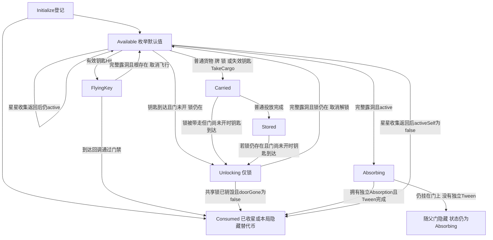

| ItemState | 当前代码含义与限制 |
| --- | --- |
| `Available` | 扫掠候选还须Root非空、activeInHierarchy、Kind白名单和告示牌顺序通过。不是所有Available都能由载人命中 |
| `Carried` | TakeCargo在物件随钩移动前按Bounds中心与Car碰撞框中心的世界X比较，缓存DropOnRight，再解除原父级、保留偏移，排序设220+storedCount并关闭子Collider。狗是另外临时创建的记录，不经过TakeCargo |
| `Stored` | 普通投放完成后的非交互态；同帧将货物SortingGroup设为Actor同SortingLayer、order减1（当前199）。不补重力、不重新扫掠、不被洞吸走 |
| `FlyingKey` | 钥匙交给共享事件链；不再被普通扫掠命中。到达回调先转Consumed，再检查是否还能启动锁链 |
| `Unlocking` | 锁共享事件已启动；总控不按动画时长猜完成，TickSharedUnlock等待doorLock实际为null。OnSharedKeyArrived不要求锁此前为Available，只检查门及锁存在；特殊时序下可能从Carried/Stored转入，不能把先前锁状态当作隐含门禁 |
| `Absorbing` | 可独立吸入，也可仅作为门的子锁随父门退场；两者不能混同。取消Tween/卸载不补写Consumed |
| `Consumed` | 表示本局不可再交互，不等于必然发奖或对象已Destroy：初始化隐藏替代币、已存档星、收星成功、已用钥匙、已毁锁、洞吸入完成都可进入 |

狗在完整离门时只创建临时`Dog/Carried`，不加入items；BeginFight清carried后该记录不再使用，并没有Dog→Stored/Consumed赋值。门打开只改doorUnlocked，不改变doorItem.State；门被洞吸入才走Available→Absorbing→Consumed。父门下的锁没有独立Absorption，因此父门隐藏后锁记录仍为Absorbing，不能漏写成所有吸入物都必然Consumed。

### 门锁、告示牌和星币的并行标志

| 标志/过程 | 置位、清除与拦截条件 |
| --- | --- |
| `doorUnlocked` | 初始false；OpenDoor一次性置true并播开门。本局不回false；OpenDoor拒绝exiting、doorGone或已开门 |
| `doorGone` / `holeStarted` | 初始false；三牌已钩起且lastBoard与洞完全不重叠时一起置true。只触发一次；这不是Failed或Reset |
| `nextBoard` / `lastBoard` | 从0起，仅Hit确认当前牌后递增；到boards.Length时保存末牌。钩尖初次擦到牌不等于已经揭完，仍须深入完成 |
| `keyUnlockStarted` | 有效到达回调启动锁链时true；观察锁销毁、露洞取消或BeginExitMotion时false。到达时若门已开/消失或锁缺失，钥匙照样Consumed但不置true |
| 星与替代币 | 每次Initialize按同下标把币位置对齐星，RefreshSavedCollectionState决定谁可见；本局收星不激活币。Hit后只有星activeSelf为false才将本关记录Consumed，否则Available并回收，不冒认发奖 |
| 解锁与吸入并发 | 正常活动帧先观察锁销毁，再推进吸入，主Phase后检查锁离门和露洞。FlyingKey/Unlocking可在露洞时取消回到Available，随后同次CheckHoleExposure纳入吸入；并非下一帧重新允许玩家钩取 |

### 图12：ExitMotion全状态与清理

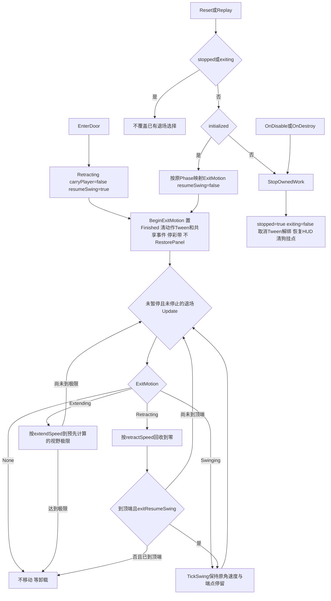

| Reset发生时原Phase | ExitMotion映射及未完成动作 |
| --- | --- |
| Swinging | Swinging，原摆角、目标端、端点剩余停留继续 |
| Extending | Extending，保留原方向；清pendingHit，忽略沿途目标，记录一次视野可走余量，到限即None |
| Retracting | Retracting，到顶端None，不再投放货物 |
| DogExit且dogPullStarted=true | Retracting，已接狗仍由UpdateRig/FollowHook随钩；不再进入狗上车或打斗 |
| DogExit且dogPullStarted=false | None，不替玩家完成隐藏停留或启动狗；旧画面等卸载 |
| Walking / Boarding / Mounting / Tossing / DogToCar / Fighting / DefeatFlying / Finished | None；取消本关主动作与物理击飞，不补落点、奖励或死亡回调；旧玩家不被传回初始位置 |

`exitCarryPlayer`只在重启时按原mounted且非Mounting/Finished计算；具体写位置仍须TickExitMotion不是None且player存在。成功入门永远false。回收转Swinging发生于到顶帧的UpdateRig之后，下一帧才TickSwing，没有把该帧剩余dt补给摆动。重启None不会取消共享系统自己的入场/死亡协程；只停止本关负责的推进。

### 图13：pendingHit深入子过程

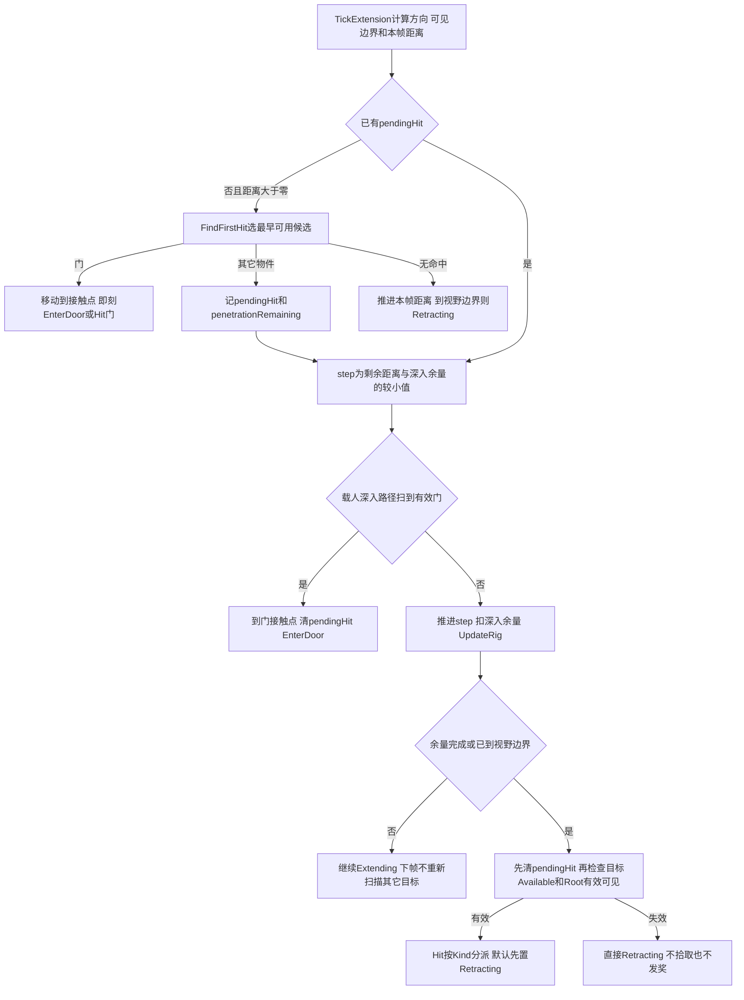

最早命中比较使用严格`t < fraction`，相同接触比例保持items中先出现者。普通探头为HookTip点，载人为BodyBounds中心/半尺寸；门统一调用SweepDoorTrigger，其余调用SweepShape。深入量为`min(钩长×penetrationLengthRatio, 命中区域内路径长度×0.5)`；它不是新Phase，不能在图中画成额外枚举。Reset/成功退场清掉锁定与余量，不在退场时完成Hit。

### 图14：EasedMotion的运行与取消

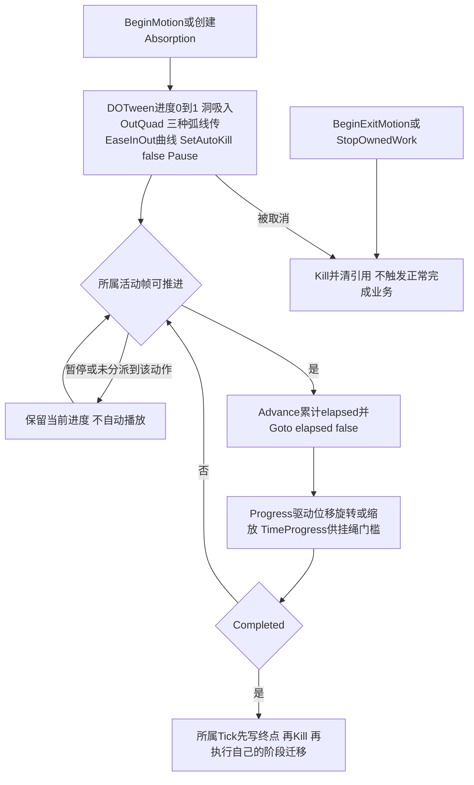

`duration=max(0.1,seconds)`；Completed依据elapsed而非视觉距离或Spine动画结束。BeginMotion先EndMotion，主动作最多一份；吸入每个独立物件一份。Finished时未主动清理的Tween可保留到卸载，不自动补完。挂载/投放/狗上车使用ArcAtProgress；狗失败后的击飞改为真实物理，不走该进度对象。旧Arc辅助函数和Level137Vortex线条文件仍保留，但总控不再调用它们推进当前玩法。

### 图15：HUD绑定和按钮出现子过程

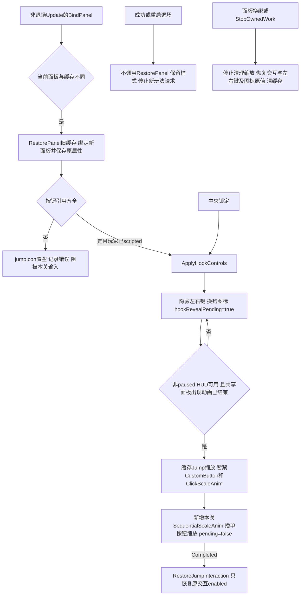

- `hookControlsApplied`防重复改图，`hookRevealPending`表示等待开始，不代表正在缩放；`jumpScaleCaptured`记录可恢复的根缩放，`jumpInteractionSuspended`表示暂禁按压/指针入口。Completed仅恢复交互，不切回跳跃图标；RestorePanel才恢复完整样式。
- GameplayInputBlocked由事件inputBlocked、面板不存在/未启用、jumpIcon缺失或ClickBlock激活共同决定；它阻止中央锁定、点击挂载和新出钩，不是运动暂停。CustomButton缩放期间enabled=false阻止其指针入口，但RequestShot并不额外检查jumpInteractionSuspended，Editor Space等其它调用仍按RequestShot自身门禁处理。
- **暂停准确边界**：TickHookButtonReveal只在开始前检查paused；已经启动的SequentialScaleAnim用Time.unscaledTime自行Update，OnPause不禁用该组件。因此已启动的按钮出现动画可在暂停或退场期间完成并恢复交互enabled；主玩法门禁仍拒绝退场出钩。不能写成所有HUD动画都随本关暂停冻结，也不把Completed等同于恢复普通按键。
- 退场exiting分支在BindPanel之前返回，因而不会主动换绑HUD。未exiting的Finished（例如狗抛出结束、等待共享Reset时）仍先执行BindPanel/TickHookButtonReveal；只有面板实例确实变化才触发既有换绑恢复，不是死亡时主动切回按键。

### 图16：狗挂点与完成标志

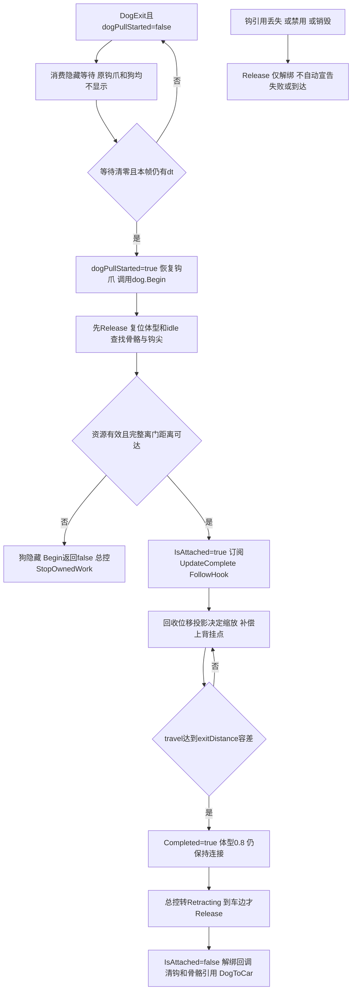

Begin按完整门Trigger与0.8体型计算exitDistance，入口命中使用的0.5宽高不用于完整离门。FollowHook由UpdateRig及Spine.UpdateComplete调用，不是另一套dt时钟；Completed根据实际投影距离重新赋值。Release只清连接，不将Completed归零，Completed不代表已松钩或已上车；成功Begin才先置Completed=false再FollowHook。若连接异常丢失，Release不会向总控触发自动失败兜底，DogExit是否能继续取决于剩余状态，属于未验证风险。

### 中断、异常与证据边界

| 路径 | 源码实际处理 | 不应声称的结论 |
| --- | --- | --- |
| 暂停/恢复 | 保存本关Spine/Animator速度、共享执行器enabled和正在播放的目标Tween；暂停并持续补冻，恢复仅还原缓存；动作/退场dt停推 | 不覆盖已启动HUD unscaled缩放、共享成功/出生协程及短音效的统一事务暂停 |
| 露洞取消 | 先停共享执行器/监听器再DOKill，避免取消完成标记继续解锁；随后按实际对象存在状态纳入吸入 | 不等于回滚之前已成功收星或已Consumed钥匙 |
| 初始化错误 | 置stopped或等待player，取决于错误位置；不执行玩法 | 不承诺所有数组内组件、Spine/Prefab装配问题都有无异常兜底 |
| 狗Begin失败 | StopOwnedWork并隐藏失败的狗；不会伪造完全离门 | 不等于自动Failed重开 |
| 重启退场 | 清主动作/吸入Tween及共享钥匙锁链，保留选定钩爪视觉；不RestorePanel | 不承诺继续完成物件投放、挂人弧线、狗上车或打斗等非钩爪动作 |
| 禁用/销毁 | stopped；清退场标志和Tween、解绑狗、取消共享事件、恢复排序/HUD/动画、停音效、清事件订阅 | 不是原地复位。禁用后再启用不会自动清stopped开始新局 |
| 全面异常恢复 | 当前没有包裹所有Tick的统一try/finally事务；依赖正常生命周期清理 | 不将静态状态图称为任意异常路径都可自动恢复 |

状态边界中的风险按实际代码保留；本轮只修正文档，不修复或掩盖这些运行分支。图/表说明的是源码可见行为，触发时序、实际画面、广告回调、多帧竞争和异常注入均未运行验证。

### 图17：洞口旋涡独立生命周期

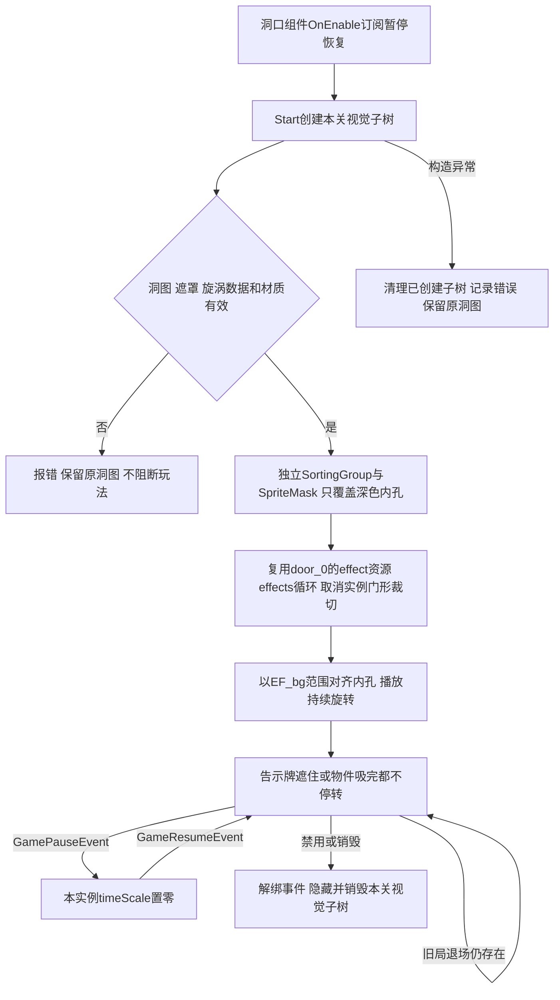

旋涡不订阅Reset/Replay，也不查看holeStarted、absorptions、phase或exiting；它不在吸入完成时停止。共享重建销毁旧关卡时组件统一清理；重新启用该视觉组件可重建自身子树，但这不改变Level137Ctrl不支持原地复位的合同。开始前收到Pause会保存paused标志，CreateVisual完成后即使用timeScale=0，Resume再续播。不新增音效、Collider、物品记录、奖励或判定入口。

### 图18：吸入彩带与实际吸入列表同步

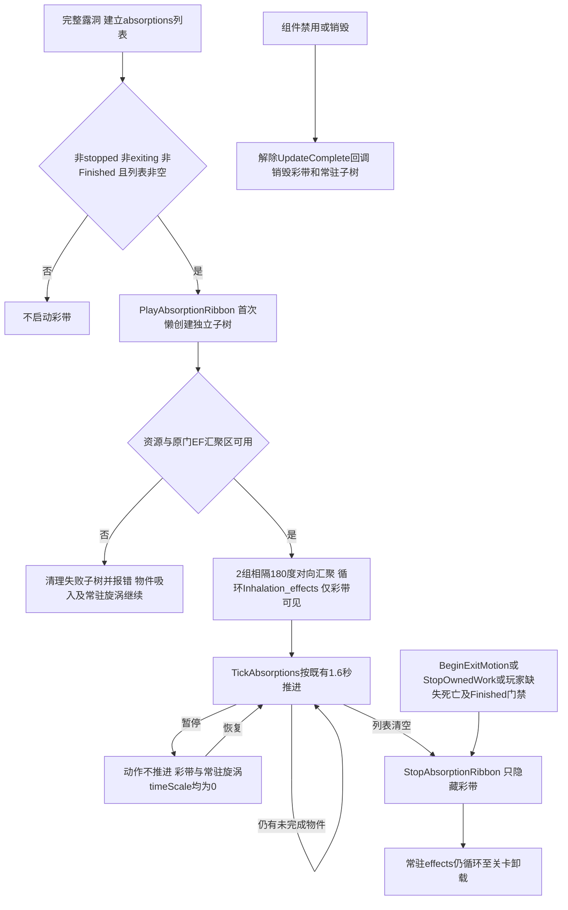

彩带不自己定义“吸完”的计时器，也不等待一整轮Spine动画结束才停止；正常播放长度由既有物件吸入列表的1.6秒决定，暂停不计入动作时间。提前进入成功/重启退场、停止或玩家死亡/缺失时隐藏彩带。BeginExitMotion不会调用ReleaseVisual，因此常驻旋涡不被一起停掉。Resume只恢复timeScale，不重新激活已经停止的彩带。退场的同帧末尾若仍执行CheckHoleExposure，新增的启动门禁会拒绝重新开启彩带，但没有改写原有吸入列表的同帧风险。

### 图19：参考138的真实物理击飞

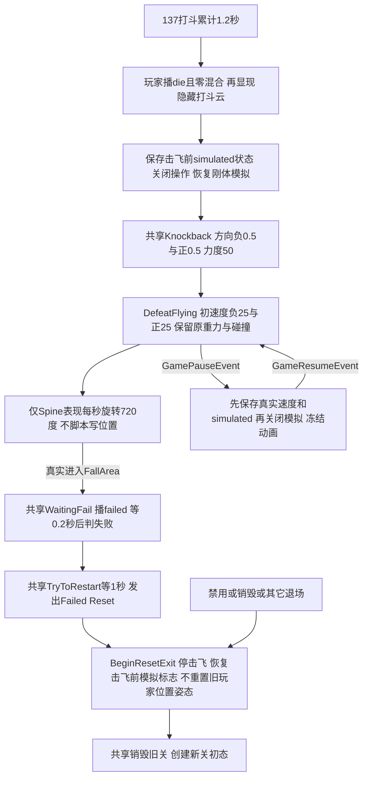

参考为只读工作区 `~/.herdr/worktrees/unity-brain-punk-1.9.0_Simon/dev138` 的Level138Ctrl.LaunchPlayer/Flying及其功能说明。对齐方向(-0.5,0.5)、knockForce=50、保留重力、Spine转速720度/秒和真实FallArea收尾；不复制138队伍、警告气泡、NPC碰撞忽略，也不把137原1.2秒打斗改成138的0.8秒。

137原先锁定后RB.simulated=false，新BeginDefeatFlight仅在失败击飞阶段恢复模拟，保持原Dynamic、gravityScale=4.5和冻结物理根旋转的约束。既有左侧FallArea在本关根局部(-18.07,0)，尺寸10×10；主Actor继承Player Tag与启用的主Collider，原资源/区域不改。上述只能说明接线与边界，不能证明所有帧率和布局下都实际进入触发区；没有额外超时判死、坐标越界判死或传送到FallArea的兜底。

暂停快照顺序依赖当前本地事件链：137在Awake订阅Pause，BaseLevelCtrl在Start注册会清零速度的StopMoving；EventDispatcher按注册列表顺序调用，故137先保存速度/角速度/simulated，再关闭模拟。Resume恢复这些快照，随后共享ResumeMoving不清速度。只有defeatFlying为true时才接管物理暂停，普通入场/其他脚本移动边界不变。StopDefeatFlight清除暂停所有权、StopKnock/StopMoving并恢复击飞前simulated标志，但不还原初始位置或站姿；共享Knockback自身的异步等待仍沿用共享实现，非本关独立重写。

## 数据结构架构图

以下是现有类的分逻辑投影，不是多套独立实现。相同 `Level137Ctrl` 在不同图中只展示该逻辑需要的成员；`- / + / #` 分别表示私有、公开、受保护成员。Unity 对象和共享类只保留关联所需部分。

### 架构 A1 主状态与真实玩家接管

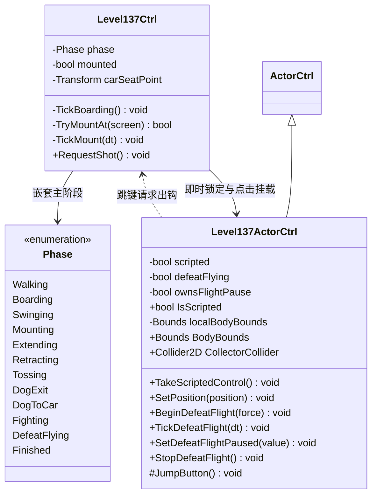

### 架构 A2 摆动、扫掠与参考框

```mermaid
classDiagram
  direction TB
  class Level137Ctrl {
    -float angle
    -float swingTarget
    -float endpointRemaining
    -float extension
    -Bounds HeadBounds
    -TickSwing(dt) void
    -UpdateRig() void
    -TickExtension(dt) void
    -FindFirstHit(from, to, halfSize, fraction, exit) Item
  }
  class Level137Geometry {
    <<static>>
    +TransformBounds(root, local) Bounds
    +SpriteBounds(renderer) Bounds
    +BoxBounds(collider) Bounds
    +SweepShape(from, to, halfSize, frame, local, enter, exit) bool
    +ReferenceView(camera) Rect
    +TravelInside(view, body, direction, margin) float
    +Arc(from, to, progress, height) Vector3
  }
  class Level137ActorCtrl {
    +TravelBounds() Bounds
  }
  Level137Ctrl ..> Level137Geometry : 几何计算不查物理
  Level137Ctrl --> Level137ActorCtrl : 身体命中与可见附件限边
  Level137ActorCtrl ..> Level137Geometry : 身体局部框转世界框
```

### 架构 A3 物件状态与搬运

```mermaid
classDiagram
  direction TB
  class Level137Ctrl {
    -List~Item~ items
    -Item carried
    -Vector3 carryOffset
    -int storedCount
    -int storedLeftCount
    -int storedRightCount
    -TakeCargo(item) void
    -TickRetraction(dt) void
    -TickToss(dt) void
  }
  class Item {
    +Transform Root
    +SpriteRenderer Sprite
    +BoxCollider2D Box
    +Postcard_Star Star
    +Kind Kind
    +ItemState State
    +int BoardIndex
    +bool DropOnRight
    +Bounds Bounds
  }
  class Kind {
    <<enumeration>>
    Prop
    Board
    Lock
    Key
    Star
    Door
    Dog
  }
  class ItemState {
    <<enumeration>>
    Available
    Carried
    Stored
    FlyingKey
    Unlocking
    Absorbing
    Consumed
  }
  Level137Ctrl *-- Item : 嵌套数据记录
  Item --> Kind : 命中类别
  Item --> ItemState : 可交互与退场状态
```

狗接钩时临时创建一个 `Item` 交给 `carried`，不加入普通场景 `items` 列表；因此不能把狗误画成会再次参与物件扫掠或洞吸入的场景目标。

`DropOnRight`只在TakeCargo接管时确定：物件中心X≤Car碰撞框中心X为true，落右侧；大于则false，落左侧。回收后不重新判侧。storedLeftCount/storedRightCount只在各侧投放完成时增长，用于该侧向外错开；storedCount继续统计两侧总完成数，保留原排序用途。取消投放不补计数，新实例从零开始。

### 架构 A4 门锁与共享钥匙事件链

```mermaid
classDiagram
  direction TB
  class Level137Ctrl {
    -bool doorUnlocked
    -bool doorGone
    -Item lockItem
    -Item doorItem
    -Item keyItem
    -TriggerExecutor keyExecutor
    -ItemJumpToListener keyJump
    -bool keyUnlockStarted
    -CheckLockDeparture() void
    +OnSharedKeyArrived() void
    -TickSharedUnlock() void
    -OpenDoor() void
  }
  class ActorSpineCtrl {
    +PlayAnimation(animName, loop, checkCurrent) TrackEntry
  }
  Level137Ctrl --> Item : 锁与门及钥匙状态
  Level137Ctrl --> TriggerExecutor : 直接启动共享Key事件列表
  ItemJumpToListener <|-- Level137SharedKeyJump
  Level137Ctrl --> ActorSpineCtrl : doorSpine 与 lockSpine
  Level137Ctrl ..> Level137Geometry : 离门重叠判断及锁中心计算
```

### 架构 A5 星星收集与存档归属

```mermaid
classDiagram
  direction TB
  class Level137Ctrl {
    -Postcard_Star[] stars
    -SpriteRenderer[] silverCoins
    -Initialize() bool
    -Hit(item) void
  }
  class Postcard_Star {
    -bool isCollected
    -bool isCollecting
    +RefreshSavedCollectionState() bool
    -OnTriggerEnter2D(other) void
    -Collect() void
  }
  Level137Ctrl --> Postcard_Star : 初始化读取及命中消息转发
  Level137Ctrl --> Level137ActorCtrl : 取得真实 CollectorCollider
  Postcard_Star ..> PostcardManager : 持久收集去重
  Postcard_Star ..> SimpleBag : 标准星星奖励
```

### 架构 A6 告示牌与吸入数据

```mermaid
classDiagram
  direction TB
  class Level137Ctrl {
    -int nextBoard
    -Item lastBoard
    -bool holeStarted
    -List~Absorption~ absorptions
    -CheckHoleExposure() void
    -TickAbsorptions(dt) void
  }
  class Absorption {
    +Item Item
    +Vector3 Center
    +Vector3 Scale
    +Quaternion Rotation
    +EasedMotion Motion
  }
  class Level137Vortex {
    -LineRenderer[] lines
    -float elapsed
    -float duration
    +Begin(position, seconds) void
    +Tick(deltaTime) void
    +Stop() void
  }
  Level137Ctrl *-- Absorption : 嵌套吸入初态记录
  Absorption --> Item : 单个退场物件
  Level137Ctrl --> Level137Vortex : 旧资源仅停止 不播放
```

### 架构 A7 狗出门与失败表现

```mermaid
classDiagram
  direction TB
  class Level137Ctrl {
    -Level137DogExit dog
    -bool dogPullStarted
    -GameObject fight
    -Animator fightAnimator
    -float phaseTime
    -TickDogExit(dt) void
    -TickDogToCar(dt) void
    -BeginFight() void
    -TickFight(dt) void
    -TickDefeatFlying(dt) void
  }
  class Level137DogExit {
    -ActorSpineCtrl dogSpine
    -Vector3 initialScale
    -Transform hookTransform
    -Bone hookBone
    -Vector2 hookBoneOffset
    -float exitDistance
    +bool Completed
    +bool IsAttached
    +Begin(doorFrame, exitRegion, hook, tipLocal, retractDirection, maximumPullDistance) bool
    +FollowHook() void
    +Release() void
  }
  Level137Ctrl --> Level137DogExit : 本关时钟驱动出门
  Level137Ctrl --> Animator : 打斗 isStop 参数
  Level137Ctrl --> Level137ActorCtrl : 真实Knockback击飞及Spine翻滚
```

### 架构 A8 标准成功交接

```mermaid
classDiagram
  direction TB
  class Level137Ctrl {
    -BaseLevelCtrl level
    -EnterDoor() void
  }
  class BaseLevelCtrl {
    +bool IsActorEnterDoor
    +OnActorTrigger2D(collider) void
    +CheckFinished() void
    -PlaySuccessAnim() void
  }
  class SuccessAnimCtrl {
    +Play(callback) void
  }
  class ActorDestroyAnimHandle {
    +PlayDestroy() void
  }
  Level137Ctrl --> BaseLevelCtrl : 真实载人扫掠命中后交接
  BaseLevelCtrl --> SuccessAnimCtrl : 门演出与完成回调
  SuccessAnimCtrl --> ActorDestroyAnimHandle : 吸入并销毁玩家
```

### 架构 A9 暂停与 HUD 清理

```mermaid
classDiagram
  direction TB
  class Level137Ctrl {
    -bool paused
    -bool inputBlocked
    -bool stopped
    -EventSubscriber subscriber
    -GamePlayPanel boundPanel
    -Image jumpIcon
    -Sprite originalIcon
    -BindPanel() void
    -FreezeAnimations() void
    -RestoreAnimations() void
    -ApplyHookControls() void
    -TickHookButtonReveal() void
    -RestorePanel() void
    -StopOwnedWork() void
  }
  class Level137ActorCtrl {
    -bool scripted
    +bool IsScripted
  }
  Level137Ctrl --> Level137ActorCtrl : 按是否锁定划分动画冻结归属
  Level137Ctrl --> Image : 缓存并恢复原图标属性
  Level137Ctrl --> EventSubscriber : 订阅与解绑
  Level137Ctrl ..> Level137Vortex : 停止旋流
```

动画缓存实际是 `Dictionary<Spine.AnimationState, float> pausedSpines` 与 `Dictionary<Animator, float> pausedAnimators`；图标除 Sprite 外还缓存旋转、缩放、`preserveAspect` 和 `raycastTarget`。音效仅缓存本关吸入及打斗的 `Sound` 句柄，不做全局音效暂停。

### 架构 A10 主玩法与退场运动分离

```mermaid
classDiagram
  direction TB
  class Level137Ctrl {
    -Phase phase
    -bool exiting
    -ExitMotion exitMotion
    -bool exitCarryPlayer
    -bool exitResumeSwing
    -float exitExtensionLimit
    -BeginResetExit() void
    -BeginExitMotion(remaining, carryPlayer, resumeSwing) void
    -TickExitMotion(dt) void
    -StopOwnedWork() void
  }
  class ExitMotion {
    <<enumeration>>
    None
    Swinging
    Extending
    Retracting
  }
  Level137Ctrl --> ExitMotion : 嵌套纯视觉阶段
  Level137Ctrl --> Phase : 退场时固定Finished
  Level137Ctrl --> Level137ActorCtrl : 仅重启载人退场时维持挂载位置
```

| 入口/状态 | 运动与交互边界 | 结束条件 |
| --- | --- | --- |
| EnterDoor | `Retracting / exitCarryPlayer=false / exitResumeSwing=true`；Actor交给共享成功动画，空钩不再参与命中 | 回收到顶端转Swinging，持续摆动至卸载 |
| Reset/Replay | 保留当前Swinging、Extending或正在回收的Retracting/DogExit；其它阶段为None；已在成功退场中不覆盖其状态 | 普通回收到顶端/伸到原视野边界停住；不延长重启等待 |
| paused | 不推进TickExitMotion；不等于取消退场 | Resume后继续 |
| stopped | 优先于exiting，所有本关更新返回 | 禁用/销毁清理后不原地重用；新实例重新Initialize |

退场不调用RestorePanel，也不重新绑定HUD；按键维持当前样式但phase已Finished，无法再次出钩。RestorePanel仅保留BindPanel换绑和StopOwnedWork清理入口。新局普通按键和初态按原生命周期恢复，不跨局保存钩爪状态。

### 架构 A11 DOTween进度与几何轨迹分离

```mermaid
classDiagram
  direction TB
  class EasedMotion {
    -Tween tween
    -float duration
    -float elapsed
    +float Progress
    +float TimeProgress
    +bool Completed
    +Advance(dt) float
    +Kill() void
  }
  Level137Ctrl *-- EasedMotion : 主动作motion
  Absorption *-- EasedMotion : 各自吸入进度
  EasedMotion --> Tween : 默认OutQuad或传入时间曲线 Pause并手动Goto
  Level137Ctrl ..> Level137Geometry : ArcAtProgress只计算轨迹
```

| 动作 | 进度驱动 | 同步规则 |
| --- | --- | --- |
| 玩家挂钩 | mountSeconds=0.65秒，ArcTimeCurve | 弧高0.65，位移/旋转同进度；挂绳仍按时间进度80%显示 |
| 物件抛落 | tossSeconds=0.7秒，ArcTimeCurve | tossArcHeight=2世界单位，保留贴地落点；锁回正与位置同进度 |
| 狗上车 | 与物件共用tossSeconds=0.7秒、ArcTimeCurve | 共用tossArcHeight=2世界单位，车边先Release，保留车顶落点；完成后BeginFight |
| 洞吸入 | suctionSeconds=1.6秒，OutQuad | 中心直线位移、自转两圈和缩小共用进度；从开始持续缩小至零 |
| 狗打败后击飞玩家 | 共享Knockback，方向(-0.5,0.5)，defeatKnockForce=50 | 初速度(-25,25)，保留重力；Spine每秒720度翻滚，真实FallArea触发失败，无固定飞行时长 |

完成时Kill；退场入口、禁用和销毁清理尚存主动作及吸入Tween。进度Tween不自动播放，也不使用全局ManualUpdate；这些结构事实不证明实际动画、暂停或低帧率观感已经验收。

参考依据：`Level_018.prefab`五把钥匙的ItemJumpOutExecutor使用两个关键帧（time/value为0/0与1/1，端点切线均为0）的timeCurve，与本关ArcTimeCurve对应。三种弧线共用同款曲线；狗上车进一步与普通物件共用0.7秒和弧高2，玩家挂钩保持独立参数。各自落点不变，不复制18关随机时长、弧高及等高终点。起终点距离不同，参数相同也不代表每秒空间位移或视觉观感完全相同。

### 架构A12：原素材只读与洞口遮罩

```mermaid
classDiagram
  direction TB
  class Level137HoleVortex {
    -SpriteRenderer hole
    -Sprite interiorMask
    -SkeletonDataAsset vortexData
    -Material insideMaskMaterial
    -SkeletonDataAsset ribbonData
    -float ribbonRangeScale
    -int RibbonDirectionCount
    -List~SkeletonAnimation~ ribbonAnimations
    -float fillOverscan
    -Vector2 innerCenter
    -Vector2 innerSize
    -bool paused
    -CreateVisual() void
    -ReleaseVisual() void
    +PlayAbsorptionRibbon() void
    +StopAbsorptionRibbon() void
    -CreateRibbon() bool
    -ReleaseRibbon() void
    -OnPause(event) void
    -OnResume(event) void
  }
  Level137HoleVortex --> SpriteRenderer : 原洞图只读
  Level137HoleVortex --> SkeletonDataAsset : 只读门内effect数据
  Level137HoleVortex *-- SortingGroup : 新建局部遮罩作用域
  SortingGroup *-- SpriteMask : 原图内孔派生遮罩
  SortingGroup *-- SkeletonAnimation : effects持续循环
  Level137Ctrl --> Level137HoleVortex : 仅请求彩带开始和停止
  Level137HoleVortex --> SkeletonAnimation : 2组对向ribbon共用洞心且不受内孔遮罩裁切
```

仅挂载组件和序列化引用写入Level_137.prefab；原洞口SpriteRenderer、Transform、原图与meta不变。新材质只引用原effects纹理，并将Stencil比较设为Spine VisibleInsideMask使用的LessEqual（4）；不修改原材质。视觉贴合、Stencil隔离与平台渲染仍需人工验证。

## 函数清单与伪代码

下列伪代码是对当前 C# 的压缩表达，省略资源判空及插值细节，**不是新的行为合同，也不能直接编译**。实际函数与职责如下。

| 代码归属 | 函数组 | 当前职责 |
| --- | --- | --- |
| `Level137Ctrl` | `Awake / Initialize / AddSprite` | 屏蔽物理入口、订阅事件、验证接线、物件登记、星币初态、表现对象克隆 |
| 同上 | `Update / LateUpdate` | 本关时钟、主阶段分发、并行过程、后置检查、暂停及打斗透明度补写 |
| 同上 | `TickBoarding / CheckMountInput / TryMountAt / RaiseMountedSorting / TickMount` | 中央范围落稳即锁定、UI 排除、点击挂人时提高显示排序、挂钩弧线 |
| 同上 | `TickSwing / UpdateRig / RequestShot / TickExtension / FindFirstHit / SweepDoorTrigger` | 摆动、固定角度伸缩、扫掠锁定、共用门入口区域与参考框边界 |
| 同上 | `Hit / TakeCargo / TickRetraction / GetUprightHalfHeight / TickToss` | 白名单结果分派、货物偏移、回程入门、锁投放回正与最终姿态贴地、普通投放与狗分流 |
| 同上 | `CheckLockDeparture / OnSharedKeyArrived / TickSharedUnlock / OpenDoor / EnterDoor` | 共享钥匙及锁链、两条开门路径、正式Trigger接触后成功交接 |
| 同上 | `CheckHoleExposure / TickAbsorptions` | 完整露洞、取消钥匙飞行、退场集合与吸入插值 |
| 同上 | `TickDogExit / TickDogToCar / BeginFight / TickFight / TickDefeatFlying / SetPlayerAlpha` | 狗被拉出、上车、打斗与物理击飞，失败由真实FallArea共享链负责 |
| 同上 | `LowerStoredCargoSorting` | 仅普通货物成为Stored后改为Actor同层order减1，不改变搬运/抛落途中的排序 |
| 同上 | `BeginMotion / EndMotion`及嵌套`EasedMotion.Advance / Kill` | 本关DOTween进度创建、手动推进与清理 |
| 同上 | `BeginResetExit / BeginExitMotion / TickExitMotion` | Finished之后纯视觉钩爪退场；成功回收后摆动，重启保持原运动，禁止玩法副作用 |
| 同上 | `BindPanel / ApplyHookControls / TickHookButtonReveal / RestoreJumpInteraction / RestorePanel` | 当前 HUD 左右键显隐、跳键换图与独立缩放、按压交互和原属性恢复 |
| 同上 | `OnInputBlock / OnPause / OnResume / FreezeAnimations / RestoreAnimations / OnReset / OnReplay / StopOwnedWork / OnDisable / OnDestroy` | 输入和暂停分离、停止旧实例及事件清理 |
| 同上 | `FreezeSharedEvents / PauseTargetTweens / CancelSharedEvents` | 保存并暂停本实例执行器/目标Tween；取消时先禁用执行器再Kill，不全局操作 |
| 同上 | `CaptureShape` | 读取门/锁关闭姿态的Spine可见局部范围，禁止初始混合；无有效范围则停止初始化 |
| `Level137ActorCtrl` | `Start / OnUpdate / JumpButton / HandleAnimators / TakeScriptedControl / SetPosition / TravelBounds` | 普通 Actor 与锁定后接管边界、Car push 排除、身体和附件轮廓；不再做出生位移补偿 |
| 同上 | `BeginDefeatFlight / TickDefeatFlight / SetDefeatFlightPaused / StopDefeatFlight / OnDisable` | 狗失败时恢复物理并复用Knockback；只转Spine，专属速度/模拟快照暂停恢复；退场或Actor禁用清理，不回写初始位置/姿态，也不覆盖共享ActorCtrl.OnDestroy |
| `Level137Geometry` | `SpriteLocalBounds / SkeletonLocalBounds / TransformBounds / SpriteBounds / BoxBounds / Overlaps / SweepShape / ShapeAxis / Sweep / Slab / ReferenceView / TravelInside / Arc / ArcAtProgress` | 素材局部区域、连续 SAT 与参考框计算；Arc保留旧SmoothStep，ArcAtProgress接收已缓动进度；`CaptureShape` 在总控中钉住门锁初始姿态 |
| `Level137DogExit` | `Awake / Begin / FollowHook / PinToHook / OnPoseUpdated / Release / OnDisable / OnDestroy` | 缓存原体型和上背骨骼，挂点对齐后计算离门距离；实际回收驱动缩放、骨骼更新后补贴，到车边/停止时解绑 |
| `Level137SharedKeyJump` | `Execute` | 同步调用共享base.Execute，前后比较播放中Tween，将新增Tween标记为本实例target以便暂停/取消 |
| `Level137Vortex` | `Begin / Tick / Stop` | 旧实现保留，总控只调用 Stop；不创建或推进旋转线条 |
| `Level137HoleVortex` | `OnEnable / Start / CreateVisual / OnPause / OnResume / ReleaseVisual / OnDisable / OnDestroy` | 只读共享effect资源，构建并清理本关内孔遮罩/Spine子树，持续播放与独立暂停；创建失败仅保留原洞图 |
| 同上 | `PlayAbsorptionRibbon / CreateRibbon / RibbonOpeningBounds / HideNonRibbonSlots / StopAbsorptionRibbon / ReleaseRibbon` | 独立原门ribbon数据；按EF轮廓定位，只让line_EF_槽位显现；与吸入列表同步显隐，停止不影响旋涡，卸载解绑回调 |

### 总控活动帧

```csharp
// 现有 Update 顺序摘要
if (stopped) return;
if (!initialized && !Initialize()) return;
dt = Time.deltaTime;
if (exiting) { if (!paused) TickExitMotion(dt); return; } // 在绑定HUD和Actor门禁前分流
BindPanel();                         // 暂停时仍可重新绑定 HUD
TickHookButtonReveal();               // 只缩放原 Jump，不改共享 HUD 动画的 targets
if (paused) return;
if (phase == Finished || player == null) { holePresentation?.StopAbsorptionRibbon(); return; }
if (player.IsDied) { phase = Finished; holePresentation?.StopAbsorptionRibbon(); return; }
TickSharedUnlock();                 // 观察共享DoorLock销毁，不重写钥匙动画
TickAbsorptions(dt);
TickCurrentPhase(dt);                // 摘要代称：实际为 switch，不存在此方法
CheckLockDeparture();
CheckHoleExposure();
// UNITY_EDITOR 下另支持 Swinging 时 Space 请求出钩
```

### 挂载与命中分派

```csharp
// TryMountAt 摘要；仅在 Swinging、未 mounted、未 GameplayInputBlocked 时检查
if (命中 GraphicRaycaster UI || 点不在 player.BodyBounds) return false;
mounted = true;                      // 本实例不再写回 false
RaiseMountedSorting();              // 当帧显示在 Car 前方，不改变物理 Layer
记录当前玩家位置与旋转及目标悬挂位置;
BeginMotion(mountSeconds, ArcTimeCurve); phase = Mounting;
playerBinding.SetActive(false);
// TickMount 先更新玩家位置/旋转，再于归一化时间进度 >= 0.8 时显示捆绑绳。

// RequestShot 摘要
if (initialized && !stopped && !paused && !GameplayInputBlocked && phase == Swinging)
    phase = Extending;

// FindFirstHit 摘要
foreach (item in items) {
    跳过非 Available 或不可见层级对象;
    牌仅放行 BoardIndex == nextBoard;
    门仅放行 doorUnlocked && !doorGone;
    载人只放行星星、已开门、尚有效的钥匙;
    用 SweepShape 选择沿本帧运动线段最早接触的对象;
}
// TickExtension：首次接触写 pendingHit，继续深入 min(四分之一钩长, 内部轨迹长度的一半)。
// 门锁和其它普通目标一样：沿原方向深入，不改angle或吸附到中心。
// 载人门使用doorTrigger的offset/size/transform，接触即EnterDoor；
// 深入星星/钥匙期间也检查实际前进路径与门Trigger的接触，避免穿过出口。

// Hit 摘要：先置 Retracting，再按目标分派
星星      => 转发标准收集消息，对象 inactive 才记 Consumed;
有效钥匙  => 记 FlyingKey，设置 keyJump 终点并启动 keyExecutor；标准链播放 getKey;
失效钥匙  => TakeCargo 并播放一次 getKey;
已开门    => mounted ? EnterDoor() : 进入DogExit，隐藏钩爪、绳尾补到触点并播放bark;
// TickDogExit先消费0.3秒停留；回收开始的第一帧立即恢复钩爪，再dog.Begin(...)并移动。
其它目标  => TakeCargo 并播放一次 getCoin；若为牌，nextBoard++，末牌记 lastBoard;
```

### 回收、投放与开门

```csharp
// TickRetraction 摘要
distance = min(extension, retractSpeed * dt);
if (载人 && 门仍 Available 且已开且未吸走 && 回程扫掠接触门) {
    回收到正式门Trigger接触点; UpdateRig(); EnterDoor(); return;
}
extension -= distance; UpdateRig();
if (尚未收完) return;
if (carried == null) phase = Swinging;
else if (carried.Kind == Dog) { dog.Release(); 记录起点与车上落点; BeginMotion(tossSeconds, ArcTimeCurve); phase = DogToCar; }
else {
    landingCenter = cargoPoint.position; // 右侧原锚点
    if (!carried.DropOnRight) landingCenter.x = 2 * Car碰撞框中心X - landingCenter.x;
    sideIndex = carried.DropOnRight ? storedRightCount : storedLeftCount;
    landingCenter.x += (carried.DropOnRight ? 1 : -1) * cargoHorizontalSpacing * sideIndex;
    landingCenter.y = 地面Collider顶面 + 包围盒半高; // 锁使用直立后的半高
    motionTo = landingCenter + 物件根到包围盒中心的偏移;
    if (货物是锁) { 保存当前旋转; motionFrom = 当前中心; motionTo = landingCenter; }
    BeginMotion(tossSeconds, ArcTimeCurve); phase = Tossing;
}
// TakeCargo在随钩移动前缓存DropOnRight；TickToss完成才增加对应侧计数。
// TickToss 完成时：Carried -> Stored；LowerStoredCargoSorting；对应侧计数++；carried=null；storedCount++；回Swinging
// 锁在TickToss中沿中心弧线运动，同时渐转至世界直立；其它货物仍沿根节点弧线且不改旋转。

// 双路径；每帧TickSharedUnlock在主阶段前，CheckLockDeparture在主阶段后
CheckLockDeparture: 锁为Carried或Stored且与门完全不重叠时OpenDoor();
OnSharedKeyArrived: 先拒绝stopped或exiting；钥匙记Consumed，锁记Unlocking并启动共享DoorLock事件链;
TickSharedUnlock: 等共享锁实际销毁，锁记Consumed并OpenDoor();
// 钥匙自己的渐隐/销毁与锁链并行，不等待锁动画。
OpenDoor: 若exiting、已经解锁或doorGone则返回，否则置doorUnlocked并播开门;
```

### 露洞与吸入

```csharp
// CheckHoleExposure 摘要
if (已经露洞 || 没有末牌 || 尚未钩起全部牌 || 末牌仍与洞口重叠) return;
holeStarted = true; doorGone = true;
if (钥匙为FlyingKey) { CancelSharedEvents(钥匙根); 钥匙.State = Available; }
if (锁正在共享解锁且尚未销毁) { CancelSharedEvents(锁根); 锁.State = Available; }
foreach (item in items 的 active 且 Available 成员) {
    item.State = Absorbing;
    if (item 是仍挂在门下的锁) continue; // 只随父门退场
    absorptions.Add(保存 Item、初始中心、缩放、旋转、EasedMotion 的记录);
}
suctionSound = AudioManager.PlaySound(suctionSfx);
if (!stopped && !exiting && phase != Finished && absorptions.Count > 0)
    holePresentation?.PlayAbsorptionRibbon();
// TickAbsorptions：中心按 DOTween OutQuad 从原中心直线移到洞心，物件绕自身中心自转；
// 从开始就以初始Scale乘以(1-eased)持续缩小，不写Alpha；到洞心缩至零后隐藏，记Consumed并移除记录。
// 旋转/缩放后补偿中心偏移，不让偏置pivot造成公转。有效吸入启动独立彩带，列表清空后停彩带。
// 没有失败、自动重启或星星收集调用
```

### 成功、失败与停止旧实例

打斗结束时，TickFight先播放非循环die并取消旧idle混合，再恢复玩家可见性；不调用Die，因为共享FailAreaTriggerHandle拒绝IsDied已为true的玩家。隐藏云后调用BeginDefeatFlight，恢复真实刚体并复用共享Knockback向左上击飞。没有落地时重播die的分支，也不按0.55秒或屏幕坐标伪造失败；实际进入FallArea后由共享WaitingFail/CheckFinished/TryToRestart收口。空中姿态、FallArea实际命中及暂停恢复仍未运行验证。

```csharp
// EnterDoor：伸出/回程扫掠接触正式门Trigger后调用，不改变发射角或预先移到门中心
if (phase == Finished || !mounted || !doorUnlocked || doorGone) return;
phase = Finished; hook.enabled = true; rope.enabled = true; playerBinding.SetActive(false);
BeginExitMotion(Retracting, false, true); // 空钩回收后继续摆动，不再牵动Actor
level.OnActorTrigger2D(player.CollectorCollider);
level.CheckFinished();

// TickFight结束：die先于显现，随后恢复物理；1.2秒打斗不改成138的0.8秒
fight.SetActive(false); AudioManager.PlaySound("footballOut");
player.BeginDefeatFlight(defeatKnockForce); phase = DefeatFlying;
// TickDefeatFlying只旋转Spine表现，不调用SetPosition/Die/Reset
player.TickDefeatFlight(dt);
// 真实FallArea -> 共享WaitingFail先播failed，等待0.2秒后判失败，再沿TryToRestart等1秒派发Failed Reset

// Reset / Replay：BeginResetExit保留纯视觉钩爪运动，关闭其它本关演出与共享事件
// StopOwnedWork：OnDisable / OnDestroy及异常停止共用
stopped = true;
holePresentation?.StopAbsorptionRibbon();
清 pendingHit 与深入距离; 恢复既有Actor排序或移除本关添加的SortingGroup;
RestorePanel(); RestoreAnimations();
player?.StopMoving(); vortex?.Stop();
停止 Using 状态的 suctionSound 与 fightSound;
EventsUtils.ResetEvents(ref subscriber);
// 不做原地场景复位，也不销毁玩家代替标准成功/失败链
```

## 关键规则与当前标定

### 上车与载人

1. 首次入场继续使用标准出门流程，但组件挂在 `StartDoor/ActorSpawnPoint`；重启跳过出门。出生点与重启 Actor 的高度直接摆在 Prefab 中，普通行走保留共享 Actor 更新。
2. 玩家身体靠近车身后接管，进入 `Boarding`，用0.3秒弧线跳到 `Car/CarSeatPoint`。落定转idle并进入 `Swinging`；随后隐藏左右键，原 Jump 换钩子图标并按共享 `SequentialScaleAnim` 的单按钮时长缩放出现，不自动发射。
3. 短绳以最上端为挂点左右摆动。点击按钮沿当前角度伸出，并单次播放用户选定的 `throwItem`；上车/挂载/伸出/收回/投放、暂停或HUD阻挡时拒绝重复出钩，也不播放该声音。
4. 在短绳待机时点击车上玩家本体，当帧提高显示排序并记录原位置/旋转，不修改准备帧的Transform。TickMount开始后，位置沿原小抛物线移动，旋转与ArcAtProgress共用DOTween驱动的ArcTimeCurve进度，从原角度同步插值到钩头角度；到位时两者一起完成。不先原地旋转，也不只在后半段赶转。时长0.3秒、弧高0.65；捆绑绳到时间进度0.8才显示（约0.24秒），不是缓动进度0.8。到位后替代钩头，物理Layer不变；示意Actor仍inactive。
5. 挂载不可逆。玩家择机按钩子按钮把自己送出去；没有通关时仍连绳回收并保持悬挂。

自动上车以身体Bounds与车身Collider的横向间隙为准，默认不超过 `0.5` 世界单位；脚底必须不低于地面顶面减 `0.25`，且不高于车顶加 `0.75`。左右靠近或短跳靠近均可触发，不再要求车中央IsGround落稳。座位仍使用显式摆放的CarSeatPoint，车与地面碰撞框不改。接管前的Car walk适配及其它共享Actor动画保持。

| 目标 | 普通钩头 | 载人 Actor |
| --- | --- | --- |
| 金币、银币、鸭子 | 带回后沿原抛物线落到来源对侧：左来右放、右来左放 | 忽略，不回收 |
| 告示牌 | 只命中当前最上层，带回投放 | 忽略，不回收 |
| 门锁 | 接触后沿原方向深入再带回，不吸附中心；完整离开门区域后解锁 | 忽略，不回收 |
| 未收集星星 | 接触后深入，标准收集并回收 | 身体接触后深入，标准收集并回收 |
| 钥匙、门尚未解锁 | 接触后深入，钥匙独立飞向锁，钩头回收 | 身体接触后深入，钥匙独立飞向锁，Actor 回收 |
| 钥匙、门已解锁 | 不消失，作为普通物件投放到来源对侧 | 忽略，不回收 |
| 已开门 | 钩尖进入共用50%区域后隐藏停留0.3秒，再恢复并拉狗 | 身体接触同一50%区域即标准吸入，不等待 |
| 未开门、地面 | 不作为有效命中目标 | 不碰撞、不通关 |

普通命中取钩尖点，载人取身体矩形，不取绳子。目标Sprite使用实际缩放/旋转的局部矩形；锁使用lock_idle快照。载人和钩狗统一由SweepDoorTrigger读取doorTrigger的offset、Transform和size乘doorEntrySizeRatio（0.5），完全共用同一份区域；仅探头不同（身体矩形/钩尖点）。原dogEntrySizeRatio字段迁为doorEntrySizeRatio并用FormerlySerializedAs兼容，不修改实际Collider资产。门的door_idle快照继续供锁离门判断及洞吸入中心使用。上述矩形并非逐像素旋涡轮廓或完整物理仿真。已搬运物件的实体Collider保持禁用。

门素材 `sp_door_001/door.json` 同时含雾、星光和吸入附件，不能取整个 Skeleton 的包围盒。关门快照只合并 `door_` 槽位中有可见 Alpha 的 Region/Mesh 顶点；先回到 setup pose 并将当前关闭轨道的混合时长置零，防止源 Prefab 的 `door_open` 初态参与快照。快照没有有效面积则记录错误并停止本关，不用旧大框静默兜底。

### 钩取音效

按用户确认的映射，只在 `Hit(Item)` 确认本次钩取时新增单次声音；沿用现有深入/对准完成后的命中分派时机，不改变首次接触、运动或回收规则。

| 对象 | 音效 key | 播放归属 |
| --- | --- | --- |
| 金币、银币、鸭子、当前可钩告示牌、门锁 | `getCoin` | 本关 `Hit` 普通搬运分支；只作声音反馈，不新增奖励 |
| 有效钥匙 | `getKey` | 保留 `keyExecutor` 调用的标准 Key 执行链及 `PlaySfxListener`，不叠加本地声音 |
| 门已开后的钥匙 | `getKey` | 普通钩头搬运分支补播一次；载人仍忽略，不播放 |
| 星星 | `getStar` | 保留 `Postcard_Star` 成功收集的标准音效，本关不再补播 |
| 普通钩头碰开门引出的狗 | `bark` | 本关进入 `DogExit` 时一次；后续打斗仍使用原 `dogFight` |

回收、投放和深入目标的逐帧更新不重复播放；空钩、无效目标及载人白名单忽略项不播放。载人进门沿原成功链，不播放狗叫或额外拾币声。门锁钩住时不提前播 `unlock`，后续解锁/开门声音保持既有语义。

四个 key 均已登记在 `Assets/SoundsGood/Data/Collections/SoundCollection.asset`，通过共享 `AudioManager.PlaySound` 遵守音效开关，使用默认音量、非循环播放。新增的短音效不持有本关持续音效句柄；不承诺已经响起的短音在暂停时立即冻结。实际可闻性、重复触发与音画同步仍为 `uncertain`，未执行 Unity 或试听验证。

本轮静态复核时，源码已要求 `keyExecutor / keyJump`，但 `Level_137.prefab` 尚未序列化这两个字段；按 `Initialize` 的必要接线检查会阻断启动。本次不修复该既有装配缺口，标准 Key 模板包含 `getKey` 不能替代本关实例接线证据。

### 摆动、边界与运输

- 以垂直向下为中线，左右各 **75°**，总角度 **150°**；左端到右端 **2 秒**，两端各停 **0.1 秒**，完整往返 **4.2 秒**。从摆放时的垂直姿态开始向左摆。
- 伸缩期间固定发射角度；回收后继续原摆动方向与端点停留计时。
- 出钩和回收速度均为9世界单位/秒，按各自速度乘dt匀速直线推进，不使用加速或缓动；只因目标接触、屏幕边界或剩余绳长截短当帧位移。狗随钩回收也使用同一速度；钩狗入区后的0.3秒隐藏停留是独立阶段，不是移动缓动。其它动作曲线不变。
- 最大范围使用 `CameraGizmoDrawer` 的 **1920×1080 黑框**：当前正交半高乘 `16/9` 得半宽，不读取长屏 `Camera.aspect`。
- 门锁与其它普通目标统一：接触后锁定，沿原发射方向继续深入当前世界钩长的 `0.25`，上限为轨迹穿过目标区域的中点，到参考框边缘则提前结束。停止点不保证是物件几何中心，不转向追中心，也不移动物件来迎合钩尖。
- 删除Centering阶段及摆角/绳长中心反解。载人使用正式门Trigger，伸出、已锁定星星/钥匙的深入阶段和回收时都能触发；命中后停在接触点并立即转标准吸入，不继续深入到中心。未开门、已吸走门及普通钩头不走载人成功分支。
- 边界计算仍包含钩头或玩家可见附件的包围盒；命中使用连续 SAT 扫掠目标实际旋转矩形，避免只检查终点。载人保持身体世界矩形，并保留原白名单。
- 搬运保留命中瞬间的相对偏移，不把物件中心瞬移到钩头。TakeCargo在移动前比较货物Bounds中心与Car碰撞框中心的世界X：左侧（含恰好居中）缓存为投右侧，右侧缓存为投左侧。右侧沿用CargoDropPoint的X/Z，左侧X关于Car碰撞框中心镜像，Z不变；到车边后仍走原0.7秒、弧高2、ArcTimeCurve抛物线。Y继续由地面Collider顶面加最终姿态半高决定，锁的中心补偿及逐渐回正不变。左右各自按完成件数每件向外错开0.22，不逐件抬高，不引入物理堆叠；storedCount只保留总计数及排序用途。狗在此普通货物落点分支之前已分流上车，不投到两侧。
- 仅锁例外处理朝向：回收途中保留从门继承的角度，进入Tossing后才按当前0.7秒投放的EaseInOut进度平滑转到世界直立。锁视觉中心沿弧线移动并补偿根偏移，其它物件保持原旋转。普通货物搬运/抛落途中继续使用220+storedCount；只有写入Stored后才调用LowerStoredCargoSorting，将整件货物SortingGroup设置为Actor同SortingLayer、order减1（当前Actor为200，货物落地为199）。缺失必要SortingGroup会记录错误，不更改物理；左右落点和计数不变。真实贴地与遮挡未运行验证。

### 门锁与钥匙

`DoorLock` 使用标准 Prefab，并作为 `door_0` 的本关新增子实例，挂点为标准局部 `(-0.2, -1.514)`。本实例的自动触发/执行器关闭，防止钩走的锁沿标准 DestroyListener 提前消失；共享资源不变。

- 钩锁路径：锁与门的二维区域不再重叠时，门播放 `door_open` / `openDoor`，锁继续运回。
- 钥匙路径直接使用 `LevelItems/Key.prefab` 嵌套实例和共享 TriggerExecutor 列表：`getKey` → 关闭浮动 → 根缩放到0.5（0.8秒、不阻塞）→ 渐隐（延迟0.4秒、时长0.5秒、不阻塞）→ 共享跳跃（083同款0.5秒、弧高3、等待完成）→ 本关 `OnSharedKeyArrived` → 共享 DestroyListener（延迟0.1秒）。各阶段按共享执行器逐帧推进，不把参数总和宣称为精确运行时序。原 `TickKey`、缩至25%及等待锁结束才隐藏钥匙的代码已移除。
- 到达回调只做门禁和状态适配：消耗钥匙、锁标 `Unlocking`，重新启用本实例共享DoorLock事件链；共享链负责unlock音效、动画等待、锁自毁，`TickSharedUnlock` 观察后开门。钥匙销毁不等待锁动画。137载人阶段RB.simulated关闭，因此仍由本关对正式门Trigger几何做连续扫掠后转发标准入门，不恢复全局物理或修改共享Actor。
- `Level137SharedKeyJump` 继承共享跳跃，只在同步 `base.Execute` 前后记录新增Tween并补上本实例target，解决共享虚拟跳跃Tween未设置target导致无法定向暂停/取消的问题。缩放、渐隐、音效、销毁与执行顺序均由共享组件执行，未修改共享脚本或Prefab。
- 锁已经运走时，剩余钥匙不重播解锁、不消失；仅普通钩头能够再搬运它。
- 出口物理Trigger保持禁用，但其序列化几何就是载人入门区域。身体矩形扫掠接触后，用真实CollectorCollider调用 `BaseLevelCtrl.OnActorTrigger2D → CheckFinished`，走标准Actor入门的业务链，不直接设置成功标记。交接时显示钩爪、保留主绳，关闭身上捆绑绳；主玩法进入Finished，但独立ExitMotion以retractSpeed匀速回收空钩，到顶端转Swinging并复用TickSwing持续左右摆动，不命中、不接受新出钩或更新Actor姿态。真实PolygonCollider边界与本关身体矩形的接触差异、视觉和回调时序仍未运行验证。

### 一次性星星与银币替代

两处星位沿用当前人工布局：索引 1 在 `(-8.25, -4.45)`，索引 2 在 `(3.61, -8.19)`，均为关卡根局部坐标。每次Initialize先将 `silverCoins[i]` 的世界位置设为 `stars[i]` 的世界位置，再决定显隐；星位是位置真源，以后只移动星星即可，银币不再依赖另一套手工坐标，大小与旋转保留自身设置。

初始化仅调用 `Postcard_Star.RefreshSavedCollectionState()` 读取标准收集状态：未收集显示星星、隐藏银币；已收集显示同位置银币。普通星星浮动组件在本关实例禁用，使位置和暂停由本关管理。

命中时通过 `SendMessage("OnTriggerEnter2D", player.CollectorCollider)` 向共享星星转发已确认的接触，使用真实玩家 Collider，由其原有 Player 判定、去重、保存、发奖、`PostcardGetStarEvent`、音效与特效处理收集。本关不直接改 Bag 或 Postcard 存档。这个私有消息入口属于明确的兼容风险，见风险评估。

**本局收星后绝不激活底下银币**；只有下次进入或重启、重建本关并再次初始化时，已收集的那颗星才在原星位由银币替代，未收集的仍显示星星。此时机与127关固定藏星砖在下次重建后按收集记录改出普通物件的规则一致；137仍固定替代银币，不引入127的随机道具或砖块掉落玩法。被洞吸走不调用收集入口。正常成功的第三颗通关星仍由 `BaseLevelCtrl` 处理。

### 三层告示牌与洞

**洞口内孔旋涡**：原 `Sp_l137_d_01.png` 的内孔是深色不透明区域，旋涡不能简单放在原图背后。现由洞口节点的Level137HoleVortex在原图之上叠加SpriteMask+Spine effects，外壳仍由原SpriteRenderer绘制。常驻层只引用door_0/effect的独立door_effects_SkeletonData（动画effects），不带门框或ribbon；彩带由下述独立短时层负责。只对实例设useClipping=false，去掉原门形裁切，原Spine文件不改。

**短时吸入彩带**：在上述常驻层之外，单独复用 `door_0/ribbon` 所用的 `sp_door_001/door_SkeletonData.asset`及Inhalation_effects动画。彩带子树与遮罩子树同级，使用自己的SortingGroup（原洞图排序+2，当前SceneLayer/101），maskInteraction=None、useClipping=false，不放进内孔遮罩。每帧动画应用后仅将非line_EF_槽位的实例Alpha置零，排除门框和重复旋涡；保留原PathAttachment与路径约束，不改共享附件、贴图、动画或材质，也不强制改彩带自身的淡入淡出Alpha。

彩带按最新要求减少为2组：RibbonDirectionCount=2，方向为0、180度，从相反两侧向同一洞心汇聚，不宣称覆盖四周所有角度。每组仍用原门EF轮廓拟合，比例乘ribbonRangeScale=2；共同父节点位于innerCenter，局部位置为 `-R × opening.center × s`，不绕Spine偏置根节点公转。两组仍可能在洞心交叠；不修改原素材或内孔旋涡fillOverscan=1.0。

2份SkeletonAnimation在第一次有效吸入时懒创建，仅让line_EF_槽位可见，不受内孔遮罩裁切；组内sortingOrder为0和1，外部仍SceneLayer/101。两组统一播放/暂停/停止，清空吸入列表或中断时隐藏，Resume不复活已停彩带。任一组创建失败会解绑已建组并清整棵彩带子树；常驻旋涡和玩法继续。共享数据/材质只读，但各组仍有自己的骨架和网格，实际性能未验证。

新遮罩 `Art/Level137HoleInteriorMask.png` 与原图同为312×192、中心pivot、100 PPU，仅白色Alpha区域参与Stencil；该区域由原图中心连通的RGBA(90,65,40,255)深色像素提取，共10770像素，边界及外壳像素不纳入。范围为像素半开区间X[100,247)、Y[30,164)，对应局部中心(0.175,-0.01)、尺寸(1.47,1.34)。原图抗锯齿边缘保留，未以抠图方式改原纹理。

旋涡以首帧EF_bg范围按比例适配内孔，fillOverscan=1.0，不再额外放大15%，外溢仍由遮罩限制；这不是将Spine原始Transform固定为Scale=1，而是取消适配后的额外放大。运行时子树自带SortingGroup，外部排序为原洞图SceneLayer/99加一的100，低于三块牌214/213/212。原洞图位置/比例、吸入目标SpriteBounds中心和物件吸入逻辑不改；旋涡拟合使用内孔包围盒中心，两种中心存在当前0.175/-0.01的局部偏移，实际边缘露空和中心贴合未运行验证。

旋涡从自身Start就循环，被牌遮住时仍推进；不等露洞启动，吸完继续旋转，退场期间也不停止。正常暂停/恢复由该组件自己的事件订阅设置实例timeScale，禁用/销毁及创建异常都清理新子树。所有原洞图、原门Prefab、Spine数据/图集/纹理/材质及meta保持只读；新增遮罩PNG和专用Stencil材质仅在本关目录。旧Level137Vortex线条仍不播放。

初始物件排序保留：金币、银币、星星、钥匙和鸭子为SceneLayer/212；告示牌214/213/212。门、锁、狗和洞原始排序不改；货物TakeCargo时提高到220+storedCount，抛落途中保持，落地Stored后才降到Actor同层order减1（当前199）。

顺序固定为 `Board`（挖宝区，214）→ `Board (1)`（别挖了！，213）→ `Board (2)`（危险！，212）；洞 `Sp_l137_d_01` 的排序 99 保留。

最后一块牌的可见矩形与洞口矩形完全不重叠后才触发吸入，不用“碰到第三块牌”代替完整露洞。下层牌在前层被钩起前不参与命中。

吸入包含下方未钩起物件和门；仍在门上的锁随门整体退场。正在钩头上回收/投放的物件、车两侧已存物件、悬挂玩家不受影响。若钥匙解锁飞行尚未结束且门开始被吸入，撤销该飞行并将钥匙并入吸入，防止回调重新打开已退场的门。

吸入时物件绕各自中心自转，中心从吸入起始位置沿直线移向洞心，不绕洞公转；短时彩带是独立渲染表现。时长为 `1.6` 秒，位移沿DOTween OutQuad推进，自转为同进度顺时针两圈（720°），缩放从开始按 `初始Scale × (1-eased)` 持续减小到零。旋转/缩放后补偿当前几何中心偏移，物件Alpha不变，完成后隐藏；列表清空停彩带但不停常驻旋涡。保留标准enterDoor音效，门自吸入开始退出交互名单；完成后不派发失败或Reset，仍由玩家主动重启。视觉时序未运行验证。

吸入开始时通过 `AudioManager.PlaySound(suctionSfx)` 播放一次 `enterDoor`，`SoundCollection.asset` 映射到 `Assets/Game/ArtSrc/Audio/Sfx/l1/enter_door.ogg`；不按每件物品叠加播放。现有句柄随暂停/恢复处理，重开或停止时停止；遵守共享音效开关。此入口原本已存在，本轮核对接线而未重复添加；实际听感与音画同步未验证。

### 狗失败分支

普通钩尖进入与载人共用的门入口区域即启动：保持原门Trigger的中心、offset和旋转，宽高乘0.5（不是面积50%）。Actor接触同一区域时直接走标准成功链，不执行钩狗等待。不要求中心或额外深入。入区设置dogPullStarted=false、dogEntryHoldRemaining=0.3并隐藏钩爪，狗保持隐藏；绳尾临时补到触点，不移动真实钩爪或改变发射角。

TickDogExit先等待隐藏停留结束，期间钩爪/绳长停住且狗不出现；结束帧先扣除等待所用dt，再立即恢复钩爪/原绳形，调用dog.Begin并用剩余dt回收。恢复不等待离开区域、狗完全出来或到车边。狗仍从美术0.35开始，保持idle5挂点接触并放大至0.8。50%同时控制钩狗和Actor的入口判定，狗完整离门距离仍使用原完整门Trigger，避免把成长完成条件一起缩小。暂停不扣停留时间；停止时清零剩余时间并恢复绳形。

先在挂点对齐且美术0.8的姿态下计算身体完全离开旋涡Trigger所需回收距离，附加0.01世界单位净空。实际钩尖位移仍驱动0.35→0.8缩放，缩放后补偿上背挂点；狗没有独立运动路径或计时。UpdateRig和Spine.UpdateComplete维持接触。若资源或剩余绳长不能满足连接与离门则报错停止；隐藏入区帧遇重开/停止也会恢复钩爪和原绳形，再执行原清理。

完整离门后直接转Retracting，仍用上背挂点跟随，不再写狗的carryOffset，也不进入普通货物的根节点偏移更新分支。直到绳子回收到车边才Release解除连接，按当前真实位置进入原DogToCar小弧线，再显示打斗云；不在出门完成时提前松钩。停止、禁用和销毁统一Release，移除UpdateComplete订阅并清除钩爪引用。打斗、狗占车、抛出玩家、Actor.Die与标准Failed重启链保持不变。

## 当前可调初值

除已经确认的摆动参数外，下列是用户授权先行给定的可调初值，不代表视觉标定完成。

| 字段 | 初值与单位 |
| --- | --- |
| `Car/CarSeatPoint` | 关卡根局部 `(0, -1.3545884, 0)`，脚底与当前车承托面静态对齐 |
| `boardingDistance / boardingHeightAllowance` | `0.5 / 0.75` 世界单位；身体与车的横向间隙及脚底高出车顶的上限 |
| `boardingSeconds / boardingArcHeight` | 自动上车 `0.3` 秒 / `0.6` 世界单位弧高 |
| `Actor` 重启出生高度 | 根局部 `Y=-2.1118957`，X 保留 `-7.32` |
| `StartDoor/ActorSpawnPoint` | 出生门局部 `(0, 0.5881043, 0)`，关卡根局部 Y 同为 `-2.1118957`；门美术不移动 |
| `extendSpeed` / `retractSpeed` | 9 / 9 世界单位每秒；出钩、回收均匀速直线，无加速缓动 |
| `doorEntrySizeRatio` / `dogEntryHoldSeconds` | 共用入口宽高为原Trigger的0.5，中心/旋转不变；0.3秒等待只用于钩狗，Actor接触即入门 |
| `viewportMargin` | 0.04 世界单位 |
| `mountSeconds` / `mountArcHeight` | 0.3 秒 / 0.65 世界单位 |
| `MountBindingRevealProgress` | `0.8`；挂载时间进度达到80%后显示身上捆绑绳，不是物理距离阈值 |
| 场景钥匙 `Sp_key_1_01` | 共享Key根Scale1，美术Square为 `(0.8, 0.8, 1)`；有效可见尺寸与替换前一致，位置仍为 `(-0.3, -8.75, 0)` |
| `tossSeconds` / `tossArcHeight` | 普通物件抛落与狗上车共用0.7秒 / 弧高2世界单位；弧高是相对起终点连线的最大向上偏移，不是固定世界最高点。狗不再维护独立参数，玩家挂钩参数不变 |
| `ArcTimeCurve` | 代码内固定AnimationCurve.EaseInOut(0,0,1,1)，端点切线为0；Boarding/Mounting/Tossing/DogToCar共用，洞吸入仍OutQuad |
| `ribbonRangeScale` | 2；短时吸入彩带在适配后宽高各放大两倍，汇聚中心不变，不影响常驻旋涡和遮罩 |
| `RibbonDirectionCount` | 代码常量2；相隔180度，从两侧向共同洞心汇聚 |
| `fillOverscan` | 1.0；内孔旋涡只保留按内孔尺寸适配，取消额外15%放大，不修改原素材 |
| `CargoDropPoint` | 根局部 `(2.8, -1.4, 0)`，作为右侧X/Z锚点；左侧X关于Car碰撞框中心镜像，Y仍按地面计算；Prefab不新增左侧节点 |
| `cargoHorizontalSpacing` | 每侧分别计数：右侧每件向右0.22、左侧每件向左0.22世界单位，不增加落点高度 |
| 共享钥匙跳跃监听器 | `duration=0.5` 秒 / `jumpPower=3` 世界单位，对齐083；缩放、渐隐和销毁沿共享Key原值 |
| `suctionSeconds` | 1.6秒；物件位移、自转两圈和全程缩小共用OutQuad，无Alpha渐隐；不控制独立洞口旋涡循环 |
| 狗 `FullScale` | 美术最终 `(0.8, 0.8, 0.8)`，与完全离门的体型计算共用 |
| 狗 `hookBoneName / hookBoneOffset` | `idle5 / (0.15, 0.35)`；本关狗Prefab中的上背挂点初值，导入后骨骼局部单位，可在人工预览后调整 |
| `hookTipLocal` | 钩素材局部 `(-0.20, -0.27)`，按 58×109 / 100 PPU 图片左侧钩尖取点；视觉贴合仍未验证 |
| `penetrationLengthRatio` | `0.25`；小目标限制到轨迹内部中点 |
| `fightSeconds` / `defeatKnockForce` | 打斗1.2秒 / 击飞力度50；方向(-0.5,0.5)，初速度(-25,25)，不再配置固定飞行时长 |

## Prefab 与资源接线

| 对象或资源 | 当前接线 / 用途 |
| --- | --- |
| 关卡根 `Level137Ctrl` | `level` 指向原 `BaseLevelCtrl`；`player` 指向本关 `Level137ActorCtrl`；`worldCamera` 指向关卡相机 |
| `Car / Ground` | 供狗站位、货物左右判定和贴地落点计算；Actor的carCollider仍只排除该车的push。失败飞行保留真实地面碰撞，不再从这些对象计算固定玩家落点 |
| `Car/CarSeatPoint` | `carSeatPoint`；中央锁定范围中心和直接固定站位 |
| `StartDoor/ActorSpawnPoint` | 承载原 `EnterDoorAnimCtrl`；BaseLevelCtrl 的组件引用不变，原出生门 Spine、真实玩家、阴影和透明度接线保留 |
| `sz_tg` 及绳、钩头 | `swingRoot / rope / hook`；主控改根旋转、绳长和钩头局部位置 |
| 示意 `Actor (1)` 及捆绑绳 | `hangingPose / hangingRope`；读姿态后关闭示意角色，绳克隆到真实玩家 |
| `CargoDropPoint` | `cargoPoint`为右侧锚点，左侧镜像；两侧各按自己的完成计数向外错开，高度按货物底边贴地 |
| `door_0 / DoorLock` | `door / doorTrigger / doorSpine / doorLock / lockSpine`；本地扫掠与动画使用同一门锁实例 |
| `Sp_key_1_01` 共享Key实例 | `key` 指美术Sprite，`keyExecutor` 指共享TriggerExecutor，`keyJump` 指继承共享跳跃的本关归属适配；初始浮动和物理拾取禁用，只由本关有效命中启动 |
| 场景物件 | `ordinaryProps` 3 个、`boards` 3 个、`silverCoins` 2 个、`stars` 2 个，另有 `key / hole` |
| `Art/Level137Dog.prefab` | `dogPrefab` 已接到模板 `Level137DogExit`（fileID `137100000000000003`），初始化克隆隐藏；模板内部 fileID 同步修复，实际 Unity 导入仍未验证 |
| `Art/Level137Fight.prefab` | `fightPrefab`；初始化克隆并隐藏，使用 Animator 的 `isStop` 控制打斗收尾 |
| 旧洞口旋流节点 | `vortex`接线与资源保留，仅Stop清理、不启动、不推进；与新增内孔旋涡不是同一组件 |
| `Sp_l137_d_01 / Level137HoleVortex` | vortexData引用门内effect；ribbonData引用原门ribbon使用的door_SkeletonData；另有内孔遮罩和本关Stencil材质。原洞图Renderer及Transform不变，两层独立排序 |
| `Art/UI_youxizhong_icon_gouzi_01.png` | `hookButtonIcon`；替换当前 HUD 实例原跳键图标，同时隐藏左右键并单独播放 Jump 缩放出现 |

以下保留现有装配边界；“保留人工布局”及坐标是既有实现记录，不表示本次重新执行了历史布局对比审计。执行期间 Prefab 有外部更新，不能把这些历史布局记录扩大为最新资产全量一致性结论。

- `BrainPunk/Assets/Game/Prefabs/Level/Level_137.prefab` 包含本关控制器、标准锁子实例、投放点和旋流组件；本轮新增中央站位和出生点节点，保留用户相机、门美术、出口门、银币和其他布局。
- `sz_tg` 原点移至 `(0.654, -2.61)`，补偿两个子节点位置；初始绳子仍在 `(0.654, -3.11)`、钩头仍在 `(0.68, -4.03)`。
- 车和大地面的 Collider 序列化字节不变；仅所在 GameObject 的 Layer 改为 Ground(6)，让普通入场 Actor 的既有地面检测能识别承托面。上车后 `Rigidbody2D.simulated=false`，地下出钩不访问地面物理。
- 本关主 Actor 仅替换自身控制器，显式重绑皮肤所有者、Spine、推物节点；不修改共享 Actor Prefab/脚本。

## 输入、暂停与生命周期

- HUD 继续使用 `GamePlayPanel_000`。跳键经本关 Actor 的 `JumpButton` 接管，不重复注册按钮事件；点击本体会排除 GraphicRaycaster UI 命中。`SwitchMoveBtns(false)` 同时清空左右长按状态并隐藏按钮；移动门禁继续阻挡键盘方向事件。挂钩、伸出、回收期间不恢复左右键。
- Jump 出现复用 `SequentialScaleAnim` 的独立实例，读取共享 HUD 的 Duration（默认 `0.2s`），不改共享实例的 targets/Completed；等待共享入场缩放与实际 ClickBlock 结束再开始。出现期间暂时关闭原 Jump 的 CustomButton 与按压 ClickScaleAnim，完成或中断时恢复原 enabled 状态，避免按压缩放竞争；车中央锁定不等待此动画。
- 订阅GamePauseEvent/GameResumeEvent及原输入/重启事件。本关脚本位移、动画和持续音效有暂停路径；失败击飞额外保存/恢复真实速度与simulated，只作用于该物理飞行。普通未锁定玩家不额外冻结，正常钩取阶段仍关闭物理；狗击飞是恢复模拟的明确例外。常驻旋涡与2组彩带由表现组件自己的订阅暂停；不修改全局Time.timeScale。
- Reset/Replay先关闭主玩法、动作/吸入Tween及共享钥匙/锁事件，停止持续音效；退场入口不提前调用RestorePanel，保留原按键样式。保留暂停订阅和纯视觉钩爪运动直到卸载，重入不改变已选退场方向。RestorePanel仍只在原有面板换绑及StopOwnedWork清理路径调用；禁用/销毁时停止全部运动、恢复HUD和动画速度、解绑事件并清理狗挂点。运行时狗、打斗和捆绑绳随关卡销毁，不延长共享重启等待，新一局恢复初态的逻辑不变。
- 标准出生/成功协程与标准死亡后重启等待仍由共享系统负责；其暂停和打断行为没有本次运行证据。
- Key与DoorLock共享事件链由本关精确暂停：保存执行器/事件监听器enabled及正在播放的本实例Tween，暂停后禁用推进与Pause，恢复只还原这些记录。洞吸入/退出先禁用执行器再Kill Tween，避免跳跃OnKill完成标记推动解锁；未到达钥匙转吸入，已经使用的钥匙不复活，解锁中仍在门上的锁取消销毁后随门吸入。

## 配置与数据流

本次读取的工作区中，`tbleveldata.json` 登记 `10137 → Level_137`，`levelSumStarCount=3`、`levelVictoryStarCount=1`；`tblevelsort.json` 已有 `id=85 → path=10137`。这两个文件在文档任务开始前已有修改，本任务不更改它们。

这证明当前本地文件存在 `85 → 10137 → Level_137` 的静态装载路由，不证明已正式投放、玩家存档已解锁或运行时加载成功。旧版说明及配套风险评估实现基线中的“没有排序入口”不能覆盖当前配置；风险评估中的历史审计结果仍仅属于其记录时的工作区。

本关不直接写 Bag/Postcard 存档，收星与第三颗通关星沿共享链；没有新增广告、IAP 或 analytics 调用。正式标题和 I2 文案不在本次架构整理范围内。

## 与共享逻辑的差异及潜在问题

### 如何理解本节

本节以本地实现提交`358c88e4c`及本次读取的共享源码为依据，说明**有意设计的差异**和**尚未排除的风险**，并非宣称下列问题都已发生。`P1`表示一旦发生会阻断操作、通关/重启或影响奖励；`P2`表示主要影响表现、时序或维护。严重程度不代表发生概率；这里没有新增运行证据。

本关沿用共享对象和业务入口，但上车后的控制、命中与演出已由本关接管。因此“用了同一个Actor/门/钥匙Prefab”不等于“执行方式与普通关卡完全一样”。本节是面向维护者的自包含风险摘要；更细的历史证据仍在同目录风险评估中，历史结论不覆盖当前未验证状态。

### 共享默认行为与137适配的对照

| 编号/领域 | 共享源码的实际行为 | 137的差异及保留边界 |
| --- | --- | --- |
| D1 玩家移动/物理 | ActorCtrl.OnUpdate推进输入、移动、碰撞与动画；StopMoving关闭canMove并清速度，不关闭RB.simulated | 普通入场沿共享更新；中央锁定后scripted跳过base并关闭模拟。失败击飞例外恢复模拟，复用Knockback和重力，停止脚本写位置；暂停只还原本次击飞快照，不为普通挂钩打开物理 |
| D2 输入/按钮 | BaseLevelCtrl的左右键检查ActorCtrlable；OnPlayerJump本身不检查该值，而是调用Actor.TriggerJump | 137通过重写JumpButton把原跳键转为RequestShot，并用本关phase/paused/HUD门禁拒绝操作；不是仅靠SetCtrlable(false)禁用所有输入。左右键隐藏、图标替换属于当前HUD实例，不修改共享按钮定义 |
| D3 门命中/通关 | BaseLevelCtrl.OnActorTrigger2D只按传入Collider对象的Layer名称是否为Actor设置IsActorEnterDoor；CheckFinished再走标准成功演出/收星 | 本关关闭门物理Trigger和自动处理器，以自己的矩形扫掠命中原Trigger的50%宽高区域，手动转发真实Collider。保留标准成功业务，但并不是Physics2D实际产生了进门回调 |
| D4 玩家吸门与洞吸物 | ActorDestroyAnimHandle自动播放DOMove/DOScale/DORotate，按hasSpine加入渐隐，完成后Destroy玩家；未单独指定SetEase | 玩家进门仍走这条共享链；137地面洞则是独立OutQuad手动进度，中心直线、自转、全程缩小至零、无Alpha渐隐。两种“吸入”不是同一动画管线，不能用同一个参数统一调整 |
| D5 死亡表现/失败状态 | ActorCtrl.Die会置IsDied、播die并停移动；FailAreaTriggerHandle拒绝IsDied已真的玩家，WaitingFail可不调用Die而直接走失败链 | 137先播die，不调用Die；按138同款真实物理飞行进入FallArea，由共享WaitingFail及TryToRestart收口。视觉已死亡不等于IsDied已置真，不再使用固定0.55秒或落点判断失败 |
| D6 小弧线/钥匙飞行 | ItemJumpToListener用自动播放的DOTween Linear进度，结束或Kill均可能把等待标志IsDone置真；18关钥匙弹出则由ItemJumpOutExecutor的EaseInOut时间曲线驱动 | 三种弧线用18关同款EaseInOut；狗上车与物件投放还共用tossSeconds/tossArcHeight，落点和结束业务不同，玩家挂钩参数独立。有效钥匙仍沿共享Linear飞行、缩放、渐隐和销毁链。Level137SharedKeyJump只补Tween target归属 |
| D7 星星收集 | Postcard_Star私有OnTriggerEnter2D检查运行状态、去重和Player身份，再保存与发奖；收集失败分支可重新启用Trigger | 137初始化关闭场景星Collider，以SendMessage转发本关确认的扫掠接触；存档、Bag及飞星仍由共享代码负责。星activeSelf变false才记本关Consumed，不直接发奖、不在本局补币 |
| D8 暂停与时间 | 共享成功Tween、UniTask等待、SequentialScaleAnim分别有自己的驱动；按钮出现使用Time.unscaledTime | 137暂停自己的dt推进、Spine/Animator、持续音效及已识别的钥匙/锁Tween，但未统一接管共享成功Tween或全部协程。已启动按钮缩放仍可能完成；不能把它们都视为一个可整体暂停的时钟 |
| D9 Finished/退场 | BaseLevelCtrl的isFinished使其Update停止；PlayCtrl负责成功界面和关卡重建 | 137的Phase.Finished不是共享isFinished。exiting分支可在本关Finished后继续空钩回收和摆动，不恢复玩法；成功Actor与本关钩爪的更新时间线彼此独立 |
| D10 重启/清理 | PlayCtrl接收Reset后先检查运行状态和IsAttemptTransitioning，再统计、等待约0.5秒、销毁/重建，随后有1秒新局暂停窗口 | 137同时订阅Reset/Replay，只决定旧关卡退场视觉，不延长共享等待；卸载才RestorePanel和清理。新局仍由新实例初始化，不继承钩爪、货物或mounted状态 |

**没有改写的共享职责**：存档去重与奖励、成功统计与通关星、Failed/手动重启统计、广告流程、正式关卡加载及普通玩家出生仍属于共享系统。本关没有因为“自己演了失败/吸入”而额外派发一套奖励或直接设置成功结果。反过来，共享接口、组件或HUD层级一旦更新，也不能假定137自动兼容。

### P1：优先关注的阻断与业务风险

#### R1 进了门的区域，但没有真正通关

- **触发条件**：Actor的CollectorCollider为空、对象Layer不再名为Actor，或实际门/成功演出接线变化。本关扫掠几何通过，并不证明共享入口也接受该Collider。
- **可能看到**：钩爪已回收/摆动、操作已结束，但玩家没有被正确吸入或不出现成功界面。
- **依据与现有控制**：EnterDoor使用真实玩家Collider且有Finished去重，未伪造成功；但BeginExitMotion先于OnActorTrigger2D/CheckFinished，也没有“共享拒绝后退回玩法”的分支。Layer判断见BaseLevelCtrl.OnActorTrigger2D。
- **边界**：这是配置变化可能导致的潜在问题，不是已证明当前Layer错误。需核对运行时换装/Collider归属和真实通关；仅靠当前Prefab引用非空不能排除。

#### R2 飞行钥匙与被钩走的锁发生竞争

- **触发条件**：钥匙飞行途中，锁又被钩起；钥匙到达的瞬间锁尚未离开门范围，所以doorUnlocked仍为false。
- **可能看到**：正在随钩或投放的锁突然开始解锁/销毁；carried还指向旧锁，后续位移访问可能报空引用，或运输演出中断。
- **依据与现有控制**：正常情况下CheckLockDeparture离门即开门，已开门的到达回调不会再启动锁链。但OnSharedKeyArrived不检查lockItem.State是否Carried/Stored，也不解除carried，仅依据门标志及doorLock存在就写Unlocking。UpdateRig/TickToss仍使用carried.Root。
- **边界**：静态上存在上述缺少互斥检查的路径，实际可达性取决于布局、钥匙飞行与出钩时序，保持`uncertain`。本节不擅自决定应该优先“钩走”还是“钥匙解锁”；若要修复需明确竞争优先级。

#### R3 星星收集失败后的重试不完全受本关接管

- **触发条件**：当前关卡Key、GameManager/Bag/Postcard尚未就绪，或共享保存调用失败；共享Postcard_Star会回到可收集并重新启用自身Trigger。
- **可能看到**：命中后未收星、仍需再次钩取；也可能重新出现原本已被137关闭的物理收集入口，与手动消息桥并存。
- **依据与现有控制**：137不在失败时伪造Consumed；共享isCollected/isCollecting与持久去重降低重复奖励风险。但137没有在每次失败返回后重新关闭星Collider；不能宣称物理入口在所有失败路径都永久关闭。
- **边界**：未验证保存失败、两种入口并发及真机消息桥。实际奖励仍应以共享存档与Bag为准，不能只看本关ItemState或飞星画面判断到账。

#### R4 普通入场正常，锁定后某些共享行为不再更新

- **触发条件**：新增换装附件、推物/击退/游泳等逻辑依赖ActorCtrl.OnUpdate或实时物理碰撞；而137已经scripted接管。
- **可能看到**：外部效果不响应、附件范围与身体命中不一致，或者视觉上擦到门却没有进入。存储的身体局部框与后续皮肤可见轮廓也可能不吻合。
- **依据与现有控制**：本关明确关闭物理并跳过base.OnUpdate；TravelBounds会合并可见Renderer用于出屏限制，但门命中仍用BodyBounds，不是附件的精确碰撞轮廓。不是把共享Actor所有功能都复制到了本关。
- **边界**：已确认是接管方式差异，不等于已有皮肤必然出错。后续增加依赖共享更新的效果时必须单独核对，不应直接打开RB或恢复base更新来“补齐”，否则会与脚本位移竞争。

#### R5 物理击飞与共享失败区域依赖

- **触发条件**：DefeatFlying未实际进入FallArea，物理/Tag/Collider被外部改动，或外部提前调用Die、覆盖Spine动画；Spine未就绪也可能使die播放失败。
- **可能看到**：角色飞走却迟迟不重启、物理被暂停清零后掉在原地、再次出现idle或翻滚附件不同步。四周彩带与货物层级变化也不能代替这条真实失败链。
- **依据与现有控制**：使用138同款初速度(-25,25)、保留重力并恢复模拟，原Player Tag、主Collider和左侧FallArea保持；暂停在共享StopMoving之前缓存真实速度，停止只清本关飞行所有权。没有固定时间/坐标越界兜底，也没有主动调用Die使FallArea拒绝玩家。
- **边界**：当前源码和序列化引用吻合，但真实轨迹、触发区擦边、事件订阅顺序变化、共享Knockback异步等待及换装表现均未运行验证；不能把静态推断称为已成功击飞并重启。

#### R6 旧局已退场，但共享重建没有按预期接上

- **触发条件**：共享PlayCtrl因CurrentLevelState缺失或已有IsAttemptTransitioning而忽略Reset，137却收到同一事件；或者新关卡资源创建失败。
- **可能看到**：旧局停止玩法，只剩空钩或静止画面；操作看起来失效，却没有进入新一局。
- **依据与现有控制**：137的BeginResetExit与PlayCtrl的Reset受理检查各自执行，前者没有等待共享“已接受重建”的确认。正常重复事件由exiting及共享transition标志分别去重，但不能据此证明首次异常受理也同步。PlayCtrl.ResetGame与ReplayGame的资源失败处理并不完全相同：Replay有失败返回分支，Reset未对创建结果作同样判断。
- **边界**：运行状态缺失/加载失败未复现，属于跨系统契约风险。旧局不应通过自行清标志、重复发Reset或延长等待绕过共享统计与重建流程。

#### R7 狗连接失败或资源缺失时，本关没有自动完成兜底

- **触发条件**：idle5骨骼/偏移、Spine就绪状态、钩引用改变，或剩余绳长不足以让0.8体型完整离门。
- **可能看到**：狗未拉出、隐藏后玩法停止，或连接丢失后DogExit无法正常收尾。
- **依据与现有控制**：Begin会检查资源和可达距离，失败记录错误并StopOwnedWork；FollowHook丢钩时Release。这样不会假装狗已经出来，但也没有自动Failed重开或恢复普通玩法。初始化部分必需接线错误同样只停止，不是完整异常恢复事务。
- **边界**：停止是当前明确实现，不是“故障已自动修复”。真实资源、骨骼动画和布局可达性仍需人工观察。

### P2：表现、时钟与维护风险

| 风险 | 触发及可能看到的问题 | 现有控制与剩余边界 |
| --- | --- | --- |
| R8 成功/退场当帧仍进入露洞末尾检查 | switch内切到exiting后，外层Update还会CheckHoleExposure；恰好露洞可再次创建吸入记录，下一帧却只推进ExitMotion，物件可能停在吸入初态 | OpenDoor拒绝exiting，下一帧退场分流有效；但CheckHoleExposure本身无exiting/stopped门禁。见图10后的同帧说明，未运行复现 |
| R9 暂停后部分画面继续动 | 玩家吸门共享Tween或已经启动的按钮unscaled缩放不在本关手动dt内，可能出现“钩爪暂停但玩家继续吸入”“按钮继续变大” | 本关动作、Spine/Animator和指定钥匙锁Tween有暂停路径；共享时钟并未统一。不要把不同步直接归因于OutQuad曲线，也不要全局Pause所有Tween来掩盖归属问题 |
| R10 钥匙Tween归属适配受共享升级影响 | Level137SharedKeyJump通过base.Execute前后全局PlayingTweens差集标记target；未来若延迟创建Tween，可能漏标；若同步回调创建其它Tween，也可能误归属 | 当前共享跳跃是同步创建，且本关只定向暂停/取消。差集归属是一项实现假设，不是稳定共享API契约；调整ItemJumpToListener后应重查，不能仅看继承关系认为安全 |
| R11 共享HUD层级或动画归属变化 | jump_btn、左右键、图标名或ClickBlock改变，会阻挡上车/出钩或造成按钮样式竞争；退场期间面板若被其它系统替换，本关不会主动重绑 | BindPanel保存/恢复原属性，缺引用记录错误；exiting先返回，保留旧样式而不提前RestorePanel。暂停/换面板/重建交错时仍有视觉与属性归属风险 |
| R12 看起来进入洞/门但几何判定不同 | 命中按局部矩形/BodyBounds，不逐像素；门锁快照取关闭姿态，开门后不重新拟合；非当前正交相机、父级缩放或皮肤轮廓变化会改变观感 | 扫掠降低跨帧漏接触，统一门入口保证载人/钩狗使用同区域；不能据此证明任意相机、透明边缘和旋转资产都贴合。改布局需重查，不只调触发比例 |
| R13 取消时对象状态并不等于完成 | 退场取消投放/吸入后不补落点、不记Stored/Consumed；门下子锁随父门隐藏却仍Absorbing，狗临时Carried不进Stored | 这些是当前生命周期安排，并非必然数据错误。后续若加“等待所有物件Consumed才结束”等条件会死等，不能把枚举名称直接当成所有权或销毁保证 |
| R14 非标准复用方式留下停止状态 | 外部若只Disable/Enable同一个137实例，而不是销毁后重建，stopped不会自动清除，mounted/记录也不会重新初始化 | 当前共享重启采用销毁重建，符合本关设计；不支持对象池式原地复用。若共享装载改为复用，需要先修订生命周期契约 |
| R15 洞口旋涡遮挡/裁切差异 | Spine effects使用MeshRenderer与SpriteMask配套Stencil材质；父级SortingGroup、渲染管线或源纹理变化可能造成漏色、洞边黑线、遮罩外显或别的对象被影响 | 新建独立SortingGroup、明确InsideMask材质，不改共享资源；遮罩Alpha只覆盖原图深色内部。仅静态确认像素与引用关系，实际Stencil隔离、抗锯齿边缘、旋涡中心与原吸入中心的小偏移均为uncertain。源洞图变更后须重新检查派生遮罩，不能自动扩大覆盖外壳 |
| R16 吸入彩带资源/方向与终点 | 2组原门彩带相隔180度，仍依赖line_EF_槽位、EF参考轮廓和路径附件；两组仍可能在中心交叠，1.6秒结束可能截断单轮动画 | 同一洞心、不受内孔遮罩裁切，只过滤实例Alpha；统一开始/暂停/停止/卸载。对向表现、密度、遮挡、移动端性能及停带观感仍为uncertain，不再宣称四周连续覆盖 |
| R17 来源对侧投放 | 来源侧按实际TakeCargo时的Bounds中心判定，跨Car中线的大物件可能与仅看钩尖方向的直觉不同；左侧镜像落点可能靠近入场玩家、装饰或地面边缘；0.22中心间距不保证宽物件互不重叠 | 接管前缓存侧别，左右分别计数，狗分支不变；仍保留原弧线与贴地高度计算，不新增Collider或物理堆叠。实际左右判侧、左侧落点净空及视觉重叠为uncertain，未运行Unity |

### 当前工作区配置风险，不要与已提交玩法混淆

- `358c88e4c`提交没有包含字体修改、临时排序路由和LevelData去重；当前人工运行的工作区因此不等于只检出该提交的干净工程。`85→10137`是本机临时入口，不是正式投放保证。回归问题应先记录当前路由、存档和源码版本。
- 本次进一步对比发现：`tbleveldata.json`未提交的120行删除实际是对10125、10127、10129～10134这8个ID的**完全相同重复条目去重，每个由2条保留为1条**；不是把8个关卡ID从配置中删除。不能仅凭Diff中的删除行数判断“关卡丢了”。去重未包含在上述提交，干净提交仍有这些重复ID；是否导致生成配置/运行装载异常未在本轮执行验证。
- 这些配置与字体改动本轮原样保留；本关文档更新不等于批准发布临时路由，也不自动替用户提交或还原它们。

### 后续人工重点观察清单

以下只列观察目标，不授权Agent启动Unity、编译、测试或探针。

1. 正常载人触门后，玩家是否真正走到共享成功结算；空钩是否先收回再摆动，是否不再拖动玩家或恢复普通按键（R1、R8、R9）。
2. 钥匙飞行途中再钩锁，分别观察“锁刚离开/尚未离开门范围”和“钥匙刚到达”的交错，留意锁销毁、残留引用、重复开门（R2、R10）。
3. 两颗星分别收集、重启，再核对共享记录、实际奖励和原位替代币；看见飞星不等于足以证明持久入账（R3）。
4. 狗拉出、车边松钩、原1.2秒打斗、die显现、左上45度初速度物理击飞与翻滚、真实FallArea共享重开；确认没有idle闪回、暂停丢速度或出屏后不重启。另检查货物只有落地后才显示在Actor后面（R5、R7）。
5. 普通移动、挂载、伸出、回收、吸入、成功和失败期间的暂停/恢复、HUD换绑、重启；分别记录本关动作、共享动画及按钮是否遵守各自边界（R4、R6、R9、R11、R14）。

**本轮证据边界**：已对照上述共享方法与137对应入口，风险中的条件是源码可见事实，所列玩家现象是可能后果而非已复现结论。只新增本文档说明，没有修改共享层或关卡行为；文字与来源对应检查、目标Diff及源文件哈希比对作为静态证据，运行层风险继续标记`uncertain`。

## 验证与回滚

### 2026-09-15 两组彩带、138同款击飞与落地降层

- 验收声明：彩带按用户最终选择为2组、相隔180度；狗打斗后采用dev138当前实现的Knockback初速度/重力/翻滚与真实FallArea失败链，137打斗仍1.2秒；普通货物只在Stored时降到Actor同SortingLayer的order减1。原弧线、左右投放、吸入1.6秒两圈、旋涡和原素材不变。
- 参考只读：dev138读取时HEAD为`4c0708fe57c7b74f5bba220c0ff2af174eec13b4`；核对Level138Ctrl.LaunchPlayer/Flying、其Prefab的knockForce=50以及共享ActorCtrl.Knockback。137继承Actor的Dynamic、重力4.5、Player Tag、SortingGroup=200；当前Prefab未移除/覆盖该排序组，左侧FallArea仍为(-18.07,0)/10×10。事件注册/分发顺序与速度快照依据本地BaseLevelCtrl、EventSubscriber和EventDispatcher，不修改共享脚本。
- 静态结果：`python3`源码区段和哈希检查PASS；击飞不再脚本写位置、不调用player.Die或手动派发失败，Pause/Resume/停止有本关物理快照，普通Actor旧方法保留；Stored之后才调用降层。Prefab相对本轮起点只把旧defeatThrowSeconds替换为defeatKnockForce=50；共享代码、FallArea/Actor原Prefab、美术、配置已有改动及dev138参考文件SHA-256保持。七份目标增量`git diff --no-index --check`无空白诊断；31/31张Mermaid图解析成功（19张TD流程图、12张TB类图），临时结果在`/tmp/level137-physics-defeat-before/`。
- 未运行Unity、编译、测试或探针；真实FallArea接触、暂停速度、换装翻滚和落地遮挡仍为`uncertain`。只回滚本轮时，应同步撤销本关Actor物理适配、总控新阶段/降层调用、Prefab击飞力度字段及对应文档，不回滚共享实现或dev138，不整份覆盖此前关卡改动。

### 2026-09-15 吸入彩带接线与收口

- 验收声明：只在实际物件吸入期间显示门同款彩带，列表清空/退场/停止/死亡门禁收口，不停止常驻旋涡；原素材只读。正常吸入仍1.6秒、物件自转两圈并全程缩小，本轮不调整任何弧线或玩法数值。
- 静态证据：原门资源实际有17个line_EF_槽位（5+8+4），EF参考裁切轮廓为8顶点；逐项核对过滤不修改共享附件、保留路径目标，彩带子树位于遮罩子树之外。主控仅新增表现组件缓存和开始/停止调用；既有动作方法、内孔旋涡创建/清理主体不变。Prefab相对本轮起点只新增ribbonData引用。原图、门/effects的Spine数据/材质、门Prefab、已有遮罩资源及字体/配置差异的SHA-256均保持。
- 验证命令与结果：`python3`源码区段、资源名称集合及哈希检查通过，六份目标的增量`git diff --no-index --check`无空白诊断；Mermaid CLI完整解析30/30图（18张TD流程图、12张TB类图），临时产物位于`/tmp/level137-hole-ribbon-before/`。槽位集合检查使用资源实际名称，不以数量猜测或字典排序代替原绘制顺序。
- 未运行Unity、编译、测试或探针；彩带汇聚方向、与内孔边缘/物件的遮挡、停止时截断单轮动画和暂停恢复观感仍为`uncertain`。回滚只撤销本轮彩带字段/方法、总控显隐调用和Prefab的ribbonData接线，不还原原门素材，也不撤销已有常驻旋涡、遮罩或运动调整。

### 2026-09-15 洞口遮罩旋涡与三种同款弧线（历史参数快照）

- 验收声明：只读复用门内effect资源，以本关新增内孔遮罩和Stencil材质持续显示旋涡，原洞口外壳及原素材不改；货物、玩家挂钩、狗上车统一使用ArcTimeCurve，各自时长/弧高/落点、洞吸入三圈及全程缩小保持。只取得静态证据，不声明Game View效果已通过。
- `python3`逐项比对PASS：总控相对本轮起点只改曲线命名和三处调用；Level_137.prefab只增加洞口组件和引用，原洞图Transform/SpriteRenderer区块字节不变。遮罩312×192，10770个非零Alpha像素全部位于原图深色内孔，未覆盖外壳与抗锯齿边。原洞图/meta、门Prefab及门/effects全套Spine资源、共享材质和已有字体/配置改动的SHA-256均保持。
- 新GUID唯一，组件/素材引用和本机Spine API定向核对通过。持续循环、Pause/Resume、禁用/销毁/创建异常清理及不调用玩法入口的源码检查通过；首次静态检查误把`hole.sprite == null`识别成赋值，修正比较符过滤后通过。十份新增/增量文本`git diff --no-index --check`无空白诊断；29/29张Mermaid图完整解析（17张TD流程图、12张TB类图），临时图位于`/tmp/level137-hole-overlay-before/`。
- 未启动Unity、编译、测试或探针。SpriteMask与Spine的实际Stencil隔离、内孔边缘/中心贴合、材质导入和新曲线观感均为`uncertain`；渲染结果需人工Game View确认。若不采用该效果，仅撤销本轮组件、派生遮罩/材质及Prefab新增接线，不还原或修改任何原素材；曲线改动可单独保留或撤销。

### 2026-09-15 状态流程逐项审计

- 验收声明：对照当前工作区Level137总控、玩家适配、狗挂点、共享钥匙适配及直接共享入口，补齐状态进入条件、持续行为、转移条件、中断与清理说明；不验证运行表现。本轮只改本功能说明和配套风险评估，保留所有运行代码与资产。
- 证据：完整读取Level137Ctrl/Level137ActorCtrl/Level137DogExit/Level137SharedKeyJump，并核对共享Actor死亡/同名动画检查、BaseLevelCtrl结算、PlayCtrl重建及SequentialScaleAnim非缩放时钟。源码中的Phase 11项、ExitMotion 4项、ItemState 7项与本节状态表/流程图逐项对应；运行函数名覆盖检查通过，不将名称覆盖当作语义证明。
- 命令与结果：`python3`内联源码/文档静态覆盖及SHA-256比对PASS，捕获的本关代码/资产与Level_137.prefab未变；两份文档相对任务前的`git diff --no-index --check`无空白诊断。Mermaid CLI完整解析并渲染27/27图（16张TD流程图、11张TB类图），输出位于本机临时目录`/tmp/level137-state-audit/`，不作为游戏画面证据。
- 补齐范围：全部枚举状态、初始化/活动帧优先级、pendingHit失效与深入、门锁/洞/星币并行标志、退场映射、Tween取消、HUD恢复及unscaled缩放、狗连接/完成/解绑；明确保留子锁Absorbing、临时狗Carried和同帧尾部检查等实现例外，不改写为理想状态机。
- 未覆盖：实际Unity导入/编译、运行时分支可达性、资源就绪、广告暂停、视觉、输入与回调竞争；均为`uncertain`。本轮不运行Unity、编译、测试或探针；扩大运行验证范围为N/A。后续代码变化必须重新核对，不能把本次覆盖结论永久套用。

### 2026-09-14 本轮验收范围

当前出/回速度均为9，载人入门和钩狗共用原门Trigger同中心的50%宽高区域。Actor接触即标准吸入；钩狗仍隐藏停留0.3秒，开始回收立即恢复钩爪。狗完整离门距离和其他玩法不变。实际区域贴合、旧字段序列化迁移和视觉时序未运行验证。

验收声明：出生高度由 Prefab 直接定义、没有开场位置补偿；普通 Actor 不被本关暂停逻辑冻结；中央落稳直接锁定，只有点击挂钩才走弧线；Car push 被局部排除；原 Jump 切出钩并缩放出现，左右键显隐与清理闭合。相机、出生门美术、出口门、Car/Ground Collider 和其他用户布局不变。源码、序列化与定向差异是本轮证据，实际交互仍为 `uncertain`。

本轮结构、坐标、源代码分支、目标差异与 18 张 Mermaid 图表检查通过；全工作区 `git diff --check` 仍报告 Prefab 已有尾随空白，未混入本轮清理。命令、结果、任务前快照摘要和边界统一记录在同目录风险评估“本轮静态证据”中，不沿用下方历史检查作本轮运行结论。

### 既有文档整理的静态证据（历史，不代表本轮重跑）

验收声明：本文按指定 138 文档的总体架构、分逻辑流程图、数据类图、函数摘要和接线结构，描述读取时的 137 源码实现，并显式记录最后复核发现的装配缺口；本任务不写入玩法或工作区已有生产文件。由于外部资产更新，不声明工作区前后整体未变。

- 源码依据：`MainLevel/Level_137/` 五份 C#、`BaseLevelCtrl`、`ActorCtrl`、`Postcard_Star`、`EnterDoorAnimCtrl`、`SuccessAnimCtrl` 和 `ActorDestroyAnimHandle`。图中嵌套类型、调用入口、主阶段与并行过程分别回查源文件。
- Prefab 依据：`Level_137.prefab` 主控序列化接线、数组与参数，以及本关 Art 模板；仅证明文件内容，不证明 Unity 反序列化与运行引用有效。
- 配置依据：对两份 JSON 定向读取 10137 内容登记和排序 85；未调整路由或本机存档。
- 既有完整 YAML/GUID/fileID 与人工布局对比证据见同目录风险评估。本次没有重跑该历史审计，不沿用对象计数作为当前全量审计通过声明。

文档检查命令与实际结果如下；临时 SVG 位于 `/tmp/level137-docs.psjZBm/`，只作图表解析证据，不作为游戏截图归档。

| 命令 / 检查 | 结果 | 证据边界 |
| --- | --- | --- |
| `rg`、源码与 Prefab 定向读取、`python3` 内联 JSON/成员名检查 | 源码类型成员、初值、当前路由核对通过；末次 Prefab 复核发现 `dogPrefab` 空引用 | 静态事实；装配不是全项通过，不证明动态效果 |
| Mermaid fenced blocks 定向检查；本机 `mmdc -i <本文档> -o /tmp/level137-docs.psjZBm/Level137.svg -j 2`（11.17.0） | 18/18 SVG 渲染成功：9 个 `flowchart TD`、9 个 `classDiagram`，无水平流程主方向 | 证明 Mermaid 可解析，不证明 Unity 视觉或不同文档平台的缩放 |
| `git diff --no-index --check -- /dev/null <本文档>`；`python3` 逐行尾随空白及代码围栏检查 | 无空白诊断，围栏配对通过；no-index 返回 1 表示目标相对空文件存在差异 | 目标为未跟踪文件，用显式 no-index 覆盖全文，不仅靠默认 Git Diff |
| `git diff --check` | 未通过：非本次编辑的 `Level_137.prefab` 有尾随空白诊断，未修复该资产 | 全工作区检查结果不能冒称通过；本文档检查单列 |
| 非目标文件集合前后 SHA-256 比对 | 不一致；Prefab 在执行期间外部更新，末次读取确认接线变化 | 本任务仅编辑本文档，未覆盖或还原生产文件；不能证明外部会话未改动工作区 |

### 未验证（uncertain）

未运行编译、Unity、测试、探针或设备验证。中央落稳锁定、重启后的 walk、鼠标/触摸与 UI 事件顺序、身体/附件扫掠边界、绳角与运输观感、星星入账、双路径解锁、露洞吸入、狗出门/打斗、暂停竞争、真实通关及重开均需人工证据。共享出生/成功异步链不受本关手动时钟完整接管；本关计时暂停不能证明共享演出也会一起暂停。

扩大验证范围理由：**N/A**；本轮为关卡行为与接线调整，不处理编译问题。

### 回滚

- **当前钩取调整回滚**：仅撤销 `Level137Ctrl / Level137Geometry / Level137DogExit`、关卡主控参数、狗模板旧参数移除和对应文档增量；保留此前出生/中央站位/HUD、狗模板接线修复及用户布局。以任务前真实工作区快照选择性回滚，不将整份 Prefab 或未跟踪脚本恢复为 Git HEAD。
- **历史文档整理回滚**：只撤销对应架构图、函数摘要及现状描述增量，保留整理前已有功能说明，不删除整份未跟踪文件。
- **既有玩法实现回滚边界**：应另行审查本关 Prefab 增量、本关代码/Art 及 `.meta` 和所属文档。必须保留用户的 `sz_tg` 分组、钩头命名、银币删除及摆放；不得整文件恢复到 Git HEAD 丢弃人工改动。本次不执行实现回滚。

## 2026-10-09：共享 GameplayPanel 跳跃图标绑定兼容

- 共享跳跃图标移入 `jump_btn/bg` 后，本关 `BindPanel()` 仍读取旧路径 `Root/jump_btn/UI_youxizhong_icon_jiantou_01`。图标为空会与按钮缺失共用错误分支并提前返回，随后 `ApplyHookControls()` 因 `jumpIcon == null` 不执行；按当前源码链路会阻断挂钩 HUD 接管。
- 当前只把图标来源改为基础 GameplayPanel Prefab 显式绑定的 `GamePlayPanel.JumpButtonIcon`。左右/Jump 对象、ClickBlock、原图标状态缓存、Hook 图标替换、SequentialScaleAnim、输入锁与 RestorePanel 流程均保持原实现。
- 完整 C# 编译 0 error / 146 warning；静态断言确认 `GamePlayPanel_000` 继承基础图标绑定且未移除对象，旧图标路径已清零。现有 Unity 编辑器已重新导入基础面板与 `GamePlayPanel_000`，无目标 PrefabImporter 错误。未运行本关 PlayMode，靠近上车、按钮出现、点击出钩、暂停、成功/失败、重开及移动端横屏触控仍为 `uncertain`。
- 回滚只撤销本关一行图标来源和共享字段/Prefab 绑定；不覆盖本关 Prefab、钩取状态机、狗/钥匙/星币或用户布局。
