# Level 138 奶茶排队功能说明

## 当前有效结论

### 2026-09-20 主角咖啡点单 Key 对齐

- 用户指定主角固定使用 `S_LevelTips_Des_level_138_1`，替换 `S_Level138_PlayerOrder`。只改 `Level138Ctrl.TickPlayerOrder` 传给共享HintBubble的一处字符串，不改NPC `_1`～`_15` 随机池、警告 `_17`、点单1.5秒、锁操作、交付及清理流程。正文由该已有词条决定，不再使用历史“来杯咖啡！”专用Key。
- 同轮按用户要求135插队警告也复用138的 `_17`；没有修改138警告调用或词条正文。未修改飞书、I2、Prefab、Excel或共享组件。
- 静态最小替换与保护文件哈希检查通过，证据 `E:/WorkSpace/outputs/l10n-key-mapping-20260920/verification.json`；目标词条存在于本地I2。未重新编译、未运行Unity/真机及切语言，显示效果仍为 `uncertain`。回滚仅恢复这一处字符串，参考同目录 `before/`，保留原玩法及其他改动。

### 2026-09-20 关店后停顿、问号与整队离场

- 用户要求：卷帘跨过关店阈值后，全队先原地idle停1秒，队首头上显示固定“?”，再停0.8秒，最后一起向右离场。新增本关ShopClosePhase（None/Waiting/Question）与活动帧计时；两个阶段分开计时，低帧率跨过第一段阈值也不会吞掉问号的展示时间。
- 等待期间暂停队伍前移、新服务、补位及插队惩罚，已经发出的杯子继续到手；接杯后也要等问号结束，已持有的杯子保留。原在途补位者仍按既有规则立即离场。重新拉开或重复关门不撤销、不重启这一轮离场；队列为空不生成问号，主角已发杯时关店仍沿原规则接杯通关。
- 在138 Prefab显式绑定135已有的Level135ColaAlert模板，仅调用ShowQuestion，固定标点不新增多语言Key。源脚本/Prefab只读复用；本关持有气泡和Animator，真正暂停时冻结计时及气泡动画，重开/禁用/销毁立即清理。主角失败仍允许NPC完成本次离场。QueueActor等待方法仅修正文档注释，使其覆盖接杯和问号两种等待。
- 完整生产C#编译0错误、113警告；实际138 Prefab、角色/Spine、2D物理和气泡的隔离场景58项检查通过，覆盖时序、八人位置冻结、队首绑定、暂停、重复开关、杯在途/已持有、失败、重开、销毁、空队伍与主角原成功链。更新夹具中旧的店铺贴图后重新通过58项，最终问号截图已查看；PlayCtrl/BaseLevelCtrl、音频等业务服务是替身，正式HUD/原生平台/真机仍uncertain。
- 证据：`E:/WorkSpace/outputs/level138-close-reaction-20260920/`，包括before、change.diff、compile.log、runtime-final.log、138-checks.txt、138-close-question.png、probe-scope.json。Prefab本次仅增加模板绑定，未改摆位；共享HintBubble和135气泡资源哈希未变。回滚仅撤关店阶段、相关门禁/清理和模板引用，不覆盖原递物音效、点单及用户场景。

### 2026-09-20 店员递出饮料音效

- 用户指定level64Block用于店员递出物品，随后明确135也需要。138在CupBinding.UpdateFlight的首次起飞分支、flying置true后单次播放，NPC与主角共用；已经飞行、已经到手、被释放或挂点无效不会重复触发。保持原NPC/主角服务时序与关帘后已发杯继续交付规则。
- 仅Level138QueueActor.cs新增音频命名空间和播放行。两关生产C#编译与静态标签/资源、重复调用边界检查完成，项目外音频库引用已同步；实际关卡听感仍uncertain。联合证据与回滚基线：`E:/WorkSpace/outputs/level135-138-serving-audio-20260920/`，138最初快照另保存在`level138-serving-audio-20260920/`。回滚仅撤新增两行。

Level 138 主题「我要喝奶茶」：开局帘子在最高点，8个NPC以1.2世界单位间距排队，Actor大小不变。NPC使用原窄队首区，玩家使用横向覆盖整间店铺的独立领取区；仍共用营业、资格与服务流程，主角开始点单即锁住移动和跳跃，点单1.5秒，再进行原1秒服务；NPC仍3秒。玩家须在队伍清空后进入自己的领取区并落地累计，不能因开店在远处自动领杯；快速关店再开店后满足条件仍可领杯，拿杯直接标准胜利。

2026-09-14 用户确认用上述1.2间距替换旧0.55紧密重叠要求，并将玩家/NPC奶茶统一从左手改至右手。2026-09-15 当前要求为普通Box加单件独占随机装饰，手持/飞行杯按最新确认从0.9恢复0.75缩放（最初0.5的1.5倍）；店铺原摆件保持不变。

以下2026-09-14/15的时序、图和函数索引保留为原制作记录；其中玩家“1秒服务”现指完成新增点单后的交付阶段，主角点单以本节2026-09-20补充为准。

同日后续确认：取消手中瞬间显杯，奶茶从店铺中间杯处以0.35秒、弧高0.35世界单位的小抛物线飞到当前角色右手；玩家飞行包含在原1秒内，NPC满2秒开始飞、满3秒离场。店铺原摆件保留，飞行中的杯不等于已领取。

拖动 `Coffee/Sp_l138_d_02` 只改变其局部 Y，范围 `[-4.24,-2.05]`；`localY <= -2.8` 为关店，`localY > -2.8` 为开店。关店立即停新增补位，已有在途补位者保持速度8与walk01向右离场；在队NPC先停1秒、队首问号0.8秒，再一起以5.5离场，队首已有飞杯时并行等杯到手。重新开店不撤销本次关店待交付、问号或离场，不召回离场者，不重新发杯。

正常行走时玩家与未离场排队者物理互挡，堵住只播walk。用户已澄清跳跃插队规则：在NPC上方原触发位置立即播放打斗，同时玩家保持物理下落、可以穿过NPC落到地面；不是等落地才播放，也不是在半空冻结。上一版“落地同帧才触发”属于理解错误，已撤回。打斗0.8秒仍从原触发点计时，后侧补位敲击、原左上击飞、通用重开与奶茶飞行规则不变。

用户进一步明确：玩家打斗或已经判定失败，整条NPC队伍都照常领奶茶、向前补位和向右离场，营业中的补位调度也继续；不是只放行命中补位者或已有杯的离场者。玩家失败不清NPC服务进度、在途杯或手持杯，真正暂停才冻结，通用重开/退出才清理；不延后重开，也不让失败玩家重新领餐。

本文以`dev138@4c0708fe5`的本关源码和Prefab为实现基线，并单列读取时工作区的临时排序、字体和环境改动。按用户指定的`dev137/docs/features/levels/137/Level137车载钩取解谜功能说明.md`补齐状态表、子流程、真实成员图、函数索引和共享差异；137仅是文档结构参考，其车、钩爪、物件状态和退场动作不属于138。

「我要喝奶茶」是当前描述性主题，不等于正式I2关卡标题已经完成。原2026-09-15文档审计仅有源码、配置和序列化证据。2026-09-20补充了下述主角点单隔离运行与编译证据；完整生产入口、平台和结算UI仍为**uncertain / 未验证**。

参考137原文在读取期间更新过。本轮最终完整读取并固定1533行副本（SHA-256前缀`91d9a85d07e3`）作为结构样例，新增的137彩带等业务内容不移植到138，也不修改137文件。

## 2026-09-20 主角先点单再领咖啡

用户明确要求修改138、135：主角到店门口先说一句话，再给咖啡/可乐，最后才能过关。本轮仅修改 `Level138Ctrl` 主角服务分支及本地I2的 `S_Level138_PlayerOrder`，不改138场景、队列构件、帘子输入或共享组件。新词条中文“来杯咖啡！”、英文“One coffee, please!”；其余语言留空沿原回退策略，未声称完成全语言翻译。旧NPC文案键不变。

`TickPlayerOrder` 在落地和购买资格检查后、原 `serviceElapsed` 之前执行。复用启动时通过现有 `Resources.Load<HintBubble>("HintBubble")` 加载的模板，气泡跟随主角，显示1.5秒再收起；随后0.65秒起飞，0.35秒后右手接杯，才调用原 `SuccessStrightly()`。连续有效落地约2.5秒完成；没有提前胜利的延迟回调。

暂停或区内起跳冻结点单与交付时钟。离区、失败、Reset取消主角点单并立即清除旧泡；重入重新说话。点单/未发杯时关店取消，已飞杯时关店仍执行原等待接杯分支。NPC点单和3秒服务未变，主角失败不取消NPC服务。气泡仍加入本关拥有集合，销毁时兜底清理；不新增全局事件、共享HUD逻辑或编辑器Tools。

证据：`E:/WorkSpace/outputs/level135-138-player-order-20260920/`，`138-checks.txt` 31项通过，使用真实138 Prefab、Actor/Spine及2D物理，覆盖点单实际文字/跟随、点单期间无飞杯、暂停、离区重入、关店重开、在途关店后接杯成功、Reset和失败无延迟交付。`138-player-order.png` 已查看；两关完整C#编译0错误、113条既有警告。验证夹具替代PlayCtrl/BaseLevelCtrl业务服务，未覆盖正式选关、广告、埋点或真机。

回滚：使用本轮 `before/Level_138/Level138Ctrl.cs` 对照撤回主角气泡/时钟及调用点，并仅移除新增138玩家词条；保留原138、135及工作区其他改动。原“玩家0.65秒起飞/1秒接杯”注释因前置点单而补充“说完后”，未改写无关注释。

## 同日追加：主角点单立即锁操作

用户要求主角点单一开始就锁定角色。本轮只改138总控：点单首帧清除方向输入、`SetCtrlable(false)` 并 `StopMoving()`，从说话到接杯/胜利持续锁住移动和跳跃。点单气泡关闭不恢复控制。沿已有暂停恢复的LateUpdate重锁机制处理共享Resume监听；没有修改Actor、BaseLevelCtrl或HUD。

关店尚未发杯、外力移出购买区等正常取消，才由 `CancelPlayerOrder` 释放本关锁并恢复移动。成功、失败、Reset、禁用和销毁不解锁旧主角。帘子仍可操作；已经发杯后关店继续等接杯并通关，不解锁/重复点单。正常玩家无法再用移动/跳跃主动离区，旧离区取消仍处理外部位移。

验证 `E:/WorkSpace/outputs/level135-138-reaction-lock-20260920/`：135隔离运行217项、138隔离运行43项通过；完整C#编译0错误、113条警告。 138检查覆盖首帧锁定、左右与跳跃无位移、模拟共享Resume最后执行仍重锁、关店恢复、再开店重锁、飞杯阶段保持锁定、胜利/失败/Reset不误解锁。使用真实场景/Actor/物理，业务服务替身；正式HUD/广告/真机仍为 `uncertain`。本轮回滚仅对照 `level135-138-reaction-lock-20260920/before/` 撤回总控锁操作及正常取消释放差异，不撤回原点单气泡或词条。

## 总体架构

本关采用一主控加两构件的局部架构，共享能力能完整表达的需求直接复用，不为本关改写共享层。

```text
Level138Ctrl（唯一总控，Phase＋并行标志＋NPC成员集合）
├── Phase（7个主阶段）、NpcSpeech（嵌套气泡归属记录）
├── Level138QueueActor.CupBinding（玩家与NPC共用的杯实例及飞行状态）
├── Level138QueueActor × N（单个排队者运行时：移动、接受统一领餐服务、挂杯、离场；补位者复用此类）
├── Level138CurtainDragInput（帘子上下拖拽、端点限制、位置变化通知）
└── 复用共享层（不修改）
    ├── ActorCtrl（walk、walk01、idle、push 覆盖为 walk、Knockback、Die）
    ├── BaseLevelCtrl（失败、重开、拿杯后的标准成功结算链）
    ├── HintBubble / I2：NPC点单与警告、coffee招牌
    └── AudioManager（本关dogFight、footballOut、trap；failed归共享失败链）
```

### 已有文件与职责（本轮未编译或运行验证）

| 文件 | 性质 | 职责 |
| --- | --- | --- |
| `BrainPunk/Assets/Game/Scripts/Level/MainLevel/Level_138/Level138Ctrl.cs` | 已有，总控 | 队列编排、单阈值营业状态、统一队首领餐资格与差异计时、补位调度、打斗与敲击、拿杯胜利、重开清理 |
| `BrainPunk/Assets/Game/Scripts/Level/MainLevel/Level_138/Level138QueueActor.cs` | 已有，构件 | 单个排队者状态：槽位移动、接受总控服务进度驱动的挂杯显隐、离场回收；补位者复用，不另起领餐计时器 |
| `BrainPunk/Assets/Game/Scripts/Level/MainLevel/Level_138/Level138CurtainDragInput.cs` | 已有，构件 | 帘子拖拽、局部 Y 夹限、释放后原地保持；不负责发杯或胜利 |
| `BrainPunk/Assets/Game/Prefabs/Level/Level_138.prefab` | 已装配 | 帘子输入、店口队首区域、隐藏 Actor 与奶茶模板、FightAnimation 与 Knock_Explosion、StartDoor 接线；断开旧门成功入口 |

### 当前实现入口

- `CanInteract` 仅允许Playing中的玩家交互；`CanAdvanceQueue` 则允许Playing、Fight、Knock、Flying和Failed中的整条NPC流程，统一排除暂停、resetPending、Inactive、Won及禁用/销毁状态。`FixedUpdate` 始终按该队伍门禁推进队列、在途补位者与离场者；`LateUpdate` 在玩家演出处理之后继续调用唯一 `TickService` 和 `MaybeRefill`，玩家IsDied不再使NPC更新提前返回。
- `Level138QueueActor` 使用模板的运动学刚体，不运行模板的 `ActorCtrl`、`ActorSkinBinding` 或脚步组件；根标签为 `Untagged`。在队NPC按1.2中心间距排开，与动态玩家保留实体碰撞；移动前按主碰撞体边界限步，避免主动推走玩家。离场关闭主碰撞体，已有杯保留至回收；离场者免碰撞穿行规则不因在队间距调整而改变。
- `Level138CurtainDragInput` 是本关 `BaseRaycaster`，按 Sprite 局部矩形拾取整片帘子，不依赖旧桌 Collider。原指针拖动期间持续命中本组件，避免滑入共享移动按钮；其他指针仍走原 UI。起手让位于已有 UI 命中，捕获后的屏幕优先级独立于场景相机 depth。
- 玩家与 NPC 共用 `Level138QueueActor.CupBinding`，右手骨骼固定为 `Box_Center9s`（父骨骼 `Soft_arm_R`）。只复用同一角色骨架上已绑定该右手骨骼的 `handBone`；同名左手挂点不复用也不改写，缺少合格挂点则补建本关拥有的右手 `BoneFollower`。挂杯局部位置零、缩放 `0.75`（恢复此前规格）、order `300`；缺失右手骨骼/关键引用时停止玩法，不退回左手或远程发奖。
- `CupBinding.UpdateFlight` 已按用户要求恢复原代码抛物线，不使用DOTween。唯一服务时钟提供归一化进度，直接以 `Lerp(起点,当前右手,t) + up * 4 * 0.35 * t * (1-t)` 定位杯子；右手BoneFollower在本次计算前刷新，保持出杯朝向。抵达后挂手并置IsHeld，零偏移、单位旋转不变，缩放按最新确认恢复0.75；仍由总控检查服务时长和IsHeld后结算，无补间完成回调。
- 飞杯仍由CupBinding拥有，Hide/Dispose取消并回收；暂停和玩家区内起跳冻结服务进度，NPC在玩家失败时继续原服务。0.35秒飞行、0.35弧高、玩家1秒/NPC3秒服务和飞杯源位置不变，杯缩放为0.75。重开通知只停止本关流程与NPC表现，真正销毁旧关时再清杯，不提前把旧关恢复初态。
- 飞行中的杯暂时不属于Actor子树：Hide/Dispose及回收/禁用/销毁覆盖清理。关店以Cup.IsFlying决定是否等待，待交付者只有IsHeld后才调用Depart，避免Depart的残留飞行兜底取消吞掉正常在途杯；玩家胜利清服务状态保留已到手杯，退出再回收。
- 打斗/敲击用本关逐帧时钟分别等待 `0.8/0.1` 秒，没有自建异步Task、Tween或Sequence；session与阶段门禁在重开前失效，同次失败不重复攻击。击飞复用 `ActorCtrl.Knockback`，力度50；按用户最新要求，打斗改为左上45度方向 `(-0.5,0.5)`，初速度为 `(-25,25)`，替换旧较平的方向。敲击仍为 `(0.5,0.5)`，身体每0.5秒翻转一圈，重力及真实FallArea失败链保持；45度指初始击飞方向，不是取消重力后的直线运动。
- `IsQueueEntryFromAbove`仍用原头顶0.6范围、脚底下移/接触识别插队；两个入口调用 `BeginFailure(true, HeadContact(...), opponent)`保存真实对手，以NPC头顶接触点播放特效和dogFight。特效位置固定、不跟随玩家下落；0.8秒结束节点再由该对手发出警告。
- `BeginFailure` 的Fight分支先保存向下速度，再通过StopMoving锁操作后恢复Y速度，保持刚体模拟与地面碰撞，并忽略玩家/NPC碰撞。因此玩家可以边打斗边落地，不修改重力、不传送，也不设置落地门禁。Knock分支仍保留原0.1秒冻结与敲击时序；Fight与Knock的物理处理不再共用无条件冻结。
- 碰撞忽略仅作用于玩家主Collider与本关未离场NPC主Collider，地面碰撞始终保留。首次接管记录每对原始ignore值，下落、打斗和击飞阶段保持忽略，避免玩家与NPC重叠时重新互挡而被弹到头顶；暂停恢复后重申当前忽略，重开通知保留快照至旧关销毁，禁用/销毁通过 `RecycleQueue -> RestoreQueueCollisions` 按原值还原并清空记录，不改全局层碰撞矩阵。
- `CanFinishHitRefiller` 的局部例外已移除。所有NPC在玩家失败阶段都不再以玩家身体做移动限步，原生碰撞也按本关快照成对忽略；失败后新生成的补位者同样登记忽略，防止被尸体或击飞中的玩家挡住。队列继续前移，因此补位者使用与正常玩法相同的 `HeadX - queue.Count * spacing` 队尾槽位，到位JoinQueue切idle，再由统一调度判断是否继续补满8人。
- `BeginFailure` 和 `StopForFailure` 只通过 `CancelPlayerService` 取消玩家服务，不清NPC服务或refilling，也不冻结NPC动画。明确的Failed状态与Inactive关闭状态分开，本关Failed不等同暂停；共享FAILED的退出语义另见状态边界；玩家服务资格额外要求CanInteract且未死亡，防止NPC流程继续时失败玩家误领杯或误胜利。重开与退出仍按原时机处理，不等队伍走完。
- `GameResetEvent`/`GameReplayEvent`只停止旧实例：锁输入、停止队伍/服务、关闭气泡，不额外接管普通玩家物理或Spine，保留旧队伍、杯与帘子位置。`StopForReset`不再调用RecycleQueue、SpawnInitialQueue、CancelService或SetCurtainOpen；共享PlayCtrl等待约0.5秒后销毁旧关并创建新关，新实例Start才生成8人并恢复开门初态。失败通知本身仍只锁玩家，NPC继续营业直到真正重开通知，不新增重开延迟或改共享代码。

### 玩家出生、出门与暂停（对齐003）

- 003与138均使用同一Actor源Prefab、BaseLevelCtrl及EnterDoorAnimCtrl，出门参数相同。共享PlayCtrl仅在ResetCount和FailCount均不大于0时调用出门；失败/手动重置后的新实例跳过出门，不另补等待或走门动画。
- 共享StopMoving关闭canMove并清速度，但不关闭Rigidbody2D.simulated；普通Pause不冻结全局timeScale，也不冻结Spine。138的普通出生、Playing和Reset后的Inactive阶段因此不额外捕获玩家物理快照、不改simulated或Spine速度，恢复时无本关快照就不回写旧速度。
- ApplyPresentationPause先按原规则暂停NPC/本关特效，再以 `IsPlayerFailurePhase` 限定玩家接管：只有Fight、Knock、Flying、Failed可捕获玩家速度/模拟快照并暂停Spine；重复暂停不覆盖已有快照。Resume/Cleanup仅在确有本关快照时恢复玩家物理与Spine；保留失败后输入重锁、打斗自然下落与敲击0.1秒停顿。
- 普通玩家暂停期间仍可能受重力影响而落定，这与003共享行为一致，不是物理全定格。NPC、服务时钟和飞杯仍暂停；气泡仍沿共享生命周期。这一调整不改Actor、BaseLevelCtrl、EnterDoorAnimCtrl、PlayCtrl、出生门位置或Prefab。

### 明确不写的东西

- 不新增 Domain 状态机与 EditMode 测试，不新增或调整 Editor 探针与 PlayMode 探针（项目约束）。
- 不修改 `ActorCtrl`、`BaseLevelCtrl`、`EnterDoorAnimCtrl`、`DragableItem` 等共享脚本；本关 push 覆盖只在排队堵住时由表现层选 walk，不改共享动画状态机。
- 不新增存档、关卡配置表项与 SDK 数据流；`10138 -> Level_138` 登记沿用现状。本关共17个I2文本条目，不补关卡标题或提示答案key。

### 执行模型与修改边界

- `FixedUpdate`负责运动学NPC的队列前移、在途归队与离场回收；`LateUpdate`先处理警告气泡交接和失败恢复输入锁，再处理玩家演出、服务和补位。两者不是一个顺序执行的Update，跨物理帧的先后不能由一张正常流程图代替。
- `Phase`只描述本关主阶段。`shopOpen`、`finishingClosedShopDelivery`、`refilling`、`warningPending`、`paused`、`resetPending`及三个NPC成员集合与它并存；不能把关店或警告等待伪装成新增C#枚举。
- 运行时自建对象是NPC克隆、服饰子树、杯和必要的右手挂点、共享气泡实例；当前没有独立Domain程序集、本关Tween飞行器、原地ResetLevel或对象池复用入口。
- 本轮只维护功能说明和配套风险评估，不修改任何关卡/共享代码、Prefab、资源、I2、配置或存档。旧文档中的设计示意类与伪造函数不再作为实际API展示。

## 流程图

图1～8保留玩家视角的玩法流程；图9～16及后续状态表补齐实际Phase、逐帧优先级、杯状态、NPC归属、服饰占用、警告交接和输入子过程。概念节点不是新增代码类型，图中路径未在Unity运行验证。

| 图 | 覆盖逻辑 | 一句话 |
| --- | --- | --- |
| 图 1 | 总览状态机 | 开局营业、拖帘切换、区域内领餐、玩家拿杯胜利与两条失败链 |
| 图 2 | 排队 3 秒领餐 | 2秒起飞、2.35秒右手接杯、3秒设离场排序无碰撞离场 |
| 图 3 | 补位时序 | 3→2触发、串行1在途，命中者继续入队idle，关门转离场 |
| 图 4 | 跳跃打斗失败 | 原位置播1.2倍特效并自然下落，0.8秒后击飞，触发NPC说警告 |
| 图 5 | 补位敲击失败 | 玩家右飞与补位者继续到队尾并行，标准重开不延后 |
| 图 6 | 帘子单阈值开关 | 局部 Y 不大于 -2.8 关店，否则开店 |
| 图 7 | 玩家领餐胜利 | 营业、队列已清空且身体中心在玩家领取区，0.65秒起飞、1秒接杯胜利 |
| 图 8 | 失败重开销毁 | `StopForReset / Cleanup`与共享重建 |
| 图 9 | 全部7个Phase及终态 | `Start / BeginFailure / LaunchPlayer / StopForFailure / CompletePlayerService` |
| 图 10 | 物理帧与LateUpdate优先级 | `FixedUpdate / LateUpdate` |
| 图 11 | 服务选择与关店待交付 | `TickService / OnCurtainPositionChanged / CancelService` |
| 图 12 | 杯的隐藏、飞行、持有、销毁 | `CupBinding.Create / UpdateFlight / Hide / Dispose` |
| 图 13 | NPC成员归属与离场分支 | `SpawnActor / TickRefiller / Depart / RecycleQueue` |
| 图 14 | 衣服必选、额外饰物与去重 | `ValidateAppearancePalette / TryChooseAppearance / Initialize` |
| 图 15 | 点单、警告顺序交接与取消 | `ShowOrderBubble / TryShowPendingFightWarning / DisposeSpeechBubbles` |
| 图 16 | 帘子指针捕获与释放 | `Raycast / OnPointerDown / OnDrag / Clear` |

### 图 1 总览状态机

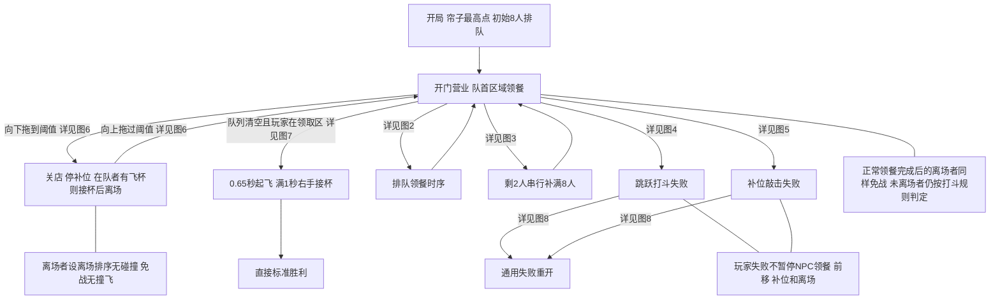

### 图 2 排队 3 秒领餐循环

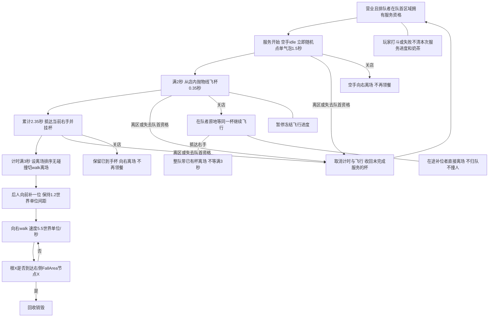

### 图 3 补位循环 剩2补满8

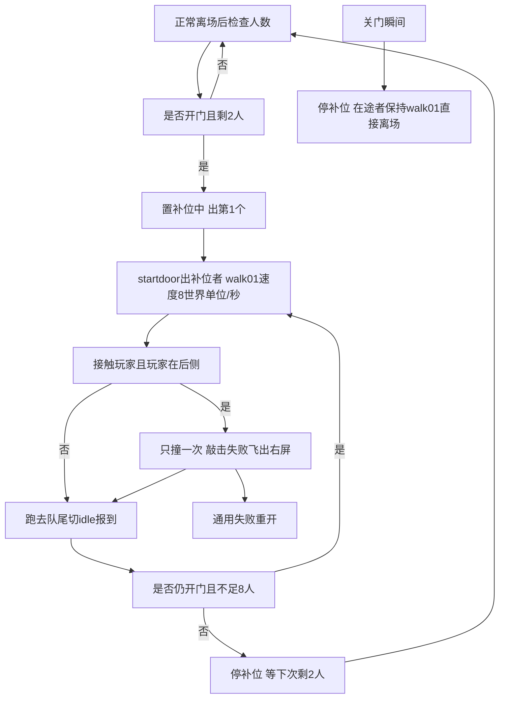

### 图 4 跳跃打斗失败链

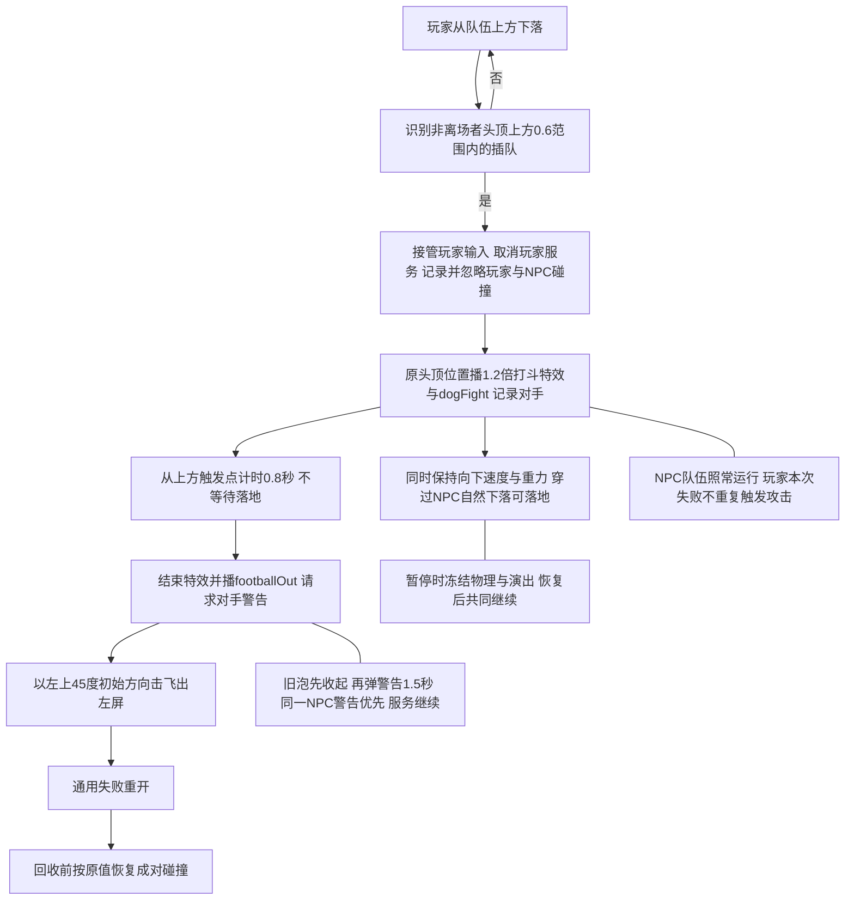

### 图 5 补位敲击失败链 083 链

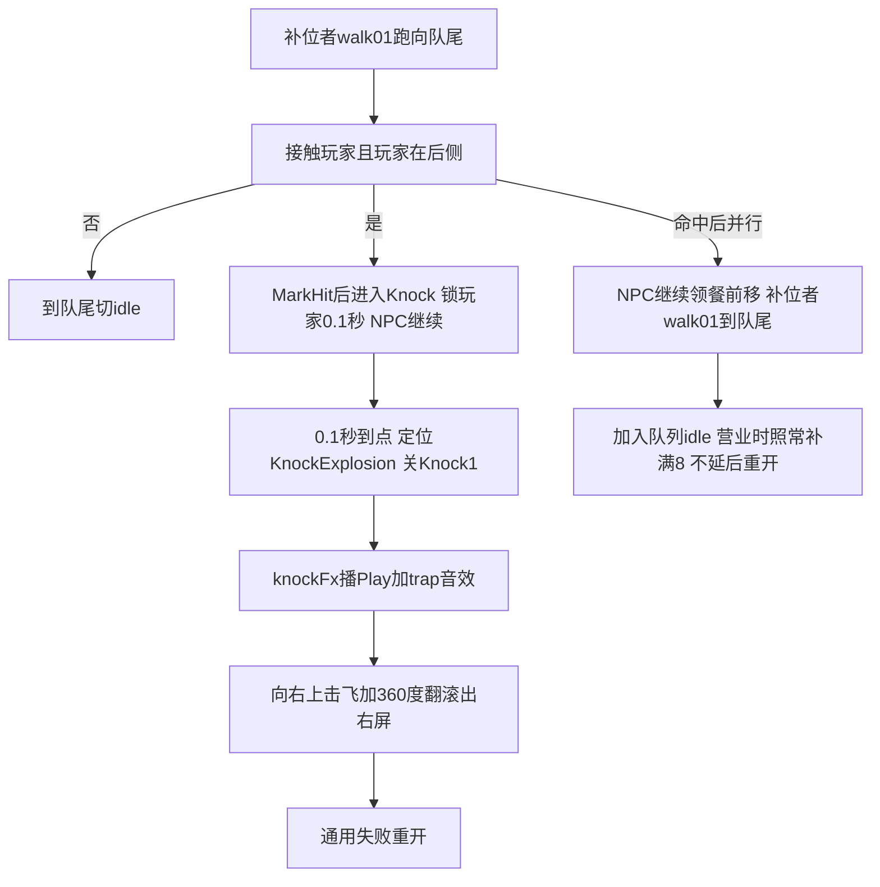

### 图 6 帘子拖拽与营业阈值

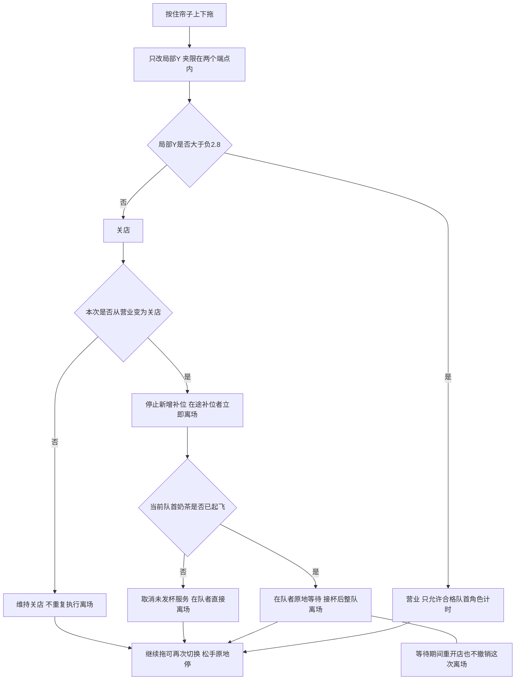

### 图 7 玩家队首领餐与直接胜利

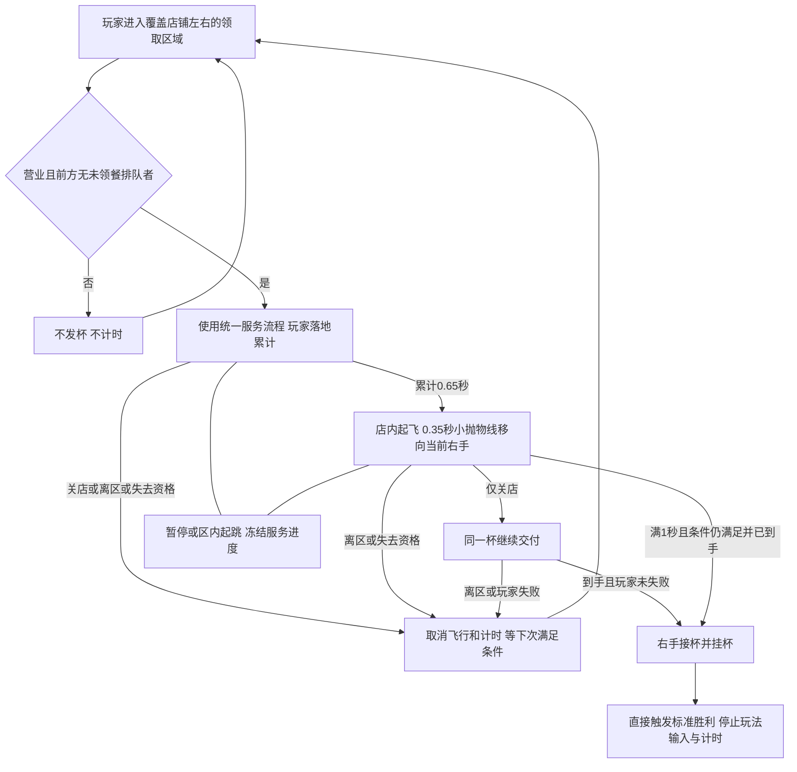

### 图 8 失败重开销毁顺序

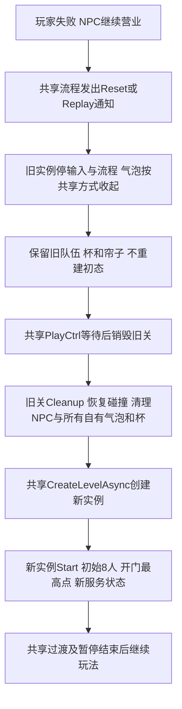

## 状态迁移逐项说明

本节对应当前代码，而不是理想化的状态机。只有`Phase`是本关枚举；杯、NPC、服务和气泡表中的阶段名称是对现有标志组合的解释。所有“继续”都受各自门禁约束，不代表暂停、重建或对象丢失后仍无条件推进。

### Phase：7个主阶段

| Phase | 进入来源及动作 | 持续行为、正常离开与中断 |
|---|---|---|
| `Inactive` | 枚举零值；SpawnActor初始化失败、StopForReset或Cleanup也写入 | CanInteract和CanAdvanceQueue均为false。只有新实例Start通过初始化才转Playing；并不存在把已清理旧实例重新置Playing的恢复入口 |
| `Playing` | Start完成主要接线与玩家杯创建后置位，随后生成初始队伍 | 允许拖帘和危险检测；NPC服务、补位与离场运行。上方接触进入Fight，后侧补位接触进入Knock；玩家有效接杯进入Won；死亡/失败事件进入Failed |
| `Fight` | BeginFailure(true)记录对手和接触点，保存向下速度，锁输入、忽略玩家/NPC碰撞，立即播放打斗 | 玩家仍能自然下落；NPC继续服务。后续LateUpdate按phaseElapsed累计0.8秒，版本匹配才LaunchPlayer→Flying并请求对手警告。失败事件可提前转Failed，中断时不补警告 |
| `Knock` | 后侧接触先MarkHit，再BeginFailure(false)；failureHolding=true并关闭玩家模拟 | 保留0.1秒停顿，NPC继续。到点LaunchPlayer播放爆点/trap、恢复模拟并向右上击飞→Flying；不会请求防插队警告 |
| `Flying` | LaunchPlayer执行共享Knockback后写入；并不等于Actor.IsDied已经成立 | 本关每秒绕本地Z轴旋转720度，NPC继续。真实FailArea/Trap或发现IsDied→Failed；没有“按飞行时长直接重开”的分支 |
| `Won` | CompletePlayerService先置位、关控制，保留玩家手杯，调用共享SuccessStrightly | 不再推进NPC/服务/拖帘/危险检测。共享负责后续收星和SUCCESS；本关的Won不表示弹窗已经显示。StopForFailure明确不覆盖Won |
| `Failed` | StopForFailure由失败事件、玩家IsDied或共享状态通知进入；只取消玩家服务、清未发出的警告对手 | NPC服务、关店待交付、补位和离场仍可继续；玩家不再具备领取资格。等共享Reset/Replay转Inactive，或随退出销毁；不会自行转Won |

**初始化不是事务**：Start的必要引用/服饰池/HintBubble/玩家杯失败会记录错误并禁用总控，OnDisable再清理；但SpawnActor初始化失败只回收该次失败克隆并置Phase.Inactive，之前已创建的对象留到后续清理。Start在SpawnInitialQueue之前已经写started=true，不能把“8人全部生成成功”当作started的定义。

**同名状态不等价**：本关`Phase.Failed`表示玩家失败后的本关处理。共享`GamePlayStateName.FAILED`节点OnEnter会DestroyLevel并记录退出；它不是保证NPC还能长时间运行的“等待失败重启”节点。普通失败路径由BaseLevelCtrl等待后派发GameResetEvent，本关在旧实例存在期间继续NPC流程。

### 图9：Phase全状态与生命周期入口

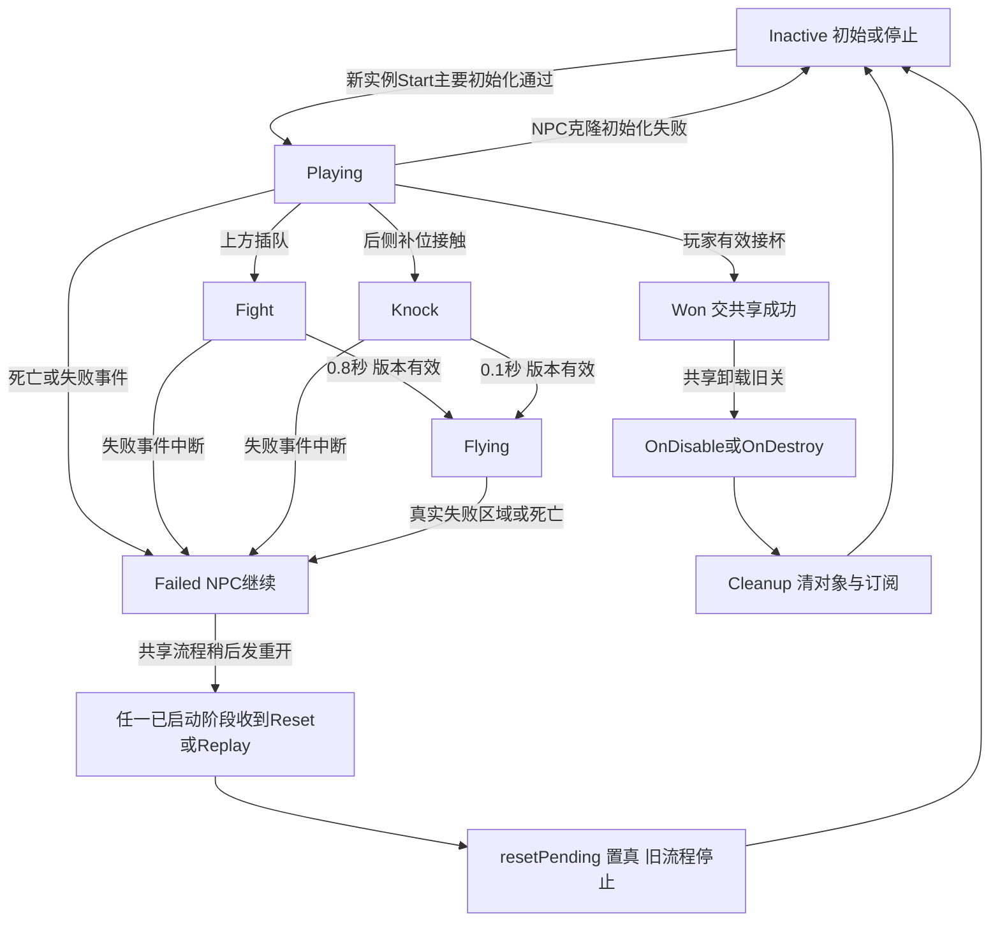

共享WaitingFail当前没有调用Actor.Die（该行是注释），而Trap的WaitPlayDie会调用Die。因此进入本关Failed不保证Actor.IsDied一定已经为true；不能只看这一个共享属性判断是否已经进入失败收尾。

### 玩家门禁、队伍门禁与独立时钟

| 条件/工作 | CanInteract | CanAdvanceQueue | 额外边界 |
|---|---|---|---|
| started、active/enabled、非resetPending、非paused，且Playing | true | true | CanInteract不额外检查BaseLevelCtrl.ActorCtrlable；共享出门/UI阻挡是另一层 |
| 同上但Fight/Knock/Flying/Failed | false | true | 不接受玩家拖帘或新攻击，仍服务NPC |
| Inactive、Won或公共前置条件不满足 | false | false | 无槽位移动、服务计时或新补位 |
| 待显示警告warningPending | 不以此为门禁 | 不以此为门禁 | LateUpdate开头处理；要求started、有效旧关、失败阶段及发言者存在，但不检查paused |
| 已显示共享HintBubble | 不以此为门禁 | 不以此为门禁 | 显示/收起等待和文字Tween归共享，普通NPC服务取消只关闭点单，不撤销已显示警告 |

`paused`只冻结本关负责的时钟和表现，不是Time.timeScale=0。普通玩家物理/Spine沿003共享行为；只有失败阶段且未持有快照时才捕获玩家速度/模拟并冻结，RestorePhysicsPause只还原本关已持有的快照。NPC动画、打斗Animator和敲击粒子有自己的暂停处理，短音效与共享出门/成功/Knockback等待没有统一事务暂停。

### 图10：FixedUpdate与LateUpdate优先级

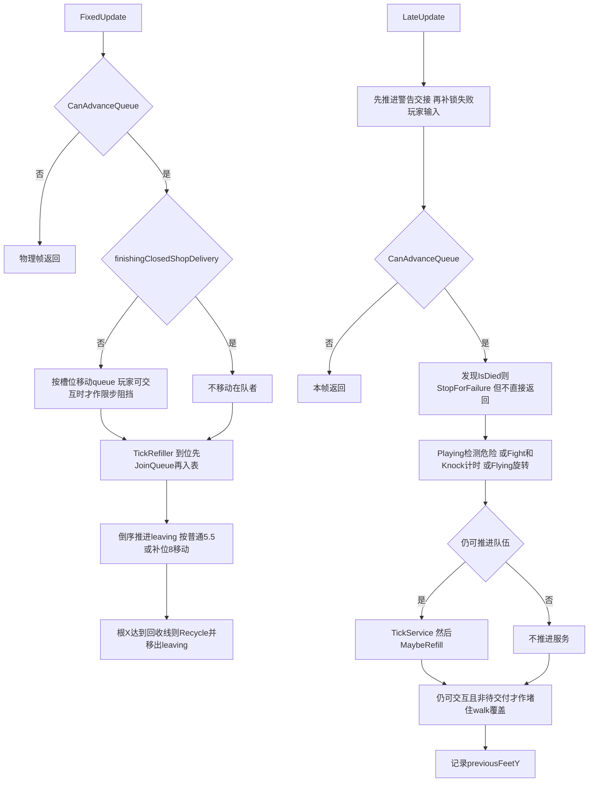

- 在Playing分支中触发BeginFailure的当帧不会重新进入Fight/Knock计时分支；但后面的NPC服务仍会推进。LaunchPlayer发生帧也不会同时执行Flying分支的旋转，旋转从后续LateUpdate开始。
- Fight/Knock内presentationSession不匹配时直接return，连本帧后续NPC服务也跳过；正常Reset/Cleanup同时改变Phase，不能把版本检查画成独立重生机制。
- TickService若置Won，后续MaybeRefill仍会被调用，但它的CanAdvanceQueue守卫拒绝生成。FixedUpdate与LateUpdate之间没有用于互斥的独立事务对象，物理接触和外部事件的实际顺序仍为uncertain。

### 图11：服务选择与关店待交付

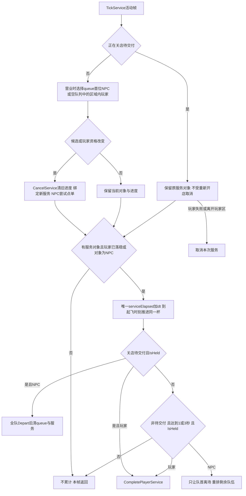

| 服务组合/事件 | 当前实际处理 |
|---|---|
| servedNpc=null且servingPlayer=false | 不累计；NPC候选和玩家资格变化时可重新绑定 |
| 普通NPC服务 | shopOpen、queue非空、queue[0]中心在headZone；服务3秒，2秒开始飞杯 |
| 普通玩家服务 | CanInteract、未死亡、shopOpen、queue为空、inflight为空、中心在playerServiceZone；随后要求IsGround且竖直速度绝对值≤0.1才累计 |
| 关店时没有飞杯 | 立即停refilling，在途者直接离场，整队Depart；取消未完成服务，已经到手的杯保留 |
| 关店时当前杯IsFlying | 在途者仍立即离场；保留serviceElapsed和原接收者，queue原地idle并关闭主Collider，finishingClosedShopDelivery=true |
| 待交付时重新开店/再关店 | shopOpen可改变，但不清待交付进度，不恢复槽位移动、攻击、新服务或补位；接杯后仍执行原离场 |
| 待交付完成 | NPC不再等原3秒，IsHeld就整队离场；玩家走同一成功入口。leaving成员从来不占领取资格 |
| 玩家区内起跳 | 先确认资格/区域，再冻结计时与飞行；跳出区域仍取消。关店只豁免营业条件，不豁免玩家离区和失败 |
| Reset/Replay | 停止旧流程，不立刻隐藏旧杯或恢复队伍；真正Cleanup时CancelService、Dispose并清待交付标志 |

这里没有“必须关店过一次”的条件，也没有记录玩家从队尾走到店前的路线历史。禁止抢领由queue/inflight占用与危险检测表达；关店清队后直接站在整店宽度的玩家区，可在重新营业时开始服务。

### 图12：CupBinding全状态与所有权

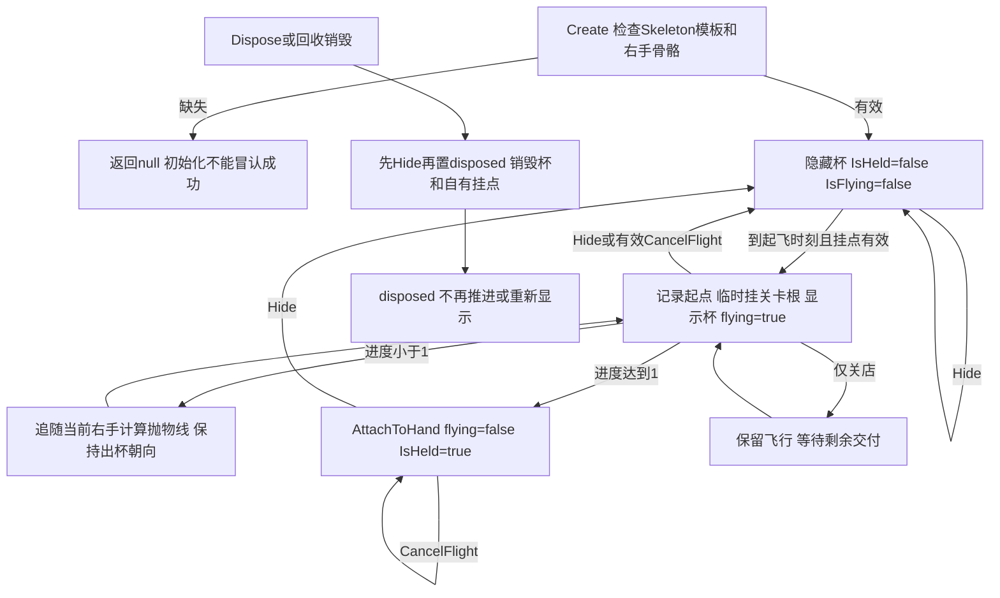

`CupBinding`不是MonoBehaviour，没有自己的Update、Tween或飞行计时；进度来自服务时钟。IsHeld是到达挂点后的状态标志，不是台上摆件的可见性。飞行暂停时仍为IsFlying，持杯时已不飞行；Dispose不把对象重新变为可用。

右手统一为Soft_arm_R下的Box_Center9s。Create只复用同骨架且绑定正确右手的handBone，否则创建本关自有BoneFollower；只销毁自建挂点，不删除共享/原有挂点。杯在飞行时脱离Actor子树，所以Recycle/OnDisable/OnDestroy和关卡Cleanup必须显式处理它。挂点暂时无效时UpdateFlight返回而不置IsHeld，服务时钟可能继续增长；恢复有效后可能直接跳到较后的进度，这不是完整运行恢复保证。

飞行杯临时处于关卡根排序作用域，接杯后返回Actor所属SortingGroup；内部sortingOrder始终为300，不代表两种父级下都处于同一全局显示层。挂手时是否出现遮挡跳变仍需人工观察。

### 图13：NPC成员集合与角色标志

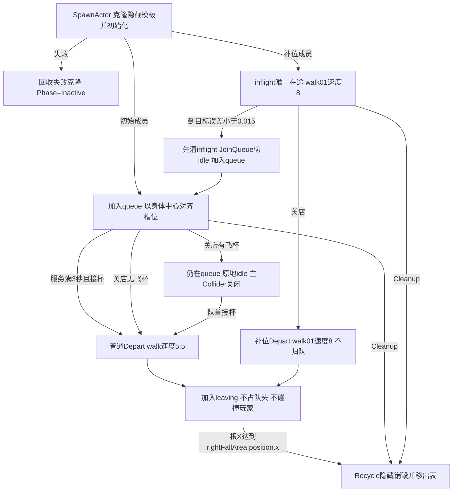

| 标志/集合 | 置位、清除及不能混同的含义 |
|---|---|
| queue / inflight / leaving | 正常逻辑分别为在队列表、唯一在途引用、离场列表；一个NPC正常转移时不同时留在两个集合。等待接杯的NPC仍在queue，不是leaving |
| IsRefilling | Initialize(refill)决定；JoinQueue或Depart清false。不是“曾经作为补位者出生”的永久身份 |
| IsRefillDeparture | Depart在清IsRefilling之前捕获；决定离场使用8/walk01还是5.5/walk，已归队者不保留补位离场速度 |
| IsLeaving | Depart置true，Initialize才复位；离场关闭主Collider，TickMove改用根X而非BodyBounds.center.x |
| HasHit | 只有后侧敲击命中前MarkHit置true，阻止0.1秒窗口重复；上方打斗不依赖它，主Phase阻止同次失败重复检测 |
| HasOrdered | 首次服务尝试点单时置true，即使因警告优先跳过也置位；取消资格或警告结束不重置 |
| WaitForClosedShopDelivery | 没有单独NPC等待枚举；关闭主Collider、清速度并播idle，是否停止移动由Ctrl的finishingClosedShopDelivery决定 |
| Recycle | 显式Dispose杯、SetActive(false)、Destroy对象；不是放回可再Initialize的池。衣服/额外饰物在移出存活成员集合后才可重用 |

**排序准确含义**：在队排序公式为`110-(queue.Count-1-i)`，初始队首103、队尾110；补位途中110。Depart使用运行时PlayerOrder-10。当前源Actor根为200且本关玩家实例没有排序覆写，因此静态推算离场为190：低于玩家，但高于在队103～110。不能把旧文档“降层级”理解为必定绘制在整个队伍后面；是否符合最终视觉需人工确认，本轮不修改排序。

### 图14：必穿衣服与额外饰物的占用

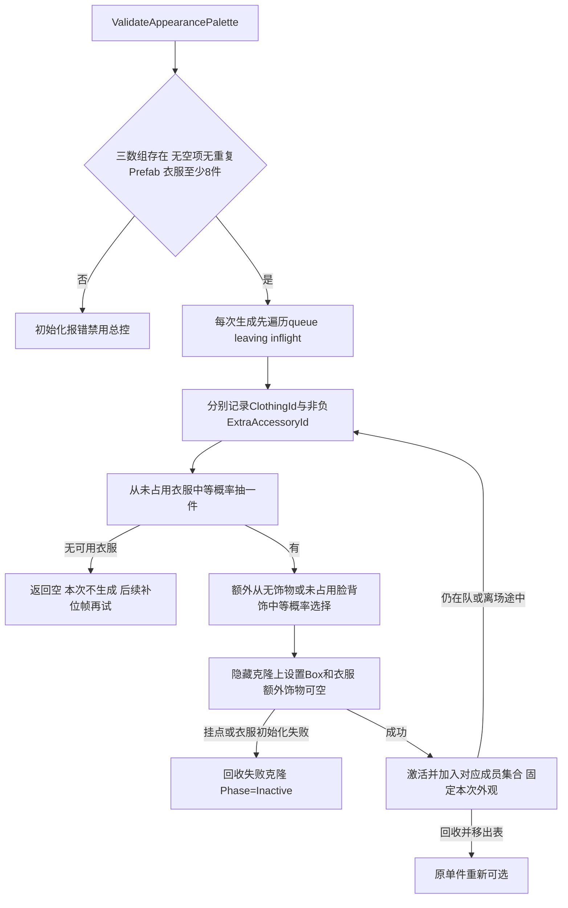

11件衣服与9件额外饰物是本次Prefab的候选数，不是写死在生成算法中的上限；额外的“不装饰”也参与等概率抽取，所以不是所有NPC都必有脸饰或背饰。Validate检查的是Prefab引用去重，不是逐像素外观判重；当前衣服源由静态美术审阅筛选。运行中重排数组会改变索引含义，不属于当前支持的热更新合同。

### 图15：点单到警告的顺序交接

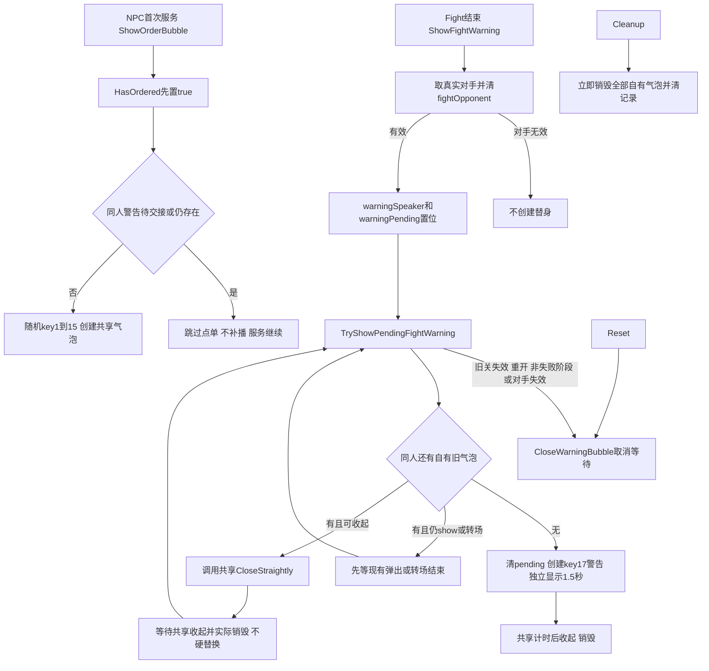

| 状态组合 | 实际职责 |
|---|---|
| fightOpponent非空、尚未LaunchPlayer | 仅记触发打斗的对手；不是已请求气泡。打斗提前被StopForFailure中断会清掉，不补播 |
| warningPending=true | 等待同人旧泡结束；HasOrdered抑制已生效，防止等待窗口插入新点单。可在本关paused时继续，因为共享气泡不是NPC服务时钟 |
| pending=false且warningBubble有效 | 警告已经创建，自己的1.5秒才开始；仍压制同NPC点单，其他NPC不受影响 |
| warningBubble自然销毁 | Unity空对象判断使抑制结束；warningSpeaker字段可暂留，不能仅凭它非空判定警告仍显示 |
| ownedSpeechBubbles | NpcSpeech记录气泡与发言者，包含正在收起或已经销毁的条目；下次Create时移除空条目，Cleanup清全部，不等于当前可见气泡数 |

共享CloseStraightly按动画时长等待后销毁，不是返回一个可await的公开“动画完成”句柄。本关检查旧实例不再存在才建新泡；旧show到idle要求show=true，因此替换前先等待show/转场结束。最终画面是否完整连续，仍依赖共享Controller、动画更新与异步销毁的实际时序，不因使用同一资源就视为已验证。

### 图16：帘子捕获与释放

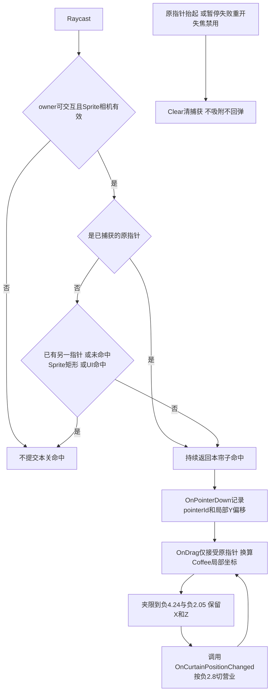

Raycast不调用EventSystem.RaycastAll，避免递归；它只逐个检查有效GraphicRaycaster。捕获后离开Sprite范围仍可拖，另一根手指不被本组件接管，可继续走共享UI。`eventCamera=null`用于屏幕捕获排序，真正坐标计算仍用序列化gameplayCamera。直接改Inspector里的帘子位置不会自动调用营业回调；当前营业判断入口来自OnDrag通知，不是每帧轮询位置。

OnPointerDown还要求Left按钮、当前没有已捕获指针且能取得平面交点；OnInitializePotentialDrag关闭拖动阈值。图16省略了重复判空，但并非任意鼠标按钮或无效相机射线都能开始拖拽。

### 中断与异常的真实边界

| 入口 | 当前处理 | 不能冒认的结论 |
|---|---|---|
| 普通暂停/恢复 | NPC/服务/飞杯暂停；普通玩家沿共享，失败玩家按快照恢复；清拖拽 | 不是全部共享等待、气泡、声音或物理都一起冻结 |
| 玩家失败 | 锁玩家，取消玩家服务；不取消NPC服务和补位；中断未结束打斗的警告请求 | 不是直接GamePlayStateName.FAILED，也不是立即重建旧关 |
| Reset/Replay | started=false时直接返回；已启动则resetPending=true、Inactive、停旧流程并关闭气泡 | 不等待队伍/飞杯/警告结束，不保证共享一定接受了同一重开请求 |
| Cleanup | 不恢复开局；清订阅/杯/气泡/NPC，归还已有物理与碰撞快照 | 不支持Disable后Enable同一实例自动开始新局；不回滚存档或共享已提交结果 |
| 资源/挂点异常 | 已有部分判空与停止分支；杯不到手就不结算 | 没有包住所有Tick的统一try/finally恢复事务；不能保证任意失效对象都自动离场或重启 |

## 数据结构架构图

以下是现有类的分逻辑投影；`- / + / ~`分别表示私有、公开和程序集内可见。Phase和NpcSpeech嵌套在Level138Ctrl，CupBinding嵌套在Level138QueueActor。重复出现同一类不代表新增了多套控制器；不再沿用旧稿中虚构的ActorState、ShopState或HeadService实现类型。

### 架构A1：主阶段与门禁

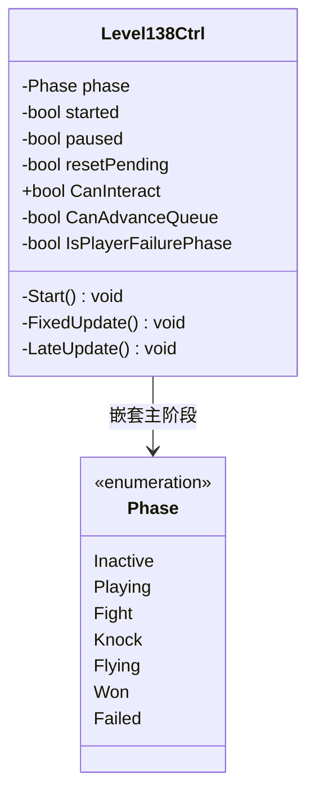

### 架构A2：队列、补位和单个NPC

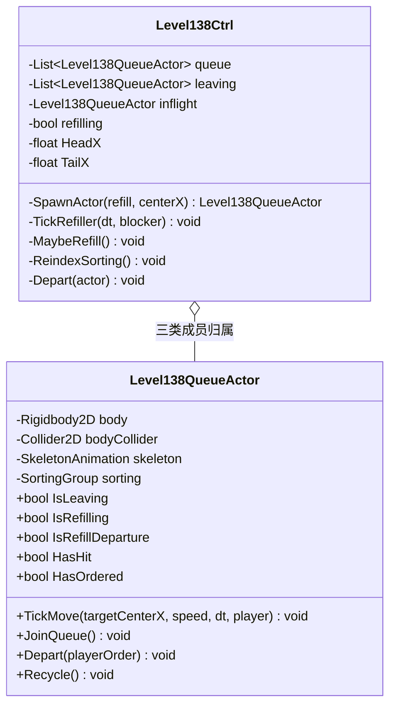

### 架构A3：服务与杯实例

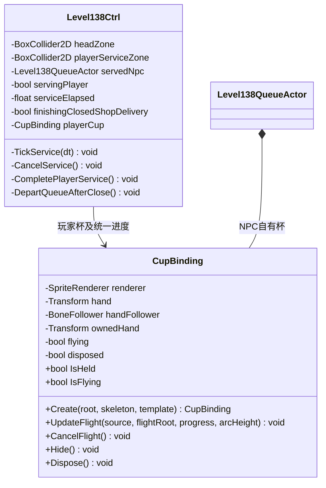

### 架构A4：衣服与额外饰物

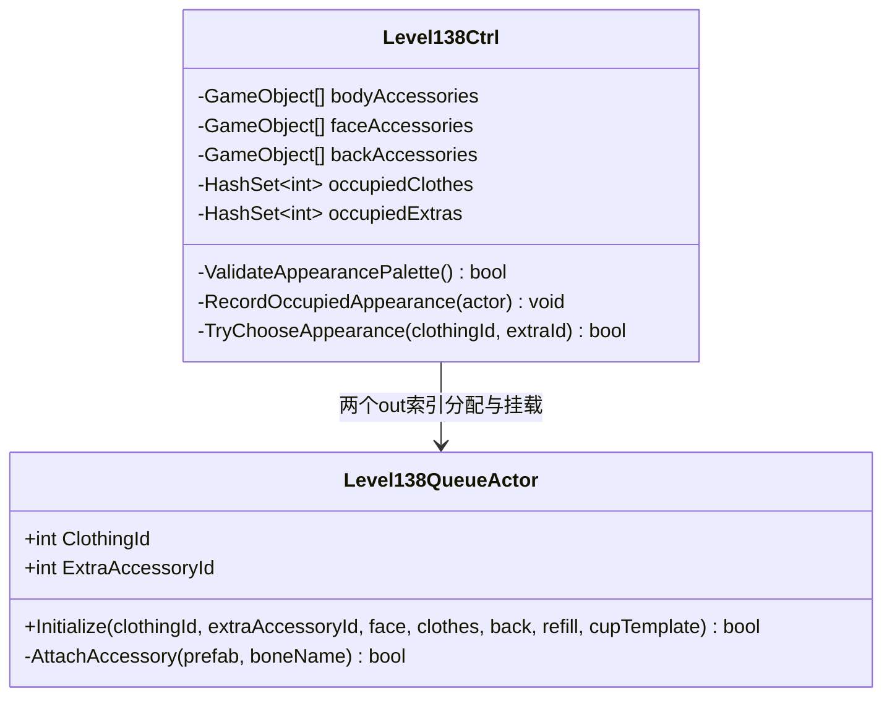

### 架构A5：失败、击飞与物理所有权

```mermaid
classDiagram
  direction TB
  class Level138Ctrl {
    -Animator fightAnimation
    -ParticleSystem knockExplosion
    -Level138QueueActor fightOpponent
    -float phaseElapsed
    -int session
    -int presentationSession
    -bool failureHolding
    -bool ownsPhysicsPause
    -Dictionary queueCollisionSnapshot
    -CheckDanger() void
    -IsQueueEntryFromAbove(actor, playerBounds) bool
    -HeadContact(actor, playerBounds) Vector3
    -BeginFailure(fight, point, opponent) void
    -LaunchPlayer() void
    -RestorePhysicsPause() void
    -RestoreQueueCollisions() void
  }
  class ActorCtrl {
    +Knockback(dir, force, knockDuration) UniTask
    +StopMoving() void
    +ResumeMoving() void
  }
  Level138Ctrl --> ActorCtrl : 共享击退 不复制死亡重开
```

queueCollisionSnapshot实际为`Dictionary<Collider2D,bool>`，记录玩家主Collider与本关NPC主Collider的原始忽略值；不是全局Layer碰撞表。旋转由Ctrl的LateUpdate直接处理，不存在ActorCtrl.Roll360方法。

### 架构A6：帘子输入

```mermaid
classDiagram
  direction TB
  class Level138CurtainDragInput {
    -Level138Ctrl owner
    -SpriteRenderer curtain
    -Camera gameplayCamera
    -Nullable~int~ activePointer
    -float grabOffsetY
    +Raycast(data, results) void
    +OnPointerDown(data) void
    +OnInitializePotentialDrag(data) void
    +OnDrag(data) void
    +OnPointerUp(data) void
    +Clear() void
    -TryWorldPoint(screen, world) bool
  }
  BaseRaycaster <|-- Level138CurtainDragInput
  Level138CurtainDragInput --> Level138Ctrl : OnCurtainPositionChanged
```

### 架构A7：点单、警告及共享气泡

NpcSpeech实际是总控内的struct，只有Bubble和Speaker两个公开字段；下面的类图框用于展示该数据结构，不表示新增MonoBehaviour。

```mermaid
classDiagram
  direction TB
  class Level138Ctrl {
    -HintBubble orderBubble
    -HintBubble warningBubble
    -bool warningPending
    -Level138QueueActor warningSpeaker
    -List~NpcSpeech~ ownedSpeechBubbles
    -ShowOrderBubble(actor) void
    -CreateSpeechBubble(key, speaker, bubbleName) HintBubble
    -ShowFightWarning() void
    -TryShowPendingFightWarning() void
    -CloseWarningBubble() void
    -DisposeSpeechBubbles() void
  }
  class NpcSpeech {
    +HintBubble Bubble
    +Level138QueueActor Speaker
  }
  class HintBubble {
    +Show(txtId, actor, disapprearTime) void
    +CloseStraightly() void
  }
  Level138Ctrl *-- NpcSpeech : 嵌套归属记录
  NpcSpeech --> HintBubble
  NpcSpeech --> Level138QueueActor
```

### 架构A8：共享交接与旧关清理

```mermaid
classDiagram
  direction TB
  class Level138Ctrl {
    -BaseLevelCtrl levelCtrl
    -EventSubscriber subscriber
    -OnGameStateChanged(evt) void
    -SetPaused(value) void
    -ApplyPresentationPause(value) void
    -StopForFailure() void
    -StopForReset() void
    -Cleanup() void
    -RecycleQueue() void
    -OnDisable() void
    -OnDestroy() void
  }
  class BaseLevelCtrl {
    +SuccessStrightly() void
    +CheckFinished() void
    -WaitingFail() UniTask
    -TryToRestart() void
  }
  class PlayCtrl {
    -OnGameResetEvent(evt) void
    -ResetGame() UniTask
    -ReplayGame(levelPath) UniTask
    +CreateLevelAsync(levelName) UniTask
  }
  Level138Ctrl --> BaseLevelCtrl : 成功请求与玩家输入门禁
  Level138Ctrl ..> PlayCtrl : 同一事件系统 各自响应Reset
  BaseLevelCtrl ..> PlayCtrl : Failed类型GameResetEvent
```

## 函数清单与伪代码

下表列实际代码入口；后面的摘要仅压缩关键条件，不是可直接编译的新实现。共享方法只描述138直接调用/交接的部分，不复制另一套成功、存档或重建逻辑。

| 归属 | 实际函数/属性组 | 职责 |
|---|---|---|
| Level138Ctrl | Awake / Start | 订阅事件、初始暂停、引用/服饰/杯校验、创建初始队伍 |
| 同上 | FixedUpdate / LateUpdate / CanInteract / CanAdvanceQueue / IsPlayerFailurePhase | 运动与表现时序，玩家和队伍门禁分离 |
| 同上 | OnCurtainPositionChanged / SetCurtainOpen / InsideZone | 单阈值通知、最高点初态及两个区域的局部矩形检测 |
| 同上 | TickService / CancelService / CancelPlayerService / CompletePlayerService / DepartQueueAfterClose | 唯一服务时钟、关店已发杯例外、取消与标准胜利 |
| 同上 | SpawnInitialQueue / SpawnActor / MaybeRefill / TickRefiller / ReindexSorting / Depart | 初始8人、串行补位、归队、排序和离场 |
| 同上 | ValidateAppearancePalette / RecordOccupiedAppearance / TryChooseAppearance | 衣服必选、额外随机、三成员集合占用去重 |
| 同上 | ShowOrderBubble / CreateSpeechBubble / ShowFightWarning / TryShowPendingFightWarning | 点单一次门禁、共享资源实例、对手警告与顺序交接 |
| 同上 | CloseOrderBubble / CloseWarningBubble / DisposeSpeechBubbles / NpcSpeech | 共享收起、取消待交接、气泡与发言者归属清理 |
| 同上 | CheckDanger / IsQueueEntryFromAbove / HeadContact / IsBlockedByQueue | 上方打斗、后侧敲击及普通堵住动画条件 |
| 同上 | BeginFailure / LaunchPlayer / HideEffects | 下落/停顿、0.8/0.1阶段时钟、共享Knockback、音效和特效 |
| 同上 | IgnoreQueueCollisions / IgnoreQueueCollision / RestoreQueueCollisions | 本关成对碰撞忽略、原值快照与恢复 |
| 同上 | SetPaused / OnGameStateChanged / ApplyPresentationPause / RestorePhysicsPause | NPC与失败玩家的暂停所有权，普通玩家沿共享 |
| 同上 | StopForFailure / StopForReset / Cleanup / RecycleQueue / OnDisable / OnDestroy | 停玩家不暂停NPC、旧关停流程、销毁清理与共享重建边界 |
| Level138QueueActor | Initialize / AttachAccessory / SetSorting / Play | NPC身份、运动学刚体、Box与服饰/挂杯初始化、动画去重 |
| 同上 | MarkHit / MarkOrdered / JoinQueue / TickMove | 一次标志、报到、按身体中心/根X移动与玩家限步 |
| 同上 | HideCup / WaitForClosedShopDelivery / Depart / SetPaused / Recycle / OnDisable / OnDestroy | 等杯、离场动画/速度身份、暂停、杯和对象清理 |
| CupBinding | 构造函数 / Create / UpdateFlight / CancelFlight / Hide / AttachToHand / Dispose | 右手绑定、隐藏/飞行/持杯标志、同一杯实例的父级切换与所有权 |
| Level138CurtainDragInput | Raycast / OnPointerDown / OnInitializePotentialDrag / OnDrag / OnPointerUp | Sprite命中、原指针捕获、零拖动阈值、坐标夹限和通知 |
| 同上 | TryWorldPoint / Clear / OnDisable / OnApplicationFocus | 射线与平面交点、释放/失焦/禁用清理 |

### 领餐与交付条件摘要

```csharp
// 真实字段条件，省略判空/表现细节；不是另一套Recipient或HeadService类型。
eligiblePlayer = CanInteract && !player.IsDied && shopOpen
    && queue.Count == 0 && inflight == null
    && InsideZone(playerServiceZone, playerBody.bounds.center);
// NPC候选只取queue[0]，区域为headZone；不检查leaving来阻挡玩家。
// 先取消无效资格，再因玩家未落地或竖直速度超过0.1而返回。
serviceElapsed += dt; // 唯一累加点，关店待交付也复用它
flightStart = servingPlayer ? max(0, playerDuration - flightDuration) : npcCupTime;
progress = (serviceElapsed - flightStart) / flightDuration;
// 达到起飞时刻才UpdateFlight；仅IsHeld后允许结束。
// finishingClosedShopDelivery：NPC整队离场，玩家CompletePlayerService；
// 普通服务：还须达到playerDuration/npcDuration，再完成玩家或只让NPC队首离场。
```

### 关店与快速重开店摘要

```csharp
// OnCurtainPositionChanged只在CanInteract且阈值状态变化时进入。
shopOpen = curtain.localPosition.y > closeThresholdY;
// 关店：refilling=false；已有inflight先Depart并清引用；关闭点单。
// currentCup.IsFlying为true：只置finishingClosedShopDelivery并让queue等杯，保留serviceElapsed。
// 否则DepartQueueAfterClose：先Depart全部queue，再Clear，再CancelService。
// 重新开店：待交付时不恢复补位；非待交付且queue.Count为1或2才设置refilling。
// queue为0不会因为开门自动重新生成8人，也不直接给远处玩家发杯。
```

### 气泡交接与重开摘要

```csharp
// ShowOrderBubble：先HasOrdered判重，再MarkOrdered；同人warningPending/有效warningBubble则跳过。
// ShowFightWarning取fightOpponent并清原引用；有效才设置warningSpeaker与warningPending。
// TryShowPendingFightWarning：失效旧关/对手则取消；同人旧泡仍show/转场则等，否则共享CloseStraightly。
// 只要同人旧泡仍存在，本帧就不创建警告；全部销毁后清pending并CreateSpeechBubble(key17)。
// StopForReset：resetPending=true，session++，phase=Inactive，停旧流程/关闭气泡；不重建队伍。
// Cleanup：started=false，解绑事件，清气泡与服务/杯，恢复碰撞并回收NPC，归还本关物理快照。
```

## 关键规则与当前标定

### 排队装饰组合

- 初始8人和后续补位者均用 `box_original`，每人必须随机穿一件不重复衣服；脸饰/背饰额外随机0或1件，也不重复。衣服不能由眼镜或背饰替代，玩家自身外观和存档不改。
- 衣服池扩为11件：`Assets/Game/Prefabs/Skins/Sp_zs_fz_img_001、002、004、005、006、011、012、014、015、016、018.prefab`；已静态查看对应衣服图片，排除飞碟、赛车、泳圈、鲸鱼、蛋糕等身体道具。额外池仍为 `Sp_zs_img_001..008` 八件脸饰及 `Sp_bs_img_001` 翅膀，不改共享资源。衣服、骨骼与奶茶的实际遮挡仍为uncertain。
- `TryChooseAppearance`分别抽取必选衣服与可选额外单件，ClothingId是衣服池索引，ExtraAccessoryId是脸/背串联索引（-1为不加额外饰物）；queue/inflight/leaving共同登记两个占用集合，回收后才释放。衣服池用尽等回收，额外池用尽允许只穿衣服；生成后不换装。Actor根SortingGroup仍后排高于前排，服饰保持在所属Actor内部排序。
- 在隐藏模板克隆激活之前，同步设置Box并挂装饰，初始化失败则回收并停止本关玩法。复用Actor现有 `point01` 脸、`point02` 身体、`point` 背部BoneFollower；脸/身体沿用内部层级10/2，背饰实例Sprite为-1，手杯300。装饰子树由NPC拥有，回收/重开/退出随角色销毁；不启用玩家ActorSkinBinding，不读取解锁或写入存档，也无异步加载回调。

### 点单气泡与I2文案（2026-09-15确认）

- NPC首次进入队首服务时**立即**随机抽取一句点单，一人一次；调用共享气泡的1.5秒显示时长，到时开始共享收起动画，不是1.5秒到点硬销毁。补位者排到队首同样适用，玩家不点单；只随机台词，不随机延迟，不改变2秒飞杯/3秒离场时序。
- 与BaseLevelCtrl一致，调用 `Resources/HintBubble` 的 `Show(I2Key, actorTransform, 1.5f)`，由共享组件负责自动计时、开场、文字渐显、收起和语言刷新；暂停也沿用共享，不再绑定serviceElapsed或逐帧控制内部Animator/Tween。气泡暂停行为与本关NPC服务/飞杯冻结规则分开；不改共享Prefab、脚本或全局timeScale。
- 字体和字号完全复用共享资源：HintBubble内嵌Tips的TextMeshPro使用Twinkly SDF；共享气泡序列化基础字号4、最小2、最大20，HintBubble.RefreshTips在显示时启用自动字号。138不覆写字体、字号或范围，因此长句可能按共享规则缩小，并非固定显示4号字；实际字形与最终字号未运行验证。
- 本关在LateUpdate创建气泡，Show后仅调用一次本实例 `Animator.Update(0f)` 采样共享show动画首帧，避免先显示Prefab单位缩放、下一帧才从零弹出。保留Prefab原默认缩放，不预写零值，以免Write Defaults把idle恢复值记成零。这针对静态发现的首帧时序风险，不代表已经运行确认闪现完全消失。
- `HasOrdered`记录一次性点单，服务资格取消后再取得也不重说；警告等待交接及显示期间优先，消费该次点单机会而不补播，不改变服务时钟。点单转警告先用共享CloseStraightly收起旧泡，等其自行销毁后再弹警告，不硬销毁或叠泡；只有关卡禁用/销毁统一立即清理全部自有气泡。
- `Assets/Resources/I2Languages.asset` 本关共以下17个Text条目，沿用76种语言槽位：1～15点单、17警告仅填zh-CN，16 coffee仅填en，其它留空；源既有Fallback策略不改。点单随机范围仍只有1～15，警告与coffee不参与随机点单。

| I2 key（统一前缀 `S_LevelTips_Des_level_138_`） | 当前文案 | 已填语言 |
|---|---|---|
| `1` | 来一杯百香果醋 | zh-CN |
| `2` | 来一杯蜂蜜绿茶 | zh-CN |
| `3` | 来一杯全家QQ奶茶 | zh-CN |
| `4` | 来一杯QQNeNe好喝到咩噗茶 | zh-CN |
| `5` | 来一杯百香QQ | zh-CN |
| `6` | 来一杯奇异果鲜奶 | zh-CN |
| `7` | 来一杯巧克力奶茶 | zh-CN |
| `8` | 来一杯草莓鲜奶 | zh-CN |
| `9` | 来一杯梅子醋 | zh-CN |
| `10` | 来一杯丝袜奶茶 | zh-CN |
| `11` | 来一杯草莓奶茶 | zh-CN |
| `12` | 来一杯柠檬醋 | zh-CN |
| `13` | 来一杯蛋蛋奶 | zh-CN |
| `14` | 来一杯芒果醋 | zh-CN |
| `15` | 来一杯榛果奶茶 | zh-CN |
| `16` | coffee | en |
| `17` | 不可以插队哦！ | zh-CN |

### 打斗放大与防插队警告

- 本关FightAnimation根（Transform `138100000000000301`）缩放由(1,1,1)改为(1.2,1.2,1.2)，不改接触位置、0.8秒时长、击飞方向/力度或Knock_Explosion。共享Dog_Fight动画仅切换Sprite，没有缩放曲线；不修改共享动画资源。
- 两个跳跃打斗入口（在队NPC、在途补位者）在BeginFailure时保存真正的fightOpponent，补位敲击入口不保存。LaunchPlayer先隐藏打斗特效，再在同一结束节点调用ShowFightWarning请求key17；有旧气泡则先完成收起再显示，没有则直接显示。不根据当前队首重新选人，允许已离场但仍存在的对手发言。
- 点单与警告共用CreateSpeechBubble、HintBubble资源、字体/自动字号及共享收起。打斗结束先置warningPending：同一NPC有旧泡时，等待旧泡完成共享收起并销毁后才创建警告；没有旧泡立即显示。警告出现后才开始自己的1.5秒时长，不扣除旧泡收起时间；等待和显示阶段均抑制该NPC点单并标记已点单，不补播，服务和其它NPC照常继续。
- TryShowPendingFightWarning在LateUpdate中独立于NPC服务门禁处理交接，沿用共享气泡暂停行为。共享show到idle转场要求show=true，旧泡尚在show或转场时先让其完成，再调用CloseStraightly；否则过早关闭可能使旧泡无法进入收起状态。不手动强切Animator状态或另造关闭计时，最终以旧实例已销毁为新警告出现的前提。
- ownedSpeechBubbles保存气泡与发言者，警告不因普通NPC服务完成/离场而被CancelService清掉。Reset关闭点单和警告、清尚未发言的对手；Cleanup统一销毁全部气泡。打斗在正常结束前被失败/重开中断或对手已经销毁时不补播，不产生替身。打斗阶段的真正暂停冻结0.8秒时钟；气泡一旦出现，暂停行为沿共享。

### 关店待交付（当前确认）

- 关店只取消尚未起飞的服务；已起飞的同一杯保留起点、当前进度与当前服务对象，继续原0.35秒飞行的剩余部分，不隐藏、不重新起飞。
- `finishingClosedShopDelivery`标记待交付，仍由唯一serviceElapsed驱动；在队NPC停止槽位移动并播放idle，关闭主碰撞体，不再阻挡玩家或触发打斗。队首接杯后经DepartQueueAfterClose一次性离场，不等NPC原3秒服务时长；若关店时已接杯，则直接离场。
- 已有在途补位者在关店瞬间Depart并从inflight移走，保持原速度8与walk01直接向右离场；不再去队尾、不切idle等待，也不敲击、阻挡或推走玩家。Depart在清IsRefilling之前记录IsRefillDeparture，动画与总控离场速度均按该标记选择；已归队者仍按普通walk、速度5.5离场。
- 等待期间重新开店只更新营业状态，不能恢复队列移动、攻击、新服务或补位。接杯后仍完成原关店离场；存量清空后才回到普通服务检查，不自动生成新队伍。
- 玩家已经起飞的杯也不因关店取消，到手调用同一CompletePlayerService标准胜利入口；玩家离区、失败及重开/销毁的原取消边界不变，区内起跳和暂停仍冻结服务进度。NPC待交付在玩家失败期间继续，真正暂停才冻结；Reset只停旧关，Cleanup取消飞杯并回收全部实例。

### 统一领餐条件与不同计时

- 玩家不能在仍有在队成员时绕到店前抢领；当前代码以queue/inflight是否清空表达资格，不记录玩家行走路线。空中不累计，区内有效进度保留至落地；离区或失去资格取消。关店尚未发杯则取消，已经发杯则完成剩余交付，到手仍可胜利。
- 补位敲击与跳跃打斗仅在正常营业排队阶段触发。关店停新增补位，在途者立即免碰撞离场；在队者有飞杯则原地等交付，不再参与攻击或互挡；重新开店也不取消这次收尾。
- NPC仍以原队首区域检测身体中心，并要求实际排到队头；玩家改用独立的玩家领取区域，横向覆盖店铺左右两侧。两者都不是身体边缘相碰即计时，也不能只靠开店事件发杯；玩家前面仍有未离场的在队者时不能抢领，已经转为离场的成员不再占资格。
- 共用服务时钟及原资格规则；仅关店已发杯进入待交付例外，不再受营业状态变化取消。未发杯关店、玩家离区或失去资格仍取消；暂停冻结进度，不累计暂停时间。
- 玩家进入失败流程不是NPC服务资格失效：当前NPC已累计的时间、尚在飞行的杯子以及已到手杯均保留，仍到原3秒节点才正常离场，不提前给全队发杯。只有当前服务对象是玩家时，失败入口才取消该玩家服务；失败期间NPC继续使用同一个服务时钟。
- **玩家：**持续保持资格并落地累计，0.65秒从店内起飞，最后0.35秒移向当前右手；满1秒且奶茶已抵达右手后才触发一次标准胜利。区内起跳冻结服务计时及飞行画面，落地续计；不额外增加0.35秒等待。开局营业本身不发杯，无须先操作帘子。
- **排队者（含已入队补位者）：**正常营业仍前2秒空手，满2秒起飞、2.35秒接杯、3秒离场；正常服务资格失效仍取消。关店若杯已起飞，则整队原地等接杯，接到即一起离场；未发杯不补发，已持杯直接带杯离场，不在离场路径交付。
- **共用飞行：**只有合格服务对象能启动飞杯，起点只采样一次，终点每帧对准当前右手；同一服务进度驱动，暂停和区内起跳不会被独立动画时钟绕过。关店不取消已启动的飞杯；玩家离区/失败、重开停止和退出清理仍按原边界处理。
- 一次只服务实际队首角色；玩家奖励与胜利每局最多一次，不能因帘子反复越过阈值重复发奖。队首区域已按下节规格序列化，玩家与 NPC 的中心统一取根主 `PolygonCollider2D.bounds.center`，不取身体边缘、脚底或 Spine 根。

### 窗口左侧领餐位置参考

用户最终选择窗口左侧，以当前 Coffee 下奶茶摆件所在位置作为队首区域的美术参考，不使用窗口中央或右侧角色位置。当前保存的三个奶茶摆件如下；它们仅提供横向定位参考，不把摆件高度当作角色中心高度。

| 奶茶摆件 | 相对 Coffee 的位置 | 当前世界位置 |
|---|---|---|
| `Sp_l138_d_04 (2)`（最左） | `(1.27, -4.09, 0)` | `(5.65, -1.17, 0)` |
| `Sp_l138_d_04 (1)` | `(1.70, -4.09, 0)` | `(6.08, -1.17, 0)` |
| `Sp_l138_d_04` | `(2.11, -4.09, 0)` | `(6.49, -1.17, 0)` |

NPC队首区域保持以下规格，不随玩家范围扩大而改变：

| 项目 | 已确认值或规则 |
|---|---|
| 横向参考 | 窗口左侧中间杯 `Sp_l138_d_04 (1)` 左侧1世界单位（2026-09-15整体左移确认） |
| 区域中心 X | 当前世界 `5.08`，对应 Coffee 局部 `0.70` |
| 区域宽度 | `0.5` 世界单位；当前世界 X 范围 `4.83～5.33` |
| 区域高度 | `1.2` 世界单位 |
| 区域中心 Y | 对齐队首位置处、地面正常站立角色的身体中心；不是奶茶摆件的高度 |
| 进入判定 | NPC身体中心进入，并满足营业与实际队首资格；玩家使用下述独立区域 |
| 队首停止点 | 与区域中心横向对齐，当前 `headX=5.08`；初始队尾中心X为`-3.32` |

NPC区域固定在店口，不随角色移动。`Coffee/Level138_HeadZone`局部位置仍为(0.70,-4.9624674,0)，世界中心(5.08,-2.0424674,0)、宽0.5高1.2；原地面顶面和Actor半高标定、HeadX、1.2间距及所有NPC目的地不改。Coffee、台上三杯、飞杯起点、玩家出生点与StartDoor也不动，飞杯仍从世界X=6.08出发。

### 玩家领取区域与快速重新开店

| 项目 | 当前值 |
|---|---|
| 节点 | `Coffee/Level138_PlayerServiceZone` |
| 组件引用 | Ctrl.playerServiceZone → BoxCollider2D `138100000000000512` |
| 局部中心 | `(2.54,-4.9624674,0)` |
| 世界中心 | `(6.92,-2.0424674,0)` |
| 尺寸 | 宽6.72、高1.2世界单位，仅扩展玩家横向范围 |
| 世界X范围 | `3.56～10.28` |
| 世界Y范围 | `-2.6424674～-1.4424674` |

左右边界以店铺主框架Sp_l138_d_01的图片矩形为准：672像素宽、100 PPU、中心pivot及单位缩放，框架世界中心X=4.38+2.54=6.92。新区域保持原地面身体中心Y及1.2高度，不扩大NPC区域，也不移动队首点。Inspector中的主框架摆位改变后需同步检查玩家区，当前不是运行时自动追踪Sprite边缘的功能。

正常玩家资格与关店待交付时的玩家离区检测都使用playerServiceZone；NPC只使用headZone。快速关店再开店可以领杯：已在队者须先完成已发杯交付并转离场，随后queue为空、inflight为空，且营业、玩家存活未暂停、身体中心在玩家区内并落地累计1秒即可；无需等leaving成员走出屏幕，不需要再次开关店。立即重开店不会撤销先前关店收尾，也不自动重新生成空队列。

原 `headX=6.08` 对准中间杯的要求已被用户批准的左移规则替代，旧4.2同样不使用。`headX` 对齐的是队首身体中心，NPC根位置按主碰撞体中心偏移换算；当前玩家Actor的人工位置与朝向保留，不把它当作队首定位点。

## 当前可调初值与硬编码边界

下列值来自当前Prefab、代码常量与共享资源；单位和用途不可混同。修改同名脚本默认值不会自动覆盖Prefab已保存值。区域坐标保留约定标定精度，Unity可能把同一float32值写成较短小数。

| 字段/节点 | 当前值 | 归属与说明 |
|---|---|---|
| spacing / queueSpeed / leaveSpeed / refillSpeed | 1.2 / 5.5 / 5.5 / 8 | 间距为世界单位，速度为世界单位/秒；在途关店离场继续用refillSpeed |
| openY / closedY / closeThresholdY | -2.05 / -4.24 / -2.8 | Coffee父空间局部Y；closedY在拖拽组件，阈值在总控，两组件openY当前一致 |
| playerDuration / npcDuration / npcCupTime | 1 / 3 / 2秒 | 玩家正常完成、NPC正常完成、NPC起飞；不是气泡显示时间 |
| cupFlightDuration / cupArcHeight | 0.35秒 / 0.35世界单位 | 弧高为相对起终点连线的最大上偏移，进度0.5时达到 |
| CupBinding.CupScale / 杯sortingOrder | 0.75 / 300 | 创建与重新挂手共用；不是台上摆件缩放 |
| fightDuration / hitDelay / knockForce | 0.8秒 / 0.1秒 / 50 | 打斗、敲击阶段时钟及共享Knockback参数 |
| headTouchHeight | 0.6世界单位 | 上方接触范围；另有脚底容差0.05与下移容差0.001 |
| 玩家落稳门禁 | IsGround且绝对竖直速度≤0.1 | 不等于冻结玩家身体；普通暂停仍可因重力落定 |
| NPC归队误差 / 限步净距 | 0.015 / 0.01世界单位 | 前者比较身体中心与目标X，后者防主动推玩家 |
| 敲击接触 / 堵住walk距离 | ≤0.04 / <0.05世界单位 | 另外都接受isOverlapped，不能用同一数值代替两类检测 |
| 后侧条件 | player中心X < TailX-1 | 只有在途补位者做敲击检测 |
| 初始/补满数量 | 8 | 代码固定循环/门槛；服饰有效性要求至少8件衣服 |
| 服饰候选 | 11衣服＋8脸饰＋1背饰 | 衣服必选，额外0或1件，两个集合分别去重 |
| OrderTextCount / OrderBubbleSeconds | 15 / 1.5秒 | 警告也复用1.5秒，但key17不参与随机点单 |
| 警告旧泡交接 | show/转场先完成，再共享Close | 无额外固定等待秒数，以旧实例销毁为创建新警告的前提 |
| FightAnimation根 | Scale=(1.2,1.2,1.2) | 只放大本关特效，不改Knock_Explosion或接触点 |
| headZone | 世界中心约(5.08,-2.042467)，宽0.5高1.2 | NPC专用，决定HeadX和队列槽位 |
| playerServiceZone | 世界中心约(6.92,-2.042467)，宽6.72高1.2 | 覆盖主框架图片左右，X=3.56～10.28，仍按身体中心判定 |
| StartDoor / 玩家编辑态根 | (-8.11,-2.7) / (-7.32,-2.06) | 门根还供补位横向出生；NPC脚底由ground.bounds.max.y另行对齐 |
| rightFallArea节点X | 18.01 | 离场根X达到即回收；移动目标为该X+2，不是等待NPC碰撞触发 |
| 在队排序 / 玩家源排序 / 离场排序 | 初始103～110 / 200 / PlayerOrder-10 | 当前静态离场190，不能笼统写为低于在队者 |
| 共享气泡字体 | Twinkly SDF，基础4，自动字号2～20 | Show时启用自动字号；长句最终字号不是固定4 |
| 共享出门时长字段 | 0.4 / 0.2 / 0.2 / 0.2 / 0.25秒 | 分别开门延迟、淡入、走出、关门延迟、关门音延迟；另有0.1初始等待和1秒皮肤窗口，不把总和当实测 |

### 音效归属

| 声音 | 调用入口与边界 |
|---|---|
| dogFight | BeginFailure(true)一次；不每帧重复，不因警告创建再播放 |
| footballOut | LaunchPlayer的Fight分支一次 |
| trap | LaunchPlayer的Knock分支一次，爆点和0.1秒停顿后一起触发 |
| failed | 共享BaseLevelCtrl.WaitingFail等失败链负责，本关不重复播放 |
| openDoor / closeDoor、jump、通关反馈 | 由共享出门、Actor或成功流程负责，不属于本关额外点单声音 |

本关不保存上述短音效的Sound句柄，不能宣称暂停时会把已发出的声音全部暂停或退出时逐个Stop；实际音画同步仍未验证。

**以下两份端点记录保留2026-09-14的确认语义，不代表本轮重新做过人工视觉标定。**当前营业阈值-2.8与最低端点-4.24是不同概念。

### Coffee 关门终态标定（2026-09-14 用户确认）

首次标定时人工保存的 Coffee 状态是**完全关门终态**，不是开局状态。帘子只能下降到此处，不得越过该关闭行程极限。本表保留关门端点，不随随后保存的开门状态覆盖；开局使用下节的开门最高端点。

证据来源：`BrainPunk/Assets/Game/Prefabs/Level/Level_138.prefab` 的 Transform 序列化值，以及用户对该状态的明确确认。帘子素材为 `Sp_l138_d_02.png`，已读取图片核对。

| 节点 | Transform fileID | 相对父节点的 localPosition | 本次标定世界位置 |
|---|---|---|---|
| `Coffee` | `2422181029827297941` | `(4.38, 2.92, 0)`，相对关卡根 | `(4.38, 2.92, 0)` |
| `Coffee/Sp_l138_d_01` | `2329583097743129576` | `(2.54, -2.58, 0)` | `(6.92, 0.34, 0)` |
| `Coffee/Sp_l138_d_02`（帘子） | `1718326867168229046` | **`(2.77, -4.24, 0)`** | **`(7.15, -1.32, 0)`** |
| `Coffee/Sp_l138_d_03` | `5264766936742674053` | `(2.82, -5.04, 0)` | `(7.20, -2.12, 0)` |
| `Coffee/Sp_l138_d_04` | `7327717508046390765` | `(2.11, -4.09, 0)` | `(6.49, -1.17, 0)` |

上述节点均启用，局部缩放均为 `(1,1,1)`、旋转均为零；世界位置按当前关卡根零变换及父子关系静态换算。Coffee SortingGroup 为 layer ID `1752186269`、order `61`。后续若移动店铺整体，不能把此时的世界坐标当成新的全局固定落点，应保留本次确认的帘子相对店铺位置。

关门标定阶段只记录端点，未改 Prefab、图片或运行时代码。使用定向 Prefab 解析核对位置、父子关系和 fileID；未启动 Unity，视觉遮挡、动画行程及交互均未运行验证。

**需求状态更新**：Coffee 已替换旧占位桌。本文统一采用帘子拖拽、单阈值营业判定、队首区域领餐和玩家拿杯直接胜利；不再使用旧桌触发区、摩擦累计、两次操作计数、打烊暗色遮罩或通关门下落方案。2026-09-14 用户批准开始制作，三份本关脚本与 Prefab 接线已落地；当前只有静态证据，不代表运行验证通过。

### Coffee 开门终态标定（2026-09-14 用户确认）

用户随后保存的帘子位置是**完全开门的最高终态**，不得继续向上超过此位置。节点仍为 `Coffee/Sp_l138_d_02`，Transform fileID `1718326867168229046`；Coffee 根位置仍为 `(4.38, 2.92, 0)`，上述其余三张店铺素材的局部位置、全部五个节点的单位缩放与零旋转均与关门标定一致。

| 帘子端点 | 相对 Coffee 的 localPosition | 本次标定世界位置 |
|---|---|---|
| 关门最低终态（保留前次标定） | `(2.77, -4.24, 0)` | `(7.15, -1.32, 0)` |
| 开门最高终态（本次保存） | **`(2.77, -2.05, 0)`** | **`(7.15, 0.87, 0)`** |

两端局部 Y 差为 **2.19 世界单位**（当前父级单位缩放）；允许的帘子局部 Y 范围为 `[-4.24, -2.05]`。开局和失败重开均恢复最高点；交互为直接上下拖拽，松手停在当前位置，无自动吸附、回弹或自动走完行程。

验收声明：记录的开门端点与当前保存的 Prefab 一致，旧关门端点不被覆盖。证据为定向 Python 解析 Transform、父子关系及坐标换算，并检查文档中的两端记录；静态核对通过。未修改 Prefab、图片或脚本，未运行 Unity；只证明保存值与用户指定的端点含义，不能证明实际动画、视觉遮挡或交互。扩大验证范围：N/A。

## Prefab 与资源接线

| 对象 | 改动 |
| --- | --- |
| `Coffee/Sp_l138_d_02` | 已挂拖拽构件，命中整片 Sprite 矩形并随帘子移动；初始最高点，端点及单阈值按本文；不移动店铺根或其他素材 |
| NPC队首判定区域 | 原 `Level138_HeadZone`，中心世界 `(5.08,-2.0424674)`、宽0.5高1.2，不改NPC停止点与服务节奏 |
| 玩家领取区域 | 新增 `Level138_PlayerServiceZone`，中心世界 `(6.92,-2.0424674)`、宽6.72高1.2，覆盖店铺主框架左右两侧；正常服务和已发杯离区检测共用 |
| `Coffee` 美术 | 沿用当前组合与摆位，以真实帘子表现开关，不另加旧方案的半透明打烊遮罩 |
| `Coffee/Sp_l138_d_01/CoffeeText` | 世界空间TextMeshPro招牌，小写`coffee`，新增I2 Localize组件绑定`S_LevelTips_Des_level_138_16`；跟随固定框架，位置/材质/字体不变，无输入 |
| `FightAnimation` 实例 | 预置1个、默认隐藏，根缩放1.2，由Ctrl定位到接触点播放；0.8秒结束时触发对手警告 |
| `Knock_Explosion` 实例 | 预置 1 个，默认隐藏，播放前关闭 `Knock 1` 子节点 |
| `door_0` | 保留资产但设为 inactive，停用旧触发组件并清空成功回调目标/方法；BaseLevelCtrl.successAnim 为空，拿杯直接结算 |
| `StartDoor` | 保留 `(-8.11,-2.7)` 与玩家入口演出接线；补位者横向从此处出发，身体脚底对齐地面而非把身体中心放到门根高度 |
| 排队者模板 | 隐藏Actor模板，激活前设置普通Box、必选衣服及可选额外饰物；总控引用11件衣服＋8件脸饰＋1件背饰共20个Prefab |
| 奶茶杯模板 | `Assets/Game/ArtSrc/Sprites/L138/Sp_l138_d_04.png`，GUID `76ebf2d6de4047b3b03890234b77fb96`；玩家、排队者及补位者统一使用 |
| 飞杯起点 | 总控 `cupLaunchPoint` 引用 `Coffee/Sp_l138_d_04 (1)` 的Transform，fileID `2219462274178768222`，当前世界位置 `(6.08,-1.17,0)`；只取位置，不拿走或隐藏店铺原杯 |

标定阶段已核对奶茶源文件 `/Users/greaterbay/Downloads/l138-v2/Sp_l138_d_04.png` 与工程图片 SHA-256 均为 `d7dec42549f3907ca4f2ef232be9ab7b356a6c70eb55a34186ebd106c385b3a2`，尺寸 `90×119`、100 PPU，本次未重复导入。手持实例统一挂右手 `handBone`，局部位置零、缩放 `0.75`、sortingOrder `300`；挂点缺失时按 `Box_Center9s` 右手骨骼补建。Coffee 下现有奶茶摆件保持原样，不移动或删除。

### 店铺招牌 coffee

用户指定参考 `/Users/greaterbay/Downloads/l138-v2/示意图.jpg`，图中明确标注字号90px、字色`#764115`、描边6px且颜色`#F8F5F1`。本关TextMeshPro文字仍显示小写英文`coffee`，不是关卡标题；2026-09-15按用户确认新增I2 Localize组件（fileID `138100000000000605`），绑定`S_LevelTips_Des_level_138_16`并自动定位TextMeshPro Label目标。secondary term设为`-`，不让I2自动替换既有en字体和独立描边材质；其它布局、字号和美术不改。

- 节点为 `Coffee/Sp_l138_d_01/CoffeeText`。当前RectTransform保存m_AnchoredPosition=(1.2,0.98)、m_LocalPosition=(0,0,0)、Scale=0.01；此前木牌位置的名义世界标定为(8.12,1.32)。不能单独用当前m_LocalPosition字段重算实际排版，锚点解析与最终位置仍需Unity确认；本轮不改该保存状态。
- 字体复用当前工程 `en SDF.asset`（源 `en.ttf`，字体文件名表为MaokenAssortedSans），字号90、不自动缩放、不换行，水平居中/字形几何竖直居中。`m_isOrthographic=1`、RectTransform缩放0.01，按素材100 PPU换算90设计像素字号；文字框为300×110局部单位，对应3×1.1世界单位。
- TMP字色为`#764115`，材质FaceColor保持白色，避免叠乘变暗。独立材质 `Assets/Game/ArtSrc/Sprites/L138/CoffeeSignText.mat` 复用en字体图集，OutlineColor为`#F8F5F1`；`OutlineWidth=FaceDilate=0.33333334`、GradientScale=10、ScaleRatioA=0.9，采用工程既有外侧描边方式，对应名义6设计像素，不侵蚀原字芯。
- 文字MeshRenderer在Coffee SortingGroup内部order1，高于原order0素材；没有Collider、raycastTarget关闭，不额外占用拖帘输入。公共字体、图集和公共字体材质均不改写。
- 90px/6px是以100 PPU表达的设计尺寸，不承诺所有Game View分辨率下都保持相同屏幕像素。字形、最终排版、实际描边、遮挡与动态SDF导入仍未运行验证，证据见风险评估。


### 当前序列化核对范围

本关主控、QueueActor和拖拽组件的Script GUID均可指回对应源码meta；总控引用含独立playerServiceZone、11件衣服、8件脸饰和1件背饰。当前Prefab有178个唯一锚点，本地fileID闭合；Unity保存曾重排对象、改写stripped引用并删除无用旧门引用别名，不能拿历史170/175/179计数当当前对象数。

本轮不改任何资产。上述闭合和参数核对只证明序列化事实，不能证明Unity反序列化、资源包依赖、所有骨骼/字体已就绪；特别是Start也没有覆盖所有子组件与数组内容的运行时有效性。历史美术标定和本轮静态核对分开记录，不宣称重新完成视觉验收。

## 输入、暂停与生命周期

- 帘子输入为触摸或鼠标上下拖拽，横向位移不改变帘子 X/Z；松手即停止。不得用店口领餐区域替代帘子输入区域，两者职责不同。
- 允许拖帘与角色移动、跳跃同时操作：拖帘指针不再触发角色操作，其他手指可操作移动或跳跃，但不能接管当前帘子拖拽。
- 用户已确认拖拽判定覆盖**帘子整体**，不是只允许拖把手，也不是固定在店铺上的旧桌区。当前帘子 PNG 为 `445×257` 像素、100 PPU、中心 pivot、单位缩放，对应完整 Sprite 矩形 `4.45×2.57` 世界单位；本关直接以该 Sprite 局部矩形命中，不另加帘子物理 Collider。尺寸与代码可静态核对，实际命中效果未运行验证。
- 按下帘子后持续跟踪最初的指针，移出帘子命中范围也可继续拖动，其他指针不接管；松手结束跟踪。**持续跟踪不等于允许越界**：每次位移都把帘子局部 Y 限制在 `[-4.24,-2.05]`，指针即使继续向上或向下移，帘子也只能停在对应端点，不能越过；中间任意位置均可松手停留。
- `GamePauseEvent` 冻结领餐计时、飞杯画面、队列移动与补位调度，并取消当前拖拽跟踪；恢复后仍符合资格的服务及飞杯从暂停前进度继续，拖帘需重新按下。玩家区内起跳同样冻结服务及飞杯；失去服务资格则清零并取消飞行，不是暂停保留。
- 首次进入通过SwitchGameStateEvent开放玩法，暂停/恢复同时监听GamePauseEvent/GameResumeEvent；本关Failed不等于暂停；共享FAILED节点还会销毁关卡，其退出语义不能与普通失败等待混同。NPC流程照常暂停；普通玩家对齐003，不额外冻结物理/Spine，只有本关失败演出阶段保存并恢复玩家模拟/速度，恢复后重锁失败输入但保留击飞速度，不改共享层。
- 重开按图8只停止旧关，初态只由共享创建的新实例Start恢复；OnDisable、销毁和胜利不生成队伍。玩家失败等待时NPC继续，resetPending置位后停止旧流程但保留队伍、杯与帘子画面；禁用/销毁时才清理全部自有气泡、恢复碰撞快照并回收NPC。胜利保留玩家手杯至退出；气泡独立沿用共享生命周期，不受本关服务暂停接管。
- 玩家死亡与重生走共享链：FallArea 事件进 `BaseLevelCtrl.WaitingFail`，重开由通用 `TryToRestart` 发起，本关只停止旧流程并在销毁时清理，新实例才恢复初态。

## 配置与数据流

当前读取基线为`4c0708fe5`，不是只看某一份未提交脚本。当前工作区存在以下差别，本轮均不修改：

| 项目 | 已提交HEAD | 当前工作区与边界 |
|---|---|---|
| tbleveldata.json | 唯一10138→Level_138；total星3、胜利星1；此前8组完全相同重复记录已去重 | 当前与HEAD一致；不能仅凭总星配置推断所有场景星交互已经验证 |
| tblevelsort.json的id85 | path=10084 | 本地未提交借位为10138；存在静态85→10138→Level_138路由，不等于正式投放或存档已解锁 |
| 关卡提示配置 | hintsDesc为空，isGiveHints=false；congraktTips/answerTips分别引用本关138名称 | NPC点单不靠HintsDesc，由本关直接调用共享HintBubble；答案/祝贺key未在本关17条中补齐 |
| I2Languages.asset | 17个S_LevelTips_Des_level_138_条目已提交 | 1～15点单、16 coffee、17警告；中文/英文与空语言边界见文案表。coffee不是正式关卡标题 |
| 字体/环境 | 本次实现提交没有包含这些本地差异 | 两份字体、两份asmdef、ProjectSettings及排序仍有任务前改动；不得把当前人工环境等同于干净检出提交 |

本关三份脚本不直接写存档、Bag、配置、广告或统计，不按点单内容改变实际饮品。成功调用共享BaseLevelCtrl，后续通关星、状态切换、统计和页面由共享链负责；重建由PlayCtrl负责。本地排序借位、标题占位仍引用115等情况应与玩法完成分开审阅，不补造正式投放结论。

## 与共享逻辑的差异及潜在问题

### 共享默认行为与138适配对照

本节仿照137文档的自包含风险写法，列的是当前源码差异和可能后果；P1/P2表示影响，不表示问题已经复现。更早的静态检查记录在配套风险评估中，不能替代当前运行证据。

| 编号/领域 | 共享默认行为 | 138适配及保留边界 |
|---|---|---|
| D1 出生与普通玩家 | PlayCtrl仅在ResetCount/FailCount都≤0时启动出门；EnterDoor定位、隐藏、等待皮肤、走出和解锁 | 138仍用原Actor/EnterDoor；普通出生、Playing及重置Inactive不额外关闭模拟/Spine。NPC只借StartDoor的X，不参与共享出门 |
| D2 输入门禁 | Base左右事件检查ActorCtrlable；跳跃事件直接TriggerJump，Actor.JumpButton再检查canMove/isSit | 失败和胜利同时SetCtrlable(false)、StopMoving，不能把前者当作所有输入都被禁用。CanInteract是另一套本关门禁，未包含ActorCtrlable |
| D3 NPC身份与移动 | 真实Actor由Base.Update→Actor.OnUpdate处理输入、物理和动画，皮肤绑定读取玩家选择 | NPC模板禁用ActorCtrl/ActorSkinBinding/脚步及pushCollider，Untagged、Kinematic；本关移动限步并选择walk/walk01，衣服直接实例化，不读取玩家解锁 |
| D4 飞杯 | 本项目有共享Tween/道具飞行组件，但它们不是138杯子的当前调用链 | CupBinding是原代码抛物线，由服务进度驱动、动态右手终点；不使用DOTween、不新增道具奖励或完成回调 |
| D5 气泡 | Base的ShowHintBubbleEvent固定针对自己的真实玩家；HintBubble.Show负责I2文本、自动字号、计时和动画 | 138直接复用资源与Show API以指定NPC，不经固定玩家目标的事件入口；自建NpcSpeech归属和警告优先队列，不接管共享内部Tween |
| D6 多语言 | Localize组件可驱动TMP；HintBubble也可通过LocalizationManager直接取key | coffee使用Inspector Localize与secondary=-，点单/警告使用HintBubble；其它语言为空回退，不是完整多语言交付 |
| D7 成功 | Base.CheckFinished先判断IsSuccess，再失败；有successAnim则入门演出，无则走收星后SUCCESS | 138保留旧门资产但断开其成功入口，Start清successAnim；接杯后Won→SuccessStrightly→CheckFinished，直接成功不等于立刻完成共享收星/弹窗 |
| D8 失败与击退 | Knockback直接设置速度并以自己的UniTask等待清isKnocked；FallArea/Trap沿Base失败等待 | 138拥有0.8/0.1阶段、下落/停顿、旋转和NPC继续规则，仍靠真实失败区域/死亡触发共享重开；不全局接管Knockback等待 |
| D9 暂停与已结束状态 | 共享Pause当前不设timeScale=0；共享FAILED节点会销毁关卡 | 本关paused冻结NPC/服务/飞杯及失败玩家快照；气泡和共享等待各有时钟。Phase.Failed不是共享FAILED，不能混作统一停止或继续保证 |
| D10 重开与清理 | PlayCtrl先校验重开请求，再统计、约0.5秒后销毁重建，新局有1秒暂停窗口 | 138独立订阅同一事件，StopForReset只停旧流程；Cleanup回收自有对象。没有等待共享“已接受”回执，也不支持原地Disable/Enable复用 |

### P1：需要优先关注的阻断与交接风险

#### R1 区域已经站到了，但服务没有开始或到手不结算

- **条件/现象**：queue/inflight未清、仍在关店待交付、paused、玩家已失败、身体中心不在玩家区，或IsGround/竖直速度未通过，都会使计时不推进。宽区扩大了X而没有增高，起跳离区仍可能取消。
- **控制与边界**：代码先检查资格，再决定冻结/取消；不以“刚开店”远程发杯。右手绑定无效时UpdateFlight不能置IsHeld，服务可能已经计到末端仍不结算。当前引用存在不证明运行骨骼和落地检测正常，不能把所有不发杯都归因于阈值或区域太小。

#### R2 初始化失败只停止部分流程，没有完整回滚或自动重试

- **条件/现象**：服饰资源、右手骨骼、关键引用缺失时，本关可能停住并留下已生成的部分NPC/杯；并非自动恢复原始场景。
- **控制与边界**：Start前置失败禁用总控，SpawnActor失败只回收失败克隆并置Inactive。PlayerOrder依赖真实玩家SortingGroup等子组件，不全部包含在Start判空中。当前资源静态可解析，不代表所有异常都有兜底；本轮不更改停止或重试策略。

#### R3 旧局已经停止，共享重建却没有接上

- **条件/现象**：PlayCtrl因缺CurrentLevelState或IsAttemptTransitioning忽略Reset，138仍可能接到事件并停旧关；创建失败后也可能没有新实例接上。
- **控制与边界**：本关resetPending防重复，但没有共享受理回执；ResetGame与ReplayGame对CreateLevelAsync返回值的处理不同。started=false时本关Reset直接返回，也不把这个早期事件记成待处理初始化事务。实际是否可达未运行验证，不能擅自清标志、重复发Reset或修改统计来绕过。

#### R4 玩家失败后的控制和时钟仍依赖共享事件顺序

- **条件/现象**：Base.Resume会恢复canMove，共享跳跃入口不直接检查ActorCtrlable；138通过StopMoving及下一LateUpdate补锁，事件之间仍可能存在输入窗口。共享Knockback等待也不随本关phaseElapsed一起暂停。
- **控制与边界**：当前失败输入锁、成对碰撞忽略、速度快照都有静态路径，普通玩家不额外冻结；但不能据此证明暂停/恢复同帧绝无跳跃或速度变化。不要通过全局timeScale或强行冻结所有玩家来掩盖这些归属差异。

#### R5 待交付队列依赖多个守卫同时成立

- **条件/现象**：等待时NPC主Collider已关闭，BodyBounds不再适合当正常槽位/接触依据；若后续代码新增未受守卫保护的读取或移动，可能让队伍错位、误攻击或提前恢复补位。
- **控制与边界**：当前FixedUpdate、CheckDanger、IsBlockedByQueue调用及服务候选选择均避开待交付队列，接杯后才Depart。主Phase、服务标志和成员表不是一个事务类型；任意外部NPC禁用/销毁或异常都不保证自动修复这组关系。

### P2：视觉、时序与维护风险

| 风险 | 条件与可能现象 | 当前控制和剩余边界 |
|---|---|---|
| R6 警告迟迟不出现或气泡不顺滑 | 旧气泡仍show/转场，或共享Close按时长销毁与实际动画不一致；对手也可能在等待期间已回收 | 等待旧实例销毁、不硬替换，失效对手取消；依赖共享状态名和生命周期，不把Close请求当“收起已完成” |
| R7 暂停时气泡或短音仍继续 | 本关NPC服务冻结，但共享气泡等待/文字Tween、出门/成功等待或已播短音不归该时钟 | 这是明确的分工，不能宣称全场完全定格；效果与共享事件帧序仍需人工确认 |
| R8 离场角色看起来盖在在队角色上 | 当前PlayerOrder源为200，离场推算190，高于在队103～110 | 已说明具体公式，不再称为必然“降到队伍后面”；排序是否合意是后续视觉决策，本轮不改 |
| R9 扩大的领取区与飞杯观感不一致 | 远端仍0.35秒到手，实际飞行距离/速度变大；玩家转向时手部旋转与飞行朝向交接 | 保留原几何、右手追踪和同一杯实例；固定区域不自动追随未来店铺主框架改宽，需重新标定 |
| R10 衣服不同但外观仍近似或遮挡 | 验证只按Prefab引用/索引去重；身体轮廓和额外饰物可能重叠，源资源未来被替换 | 当前候选已静态筛选，实例所有权与层级明确；不证明像素级不重复/不遮挡，也不支持运行中随意重排池数组 |
| R11 局部位置、锚点与序列化编号被误读 | Unity保存可重排对象、合并stripped引用或缩短float文本，coffee RectTransform还同时有anchored/local字段 | 以当前接线及字段语义核对，不按旧fileID数量/单字段差异判删除或移动；实际排版仍未运行验证 |
| R12 只禁用再启用旧关 | Cleanup后started=false，Start不会再执行，且可能保留resetPending等终态标志 | 共享采用销毁重建；不支持对象池式复用，不能靠重新enabled=true冒认新局 |
| R13 标题、答案或祝贺文字缺失 | 本关17条只覆盖点单/coffee/警告；配置仍引用其它138答案/祝贺名称，标题占位沿旧115 | 不自动新增翻译或改正式标题。当前本地可加载路由不代表文本交付、正式投放与存档解锁均完成 |

### 后续人工重点观察

以下是观察目标，不授权Agent启动Unity或自动探针：

1. 普通出生与失败重开分别观察是否出门、玩家是否自然落定；对照普通暂停和失败演出暂停，确认输入/速度没有错误恢复。
2. 玩家在宽区左右边缘、起跳和离区时的计时；快速关店再开店，分别覆盖未发杯、NPC飞杯、玩家飞杯及已有在途补位者。
3. 检查关店等杯不消失、接杯后全队离场，补位者保持8/walk01且免碰撞；正常归队者仍5.5/walk。
4. 检查警告对手归属、旧泡收起后新泡出现、警告期间点单抑制，以及离场、暂停、重开/销毁对气泡的影响。
5. 检查11件衣服及额外饰物的显示、在队/离场排序、右手奶茶与字体；成功以共享结算和实际奖励为准，不只看IsHeld或某个气泡。

## 验证与回滚

### 本轮文档验收声明

参考用户指定137文档的说明粒度，覆盖138实际7个Phase、三类NPC成员、服务/关店待交付、杯/服饰/气泡/指针状态、活动帧优先级、真实类与函数、共享交接和当前配置；只证明文档与本轮读取的静态事实对应，不证明运行表现。

- 证据来源：完整读取指定137功能说明、当前138三份源码及直接共享Actor/Base/出门/气泡/重建入口；定向解析Prefab、I2和配置。以当前HEAD=4c0708fe5为提交基线，本地路由/字体/环境差异另列，不拿历史/tmp检查代替本轮核对。
- 验证计划：实际类型/方法及7阶段覆盖、字段/参数/路由对照、两份文档git diff --check、全文Mermaid解析渲染、读取范围内生产文件与任务前哈希对照。实际结果统一记录在配套风险评估“2026-09-15参照137的文档补充与状态审计”。
- 当前可确认的序列化事实：178个唯一Prefab锚点，本地引用闭合；衣服11、脸饰8、背饰1；独立NPC/玩家区域；I2共17条，正文保留完整key表。数量与引用不是Unity导入验收。
- 不编译、不运行Unity、测试、探针或设备验证；扩大运行验证范围为N/A。所有动态风险继续为uncertain。

### 历史证据与本轮的区别

配套风险评估保留早期170/175/179锚点、区域改动、DOTween尝试后撤销、字体/加载问题和人工观察的历史记录；这些只属于各自当时状态。本文当前事实不再沿用“无本地排序入口”“虚构ActorState/HeadService”“离场排序必然低于在队者”等旧表述，也不沿用旧设计伪代码证明实际API。

### 回滚边界

- **本次文档补充**：仅选择性撤回本轮功能说明和配套风险评估的增量；不删除整份文档、不回退任何生产代码或资产。用户未要求本轮提交或推送。
- **未来实现回滚**：另行取得批准，以本关代码、Prefab当前语义、专属资源和17个I2条目的实际差异审阅；不要按历史“六个旧对象”或fileID前缀整块恢复，也不要把旧四皮、硬切气泡、失败停全队或DOTween飞杯误当现行要求。
- 保留共享Actor/出门/成功/失败链、10138唯一登记、用户字体/asmdef/ProjectSettings及本地排序状态。单独撤销功能不能把已清除的完全相同配置重复项重新带回，也不能用全树reset/clean代替选择性操作。
